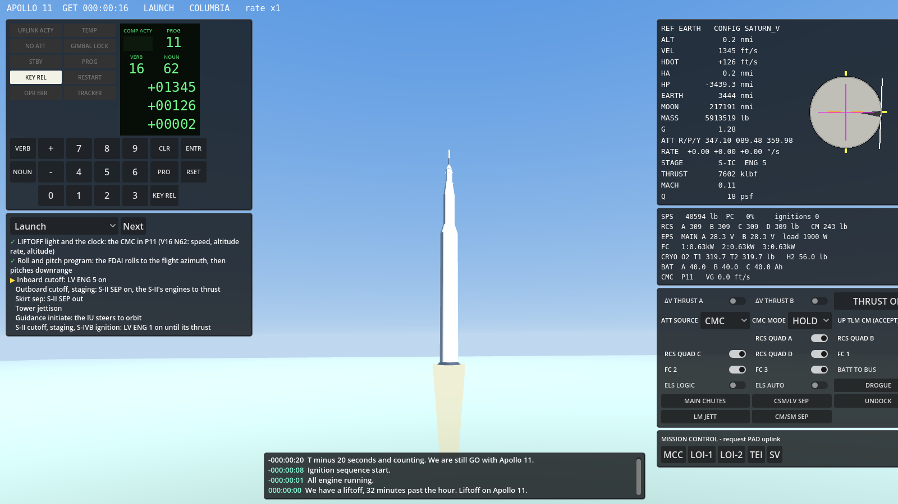
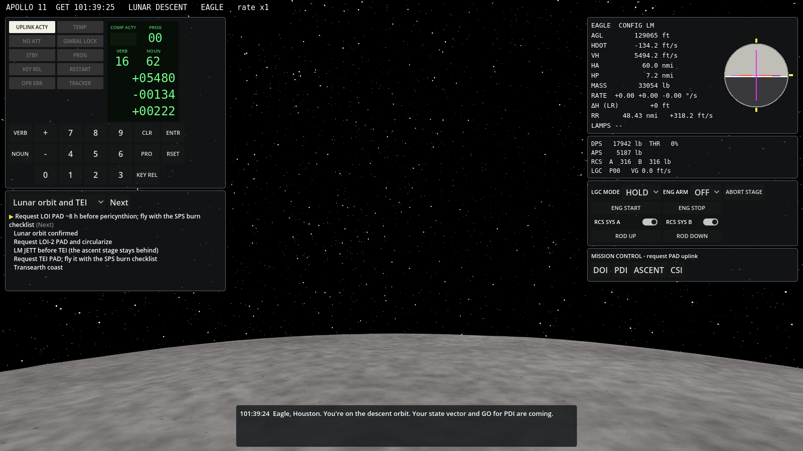
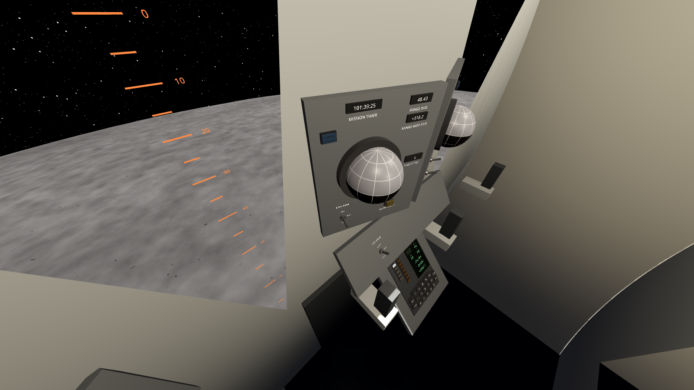
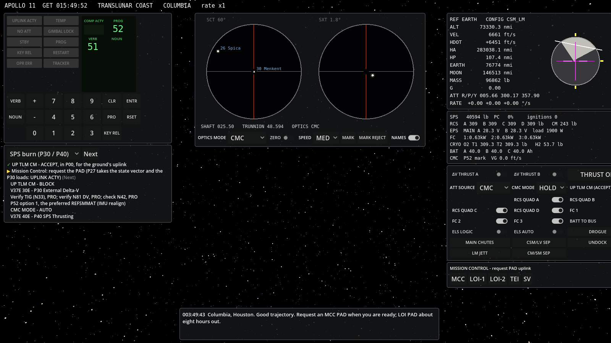
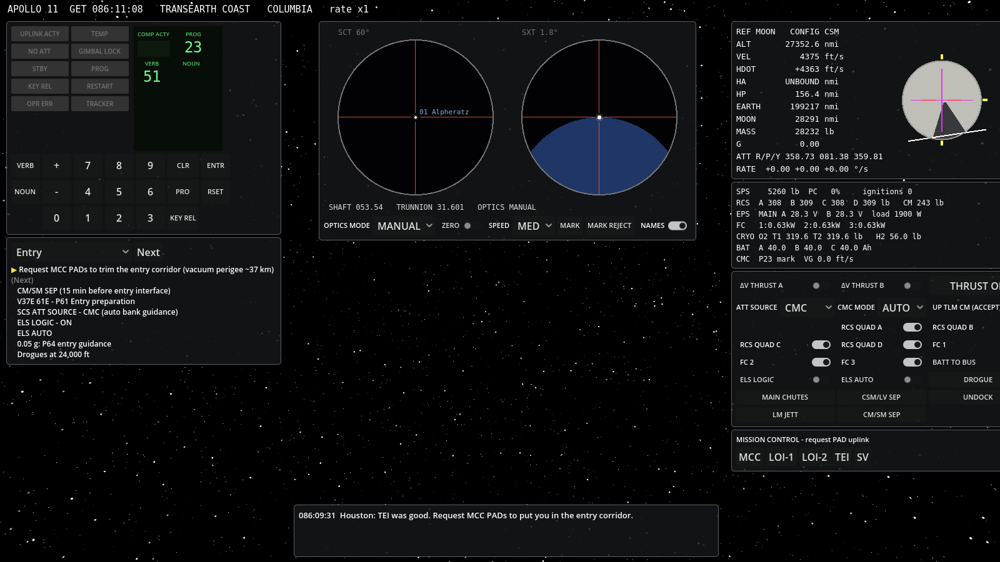

# Apollo CSM Simulator

A lunar-mission simulator of the Apollo Command/Service Module, built with
Godot **4.4.1** on the architecture of the
[Gemini capsule simulator](https://github.com/scomofo/gemini-capsule). It flies the
Apollo 11 profile from the launch pad, on the Saturn V into Earth parking
orbit, through TLI, midcourse corrections, lunar orbit insertion,
transearth injection, entry and splashdown, with every maneuver planned by
a simulated Mission Control and executed through the Apollo Guidance
Computer's DSKY.














The project used
[scomofo/gemini-capsule](https://github.com/scomofo/gemini-capsule) as its
template and began as the `apollo/` directory of that repository. It now
lives in its own repository, with its own tests and CI, and needs nothing
from gemini-capsule to build, run or test.

## Running

From the repository root, `godot --path .` opens on the flight menu, in
the cabin: every mission under `data/missions/`, in the order they flew,
each start phase and a line on where it starts. `< MISSION`, `MISSION >`,
`< PHASE` and `PHASE >` choose, and START flies it. Closing the menu (M
on the desktop, the left controller's menu button in a headset) flies the
flight behind it instead, Apollo 11's parking orbit. The menu is the
wrist menu's FLIGHT page, clicked on the desktop and pressed with a
fingertip in a headset; BACK turns to the wrist menu's other buttons. F1, or FLIGHT on the wrist menu, brings it back in a flight, and
the flight chosen starts in place of the one flown, with the eye height,
the comfort aids, the checklist highlight and the sound's level kept.
SAVES on the flight page lists the saved flights, newest first, each
named for its mission, phase and GET: SAVE keeps the flight flown now,
RESUME starts the one shown in place of it, and DELETE, pressed twice,
deletes it. A save made by a version whose checkpoints differ is listed
but can't be resumed. F5 and F9 keep a quick save among them. The saves
are in `user://saves/` and the settings, kept as they change, in
`user://settings.json` (Godot's user data folder for the project). A
flight given on the command line starts without the menu:

```
godot --path . -- --mission=apollo_11           # parking orbit, TLI ahead
godot --path . -- --phase=launch                # on the pad, 20 s before liftoff
godot --path . -- --phase=translunar_coast      # after TLI and docking
godot --path . -- --phase=lunar_orbit           # after LOI-2, 54 × 66 nmi, Eagle docked
godot --path . -- --phase=lunar_descent         # Eagle after DOI, 20 min before PDI
godot --path . -- --phase=lunar_surface         # Eagle at Tranquility Base, 10 min after landing
godot --path . -- --phase=lunar_ascent          # 20 min before liftoff, the ascent PAD in
godot --path . -- --phase=tei                   # Columbia alone, a minute before the TEI PAD
godot --path . -- --phase=transearth_coast      # after TEI
godot --path . -- --phase=entry                 # ~20 min before entry interface, the target in
```

Later start phases are made by flying the earlier ones through the RTCC's own
solutions (TLI, DOI, the landing time, the liftoff time, TEI), so every
start is consistent with the mission it continues. The LM's start phases
undock Eagle at Apollo 11's time and follow Mission Control's timeline
from there (below), with you in Eagle. Starting in any phase after
`lunar_orbit` takes a few seconds while the ground computes the
trajectory.

`-- --mission=apollo_8` flies Apollo 8 instead: the CSM alone, the S-IVB
carrying a test article where Apollo 11's carried Eagle, ten lunar
orbits, and Mission Control's timeline from TLI to the entry. Its start
phases are `launch` (on the pad, AS-503 its Saturn V), `parking_orbit`
(the default), `translunar_coast` (after CSM/LV SEP), `lunar_orbit` (after LOI-2, 60 × 61 nmi), `tei`,
`transearth_coast` and `entry`. `-- --mission=apollo_10` flies Apollo
10: Snoopy flies the landing mission down to 8 nmi over the first
landing's site without landing, stages in orbit and flies the rendezvous
back to Charlie Brown. Its start phases are `parking_orbit` (the
default), `translunar_coast`, `lunar_orbit` (after LOI-2, 61 × 59 nmi),
`lunar_descent` (Snoopy on its descent orbit, 20 min before the low
pass), `tei`, `transearth_coast` and `entry`. `-- --mission=apollo_12`
flies Apollo 12: Intrepid lands beside Surveyor III in the Ocean of
Storms, the landing site moved in powered descent by the ground's noun
69. Its start phases are `parking_orbit` (the default),
`translunar_coast`, `lunar_orbit` (after LOI-2, 66 × 54 nmi),
`lunar_descent` (Intrepid on its descent orbit, 20 min before PDI),
`lunar_surface` (10 min after the landing), `lunar_ascent` (20 min before
the liftoff, Yankee Clipper's first plane change flown), `tei`,
`transearth_coast` and `entry`. `-- --mission=apollo_13` flies Apollo
13: the SM's oxygen tank fails at 55:54:53, and Aquarius, the LM, is the
lifeboat that brings the crew home around the Moon. Its start phases are
`parking_orbit` (the default), `translunar_coast` and `tank_failure`
(five minutes before the failure). Each mission is data under
`data/missions/<id>/`: its dates and the JPL ephemeris for them, its
vehicles, its orbits, Mission Control's timeline, the call signs, the
checklists, and its start phases with the flight menu's line on each.

Builds of the PC VR presets (Windows and Linux) come from CI on every
merge to `main`, as the run's `ApolloVR-pc-vr` artifact, and are attached
to a tag's release; each has the executable and its `.pck` side by side.
CI flies a minute of the launch on the Linux build, headless, before it
keeps them (`-- --quit-after=<s>` quits after that many seconds of GET).
It builds a Quest 3 APK the same way, for a Quest by itself, with no PC
([docs/QUEST_STANDALONE.md](docs/QUEST_STANDALONE.md)); no pass on a
Quest has been recorded yet.

`godot --path . --xr-mode on` starts OpenXR, which is off by default, and
puts you in the commander's couch in a headset, or, once Eagle undocks
and in its start phases, at Eagle's commander's station. No headset run
has been recorded yet ([docs/ROADMAP.md](docs/ROADMAP.md), slice 2e).
[docs/HEADSET_RUN.md](docs/HEADSET_RUN.md) walks through one, including
the PC VR exports in `export_presets.cfg`;
[docs/VR_ACCEPTANCE.md](docs/VR_ACCEPTANCE.md) is its checklist, and
[docs/VR_INTERACTION.md](docs/VR_INTERACTION.md) describes how the cabins
work in a headset.

The cabin has sound, on the desktop and in a headset alike:
- the Saturn V's stages, the S-IVB, the SPS, and in Eagle its descent and
  ascent engines;
- the attitude jets, and the air in the launch and the entry;
- the pyros, the docking latches and the parachutes' mortars;
- the switches and the DSKY keys, and the cabin fans;
- the master alarm's tone, which a MASTER ALARM switch-light (on MDC-1,
  MDC-3 or the HUD) silences until the next caution light comes on.

Every voice is synthesised. `-- --o2-failure-in=<s>` fails the SM's oxygen
tank 2 that many seconds into the start phase, as Apollo 13's did, which
sounds the master alarm. No listening pass has been recorded yet
([docs/LISTENING_PASS.md](docs/LISTENING_PASS.md) is its checklist, with a
tool that renders each voice to a file).

Failures are data (`data/failures.json`): an O2 tank, a fuel cell, an SM
RCS quad, the CMC or the IMU fails as the catalog says, lights its caution
and warning light (CRYO PRESS, FC 1 to 3, SM RCS A to D, CMC or ISS, on
MDC-2 and the HUD's C&W line) and sounds the master alarm, and its
malfunction procedure opens on the checklist card. A mission arms its own
at their times, as Apollo 13's tank. FAILURES on the flight menu is the
instructor's page: `< FAILURE` and `FAILURE >` step through the catalog,
and FAIL fails the one shown at once.

**The backups.** With the CMC gone, the SCS and the EMS fly the CSM
(`src/systems/scs.gd`, `src/systems/ems.gd`; their switches are on MDC-1
and the HUD):
- **The SCS.** Its body-mounted gyros feed the GDC, which keeps its own
  attitude; GDC ALIGN brings it to the IMU's while the CMC reads it, and
  it drifts a few tenths of a degree an hour from there. With ATT SOURCE
  at SCS the FDAIs show the GDC's attitude. The hand controller commands
  rates: 0.7°/s at full deflection with RATE LOW, 7°/s (20°/s in roll)
  with HIGH. Released, the SCS holds the attitude within its deadband:
  0.2° at RATE LOW and ATT DEADBAND MIN, up to 8° at HIGH and MAX.
- **The SPS under the SCS.** While the SPS fires, its gimbal (±4.5°)
  holds the attitude (SCS TVC AUTO), or turns the CSM on the hand
  controller (RATE CMD, MTVC).
- **The EMS.** Its ΔV counter, set on the ΔV/EMS SET rocker, counts down
  the ΔV its own accelerometer senses along X. With the EMS in ΔV,
  THRUST ON starts the SPS and the EMS ends the burn at −0.1 ft/s.
  Houston's maneuver PADs now give the burn attitude as the FDAI's R, P
  and Y and the counter's setting, ΔVC: the ΔV less the SPS's tail-off.
- **The EMS in the entry.** Set its scroll to the entry PAD's VIO (VO
  SET) and its range to RTGO (RNG SET), and turn it to ENTRY. At 0.05 g
  its light comes on, and the scroll traces g against velocity while the
  range counts down. Ten seconds on, a corridor light says which way the
  lift must point.

**The launch's aborts.** Apollo 11's launch can end in any of its four
abort modes, from the CSM Apollo Operations Handbook's section 2.9 and
the flight's Mission Operation Report (`src/systems/eds.gd`,
`src/systems/les.gd`; the switches and lights are on MDC-1 and the HUD):
- **The EDS.** With EDS AUTO, 2 ENG OUT and LV RATES on, it aborts by
  itself from the liftoff for two S-IC engines out or the launch
  vehicle's rates past their limits, until the IU switches it off at the
  S-IC's centre engine's cutoff. Otherwise the ABORT light is Houston's
  call, and the abort handle (the translation controller turned
  counterclockwise: the HUD's ABORT) is the crew's. LV RATE and LV GUID
  light for the rates and the IU's guidance platform.
- **Mode I**, while the tower is on: the escape motor pulls the CM away.
  In the first 42 s (IA) the pitch control motor tilts it out to sea;
  11 s on the canards turn it blunt end forward. The tower goes when the
  ELS comes on below 24,000 ft, and the chutes follow on the ELS's
  timers. In mode IC the crew may send the tower with TWR JETT.
- **Modes II to IV**, after the tower: the handle cuts the booster off,
  fires the SM's +X jets while it is held, and separates the CSM 3 s
  later. In mode II the CM separates and falls to a full-lift entry. In
  mode III (the crew brought home at once, from 9:00) Houston's PAD
  burns the SPS retrograde. The crew turns the CSM on the SCS at RATE
  HIGH, flies P40, then enters on half lift, rolled 60° to the south. In
  mode IV (from 9:00) Houston's PAD takes the CSM into orbit on the SPS.
- The modes are called as Apollo 11's were: Armstrong's One Bravo at
  0:44, then Houston's Mode One Charlie at 1:58, S-IVB to COI capability
  at 5:27 and Mode IV capability at 9:00.

**Eagle's aborts.** From the descent's ignition to the touchdown, the
LGC answers Eagle's two abort pushbuttons (Luminary 099's P70 and P71;
the switches are on panel 1 and the HUD):
- **ABORT** (P70): the descent engine throttles up to full thrust and
  P12's guidance flies it to insertion, 60,000 ft up.
- **ABORT STAGE** (P71): the descent engine stops, the LM stages, and the
  ascent engine flies the same guidance, from P63 to P66 or from P70 when
  the descent engine runs low. Each button arms its engine whatever ENG
  ARM says. Below 25,000 ft the LM first rises vertically to 40 ft/s up.
- **The orbit** depends on where Columbia is. Early in the descent Eagle
  is ahead of it, and climbs into an orbit with a high apolune to fall
  behind; later Columbia is ahead, and Eagle goes into a lower one. The
  apolune is the one that brings TPI at the time the PDI PAD gives for
  the abort: 105:12:30 in the first ten minutes, 107:11:30 after, as
  Apollo 11's did. Houston uplinks Columbia's state vector with Eagle's
  before PDI for it, and five minutes after insertion the CSI PAD, from
  which the rendezvous goes as after a liftoff.
- **Eagle's caution and warning lights** (panels 1 and 2, and the HUD's
  C&W line) light its master alarm: DES REG for the descent tanks'
  helium, RCS A or B REG for an RCS system's regulator, LGC and ISS for
  the PGNS. DES QTY comes on quietly with 5.6 % of the descent
  propellant left, about two minutes of hovering. Each failure opens its
  procedure in Eagle's checklist book.

The launch vehicle's engines and its guidance platform are on the
failure catalog. A failure can also be armed a time after a mission
event, rather than at a GET.

| Input | Action |
|---|---|
| W/S, A/D, Q/E | Rotational hand controller: pitch, yaw, roll (hold Shift for 10 %); in Eagle, its ACA |
| Arrows, R/F | Translational hand controller: ±Y/±Z, +X/−X (ullage); in Eagle, its TTCA: R/F up and down, Up/Down forward and aft |
| 0–9, `=`/`-` (or keypad) | DSKY digits, + and − |
| V, N, Enter | VERB, NOUN, ENTR |
| Space, Backspace | PRO, CLR |
| Insert, Delete | KEY REL, RSET |
| T (hold) | SPS THRUST ON, the manual backup (in Columbia) |
| L | Fly Eagle or Columbia, while Eagle flies free |
| `[` `]`, P | Time rate slower/faster (1× to 10,000×), pause |
| C | Window, chase or cabin view (Columbia's or Eagle's) |
| Right-drag | Look around (window and chase views) |
| In the cabin view: click, scroll | Work the control under the cursor: a click cycles a switch or presses a key, scrolling moves a switch up or down |
| In the cabin view: right-click, Z, Home | Mouse look on and off; inspect the control under the cursor; recentre |
| In the cabin view: M | Wrist menu: PAD requests, time rate, pause, recentre, eye height, seat (the couches, and the lower equipment bay with the optics), checklist, comfort aids, the sound's level, and FLIGHT, the flight menu |
| F1 | The flight menu, in the cabin view: another mission or start phase, started in place of the one flown, and the saved flights |
| O | The optics, the sextant and the scanning telescope: while they're open, W/S and A/D move them instead of the hand controller, X is MARK and Y MARK REJECT. In the cabin they are at the lower equipment bay, where the same keys and the right stick move them |
| F5 / F9 | Quick save, and back to it: in place, or as its flight in place of another mission's. The flight menu's SAVES lists it with the other saved flights |
| H | Key help |

Every DSKY key and cockpit switch is also clickable on screen, in the HUD
or, in the cabin view, on Columbia's main display console and lower
equipment bay, or on Eagle's panels. Above 100× the
cabin's switches lock, and its DSKY keys still work. Time acceleration
drops back to 10× by itself when an engine lights, at each scheduled
event (TLI, TIG−60 s, V99, and Mission Control's calls and PADs from
undocking to TEI) and at entry.

## Flying the mission

1. **Launch.** The launch phase starts on Launch Complex 39A 20 s before
   liftoff, at 13:32:00 UTC. The Saturn V flies itself on the Instrument
   Unit's program, as AS-506 did:
   - the roll and pitch program;
   - the S-IC's cutoffs and staging;
   - the S-II and the S-IVB on the IU's iterative guidance, and the
     tower's jettison;
   - insertion into the 100 nmi parking orbit at 11:51.

   At liftoff the CMC comes up in P11 (V16N62: inertial speed, altitude
   rate, altitude). Panel 1's LV ENG, LIFTOFF and S-II SEP lights show the
   stages, and the launch checklist checks itself off as they come. After
   insertion, `V82E` shows the orbit. A failure in the launch ends it in
   its abort mode (**The launch's aborts**, above).
2. **Parking orbit.** CAPCOM gives you GO for TLI. The S-IVB/IU flies TLI
   automatically at the planned TIG (GET 2:44), on its iterative guidance,
   onto the free return the RTCC planned. Watch it with `V16N62E` or
   `V82E`.
3. **Transposition and docking.** Press **CSM/LV SEP** after cutoff. It
   happens automatically an hour after cutoff if you don't.
4. **Midcourse correction.** With the CMC in P00 and UP TLM CM in ACCEPT,
   press **MCC** under Mission Control. The RTCC solves the burn from the
   state MSFN tracked, and uplinks that state vector and the PAD: P27 and
   V71 on the DSKY while UPLINK ACTY is lit. Then set UP TLM CM to BLOCK.
   On the DSKY:
   - `V37E30E` (P30): check TIG in N33 and PRO; check ΔV in N81 and PRO;
     check the predicted apsides in N42 and PRO.
   - Realign the IMU with P52 option 1, to the preferred orientation P30
     worked out for the burn (below).
   - Set CMC MODE to AUTO. Then `V37E40E` (P40, SPS), or `V37E41E` (P41, RCS)
     for burns under 10 ft/s.
   - At V50N18, press PRO to maneuver to burn attitude. Set ΔV THRUST A and B
     to on.
   - At TIG−5 s, V99N40 flashes: press PRO to enable the engine. Monitor
     V16N40.
   - After cutoff, trim the V16N85 residuals with the THC, then press PRO.
5. **LOI.** About 8 h before pericynthion, press **LOI-1** and fly it
   (~875 m/s, 6 min, 53 × 170 nmi). Two revs later, fly **LOI-2** into
   Apollo 11's 54 × 66 nmi orbit, out of round for the Moon's mascons to
   round it toward 60 nmi by the rendezvous.
6. **TEI.** Press **LM JETT**, then **TEI**, and fly it. Then fly one or two
   transearth **MCC**s until the vacuum perigee is about 37 km (20 nmi),
   or navigate on board with P23 and plan them with P37 (below).
   Before LM JETT you can undock and dock again (below).
7. **Entry.** Select `V37E61E`. P61 flashes N61, the target the entry
   PAD's uplink brought, and HEADSUP (-1, lift up); PRO, and PRO again at
   N60 (the peak load expected, and the speed and flight path angle at
   entry interface) and N63 (the EMS's range, speed and time to go). P62
   asks for CM/SM SEP (V50N25 00041): press **CM/SM SEP**, then PRO. At
   N61, set CMC MODE AUTO and PRO: the CM turns to the entry attitude,
   and P63 takes over once it is near. Set ELS LOGIC and ELS AUTO on. At
   0.05 g P64 starts Colossus's entry guidance, which rolls the lift to
   bring the CM down on the target: P65's up-control (PRO at its flashing
   N69), P66's skip on a long range, and P67's final phase, which ends at
   1,000 ft/s with N67 flashing the range to go and where the CM is (PRO
   for P00). The drogue and main parachutes deploy automatically.

**Apollo 8.** With `-- --mission=apollo_8` the flight is Apollo 8's, from
the pad or its parking orbit. From the pad it's the launch above on the
first crewed Saturn V, AS-503, at 12:51:00 UTC on 21 December 1968: its
own stages, clock and flight azimuth, its S-II burning on all five
engines to its cutoff, and insertion at 11:42. The S-IVB flies TLI at the
RTCC's TIG (GET 2:50), and CSM/LV SEP leaves the S-IVB and its test
article behind, with nothing to dock with (it happens by itself 25 min
after cutoff). Mission Control's timeline then brings each PAD at the
flown time, and CAPCOM's calls at theirs:
- the two separation maneuvers from the S-IVB, radially up (3:40 and
  4:45, the second the unplanned one);
- MCC-1 (11:00) and MCC-2 (61:00);
- LOI-1 (69:08) and LOI-2 two revolutions on (73:35);
- TEI on the tenth revolution (89:19);
- the transearth MCCs (104:00, and 122:00 and 144:46 only if the corridor
  needs them);
- the entry PAD (145:12).

Fly each as above: the separation maneuvers and the small corrections on
P41 (the RCS burn checklist), the rest on P40. Realign the platform
before the entry, with P52 option 3.

**Apollo 10.** With `-- --mission=apollo_10` the flight is Apollo 10's,
from its parking orbit. The S-IVB flies TLI at the RTCC's TIG (GET 2:33),
and transposition, docking and extraction follow by themselves 24 min
after cutoff. The timeline's PADs come at the flown times:
- the evasive maneuver on the SPS (4:39);
- MCC-1 (26:33), and MCC-4 (70:56) if the tracking has the approach off;
- LOI-1 at its PAD's TIG (75:56), which turns the orbit into the first
  landing's plane over site 2, and LOI-2 (80:25);
- Charlie Brown's separation PAD before the undocking at 98:12, for 2.5
  ft/s radially down at 98:47;
- Snoopy's DOI PAD after the undocking, for DOI at 99:46, down to 8 nmi
  over the site at 100:44;
- the phasing PAD (100:58), on the DPS at 10 % for 26 s, then full;
- the insertion PAD (102:55) and a state vector for Snoopy, and GO for
  staging: stage (ABORT STAGE) ten minutes before the insertion, then
  fly it on the ascent engine (P42);
- the CSI PAD after the insertion: CSI (103:46), CDH, TPI and the
  midcourse corrections on P32 to P35, as from Apollo 11's
  `lunar_ascent`, braking, and Charlie Brown docks;
- GO for jettison two hours after docking, and TEI (137:36);
- the transearth MCCs (176:50 and 188:50, if the corridor needs them)
  and the entry PAD (190:49).

Snoopy's checklists follow its flight: the undocking and DOI; the low
pass, phasing and staging; the insertion and the rendezvous.

**Apollo 12.** With `-- --mission=apollo_12` the flight is Apollo 12's,
from its parking orbit. The S-IVB flies TLI onto the free return at the
RTCC's TIG (GET 2:47), and transposition, docking and extraction follow
25 min after cutoff. The timeline's PADs come at the flown times:
- MCC-2 (30:53), which takes the stack off the free return onto the
  hybrid, and MCC-4 (78:25) if the tracking has the approach off;
- LOI-1 at its PAD's TIG (83:25), which turns the orbit into the plane
  over the landing site, some 14° to the lunar equator, and LOI-2 at its
  own (87:49);
- Yankee Clipper's separation PAD before the undocking at 107:54, for 2.5
  ft/s radially down at 108:25;
- Intrepid's DOI PAD after the undocking, for DOI at 109:20; the PDI PAD
  and its state vector half an hour before PDI (110:20), and GO for PDI;
- after throttle-up, the ground's noun 69: key V21N69E and R1 as CAPCOM
  reads it (+ or −, ft), and the LGC moves its landing site that far
  downrange;
- STAY for T1 and T3; Yankee Clipper's first plane change (119:45), which
  puts its orbit over Intrepid for the liftoff; the ascent PAD (140:19)
  and the liftoff (142:01);
- the CSI PAD after the insertion, and the rendezvous as from Apollo 11's
  `lunar_ascent`; GO for Pyro Arm two hours after docking;
- the second plane change (159:05), for the photographs, a fixed
  maneuver on the SPS;
- TEI (172:24), the transearth MCCs (188:27 and 241:22, if the corridor
  needs them) and the entry PAD (239:32).

The landing site is the Surveyor's, on the inner slope of its crater,
1,432 m below the reference sphere on LROC's model of the site; Intrepid
came down 535 ft from it, on the rim to its northwest. The orbit has
drifted north of the site by PDI, and P63 steers across to it. In P64
the LPD on the window shows where the LGC is taking you: redesignate
with the ACA onto the crater, then take over with the ROD switch (P66)
at a few hundred feet and fly to your spot. Intrepid's checklists follow
its flight, with noun 69 in the powered descent's; Yankee Clipper's has
the plane changes.

**Apollo 13.** With `-- --mission=apollo_13` the flight is Apollo 13's,
from its parking orbit, or with `-- --phase=tank_failure` from five
minutes before the failure. TLI puts the stack on the free return, and
MCC-2 (30:41, on the SPS) takes it onto the hybrid, 60 nmi over the Moon.
At 55:54:53 the SM's oxygen tank 2 fails: the master alarm, MAIN B
UNDERVOLT, fuel cells 1 and 3 lost, and tank 1 leaks its oxygen away
while fuel cell 2 carries the CSM, until about 58:15. The timeline's
calls and PADs come at the flown times:
- the emergency power-down (56:16): CM POWER to EMER;
- into the LM (57:41): LM PWR on, its LGC MODE in FREE while the CMC's
  DAP still holds the stack, and the CMC's gimbal angles (57:48) for the
  LGC's coarse align through the docking (V41N20): the CM's inner plus
  180°, and its middle's negative;
- the CSM powered down (58:37): CM POWER OFF, LGC MODE HOLD, and the
  LGC's REFSMMAT, the CMC's carried across (58:44);
- the free return (61:30) and PC+2 (79:28) on the descent engine, P40
  flying the docked stack, PC+2 5 s at the minimum, 21 s at 40 % and then
  full;
- the PGNS off to save the LM's power (82:03); MCC-5 read up by voice
  (104:34) and flown by hand on the AGS at 105:18:28: point +X along the
  burn on the ACA, AGS ALIGN, ullage on the jets, ENGINE START at the
  TTCA's minimum throttle and ENGINE STOP on the DEDA's count;
- the LM charging the CM's entry batteries from 112 hours: LM PWR on the
  CM's panel;
- the PGNS up again for the ground's coarse align angles and REFSMMAT
  (134:40, 135:04), and MCC-7 on the LM's jets in P41 (137:40);
- SM SEP (138:02) with the AGS holding: 0.5 ft/s +X on the jets, CM/SM
  SEP, 0.5 ft/s back;
- the CM's coarse align angles (139:52), its power-up (140:10), state
  vector (140:24) and REFSMMAT (140:45), and a P52; LM JETT (141:30), the
  docking tunnel's pressure pushing Aquarius off; the entry PAD (141:48)
  and the final state vector (142:01).

Aquarius's checklists follow the lifeboat's flight: its activation and
the docked alignment, the descent engine's burns docked, MCC-5 on the
AGS, and the PGNS again for MCC-7 and SM SEP. Odyssey's open on the
failure at `tank_failure`, and on the power-up and entry after the Moon.

**State vectors.** The CMC flies on its own state vector. Its
accelerometers feed it only in P40, P41, P47 and entry, and during TLI. In
coast the SM's vents and the attitude jets' imbalance slowly move the CSM
off it, and so does a translation in P00. In lunar orbit the Moon's
mascons move it kilometres off in a few revolutions, since the CMC
integrates the simpler R-2 model its program flew with, as Eagle's LGC
does too. Mission Control uplinks the
state vector MSFN tracked with each of Columbia's PADs, and **SV** under
Mission Control asks for one alone. The CMC takes them in P00, with UP TLM
CM (panel 2, right of the DSKY) in ACCEPT. In BLOCK, CAPCOM reads the
PAD up by voice instead.

**The IMU.** The CMC reads its attitude and its accelerometers through
the IMU's stable member, which it takes to lie at REFSMMAT. The gyros
drift the platform off it, about 0.02° an hour, and a burn flown on a
drifted platform goes that far off in direction. Each start phase starts
freshly aligned: to the launch pad REFSMMAT until the lunar orbit, to the
landing site's there, and to the local vertical on the way home. The
FDAI's total attitude and N20 are the ICDU angles, the CSM's attitude
relative to the stable member. GIMBAL LOCK lights past 70° of middle
gimbal, and past 85° the CMC cages the IMU: NO ATT, and the alignment is
lost (P51 and P52 stop with 00220). P40 won't maneuver to a burn attitude
past 60° of middle gimbal (PROG, 00401), and it plans each maneuver
clear of lock: the thrust axis the short way onto the burn's and then a
roll about it, or, where that would pass near lock, one gimbal at a time.

Realign before a burn with P52 (the IMU realign checklist): `V37E52E`,
then `V22E`, the option and `E` (1 the preferred orientation P30 worked
out for the burn, 2 the local vertical, 3 REFSMMAT again, 4 the landing
site's), and PRO. For a new orientation, PRO at N22 drives the gimbals to
it (NO ATT meanwhile). If its middle gimbal is past 60° where the CSM
points, PROG and 00401 say so instead: turn the CSM until N22's middle
gimbal is small, clear of GIMBAL LOCK on the way, RSET, and PRO again.
PRO at V50N25 00015, and the CMC picks two stars.
For each, PRO at N70: the CMC drives the optics to where it expects the
star, in OPTICS MODE CMC. Switch to MANUAL, centre the star in the sextant
and MARK. N05 is the star angle difference, and N93 the gyro torquing
angles; PRO torques the gyros through them. On the desktop, O opens the
optics. In the cabin they're at the lower equipment bay, away from the
couch (SEAT on the wrist menu), with a second DSKY. The optics look out of
the CM's side toward the crew's feet, so in low orbit, heads up, they see
the Moon or the Earth: PROG and 00405 say there are no stars, and you
roll heads down first. A caged platform needs P51 (`V37E51E`). It runs
the IMU up at zero gimbal angles; find two stars yourself, MARK each and
load its octal code (`V21E`, the code, `E`, PRO), and P51 works out the
platform's orientation. The 37 navigation stars and their codes are in
[data/stars/navigation_stars.json](data/stars/navigation_stars.json).

**Navigating on board.** The CMC can keep its own state vector with the
sextant, as the crew did in case the ground went quiet. P23
(`V37E23E`) marks a star on the Earth's or the Moon's horizon. At
V05N70 load the star's code (`V21E`, the code, `E`) and the horizon
(`V23E`, 1 for the Earth's or 2 for the Moon's, `E`), then PRO. A star
behind the body, or more than 57.5° from its horizon, brings PROG and
00404. V50N18 is the attitude that lays the sextant's landmark line,
which looks along the optics' shaft axis, on the horizon under the
star: in CMC MODE AUTO, PRO flies there, and at V51 the CMC has driven
the optics to the star. The sextant lays the landmark line's fainter
view of the Earth or the Moon over the star line's. In OPTICS MODE
MANUAL, move the star onto the horizon and MARK: the trunnion angle is
then the angle between them. V06N49 shows how far the mark would move
the state vector (ΔR in nmi, ΔV in ft/s). PRO takes it in and goes back
to N70 for the next; V32 or MARK REJECT marks again. P37 (`V37E37E`)
works out a midcourse correction from the CMC's own state vector to the
entry corridor's middle, a vacuum perigee of 37 km (20 nmi). N33 has TIG
half an hour on (load another with `V25E`); PRO for the ΔV in N81, PRO
for the apsides in N42, and PRO stores it. Fly it as a PAD's, after P52
option 1. In lunar orbit P22 (`V37E22E`) marks a landmark: the landing
site, unless you load another into N89 (latitude, longitude halved,
altitude). PRO for V50N18, the attitude that points the landmark line at
it on the next pass, and PRO to fly there; the clock stops ten minutes
before the pass. As the CSM comes up on it, the CMC drives the optics to
the landmark, ringed in the optics view: centre it, MARK, and PRO at N49,
a few times through the pass. Each mark is weighted by the navigation
filter's estimate of the state vector's errors. V67 shows their RMS
(N99: position in ft, velocity in ft/s), and loading either starts the
filter again from it. V93 starts it again at the next mark, as a burn of
more than 50 m/s, a start phase or an uplink does.

**Undocking and docking.** In lunar orbit, **UNDOCK** releases Eagle. The
probe pushes the two apart at 0.1 ft/s, and the LM flies free on its own
orbit, with you in it (below). Its computer, the LGC, powers up as it
undocks and holds the attitude it undocked in. Press **L** to go back to
Columbia. While Eagle flies free, Columbia's flight panel shows the
range to its docking port, the range rate, where the port is along the
CSM's axes (X along the probe) and how it moves, and how far the two
docking axes are out of line. Fly the CSM back to it on the translation
controller. The
probe captures, and the vehicles are docked again, when it meets the
drogue at under 1 ft/s, moving across at under 0.5 ft/s, within 1 ft of
its centre, within 10° of alignment and under 1°/s of relative rate. Any
other contact rebounds, and CAPCOM says why.

**Eagle's own burns and the landing.** The LM has its own computer, the
LGC, with its own DSKY. Its descent and ascent engines, its RCS and its
autopilot fly the same way as Columbia's. LOI puts the lunar orbit over
Tranquility Base (0.674° N, 23.473° E) at Apollo 11's landing time.
Mission Control uplinks the DOI PAD and the landing site to the LGC, and
the crew flies DOI with P30 and P40 on the descent engine: 10 % throttle
for 15 s, then 40 %, as Apollo 11 did. Before PDI the ground uplinks the
LM's state vector with the PDI PAD, and it carries the tracking error
(mission.json "pdi"). The LGC flies on its own state vector from then on,
not on truth. Half a revolution after DOI, P63 ignites powered descent
470 km before the site. It brakes at full thrust until the throttle comes
back into its range.

The landing radar under the descent stage finds the ground, the real
ground of NASA's elevation maps. From ignition P63 shows N63, the speed,
altitude rate and altitude, as Luminary 099 did. As the radar's data
come good, the ALT and VEL lamps on the LGC's DSKY go out, and V16N68
shows ΔH, the radar's altitude less the LGC's: about −3,100 ft here,
with the range to the site and the time to go in braking. The crew keys
V57, and the radar
pulls the LGC's altitude and velocity in. Without V57 the LGC flies
Eagle into the ground a kilometre short of where it thinks it is. P64
flies the approach from high gate, about 2 km up and 8 km out. The LPD
angle in N64 tells the commander where on the window's scale to look for
the landing point, and each click of the hand controller moves it: 0.5°
fore or aft, 2° left or right. P65 lands automatically. At the first
click of the ROD switch, P66 hands the attitude to the crew while the
throttle holds the descent rate, 1 ft/s per click. CONTACT LIGHT comes
on when a probe touches, and at touchdown P68 shuts the engine down.

**Apollo 11's program alarms.** The LGC's Executive runs the descent's
jobs on the time its interrupts leave (`src/systems/lgc_executive.gd`).
A job holds one of eight core sets while it waits or runs, and one of
five VAC areas if it uses the interpreter. At the descent's peak the
jobs take about 90 % of the computer, as the mission report has it.
Eagle's crew left the rendezvous radar's mode switch (RNDZ RADAR, on
panel 3 and the HUD) at AUTO TRACK and then SLEW, not LGC. That ran the
radar's resolvers on an 800 Hz supply out of phase with the LGC's, and
their CDUs slewed, sending the LGC counter pulses that took about 13 %
of its time. On top of that, the crew's V16N68 in P63, once the radar's
data come good, or P64's landing point designator in AUTO, is more than
the LGC has. Jobs pile up. When no core set is left for one, the
Executive alarms 1202; when no VAC area is left, 1201. Either way it
restarts:
- PROG lights, V05N09 shows the codes (the first, the second and the
  last), and RSET clears them;
- whatever the crew had keyed is gone, and the program's display is
  back;
- the guidance carries on at the Servicer's next cycle.

Houston calls GO half a minute after the first alarm and within seconds
after the rest. With the switch at LGC no alarm comes. Apollo 12's
Luminary 1B and later zeroed the CDUs, so their switch doesn't matter.

**The ascent.** On the surface, Mission Control's ascent PAD gives the
liftoff time. The RTCC flies the LGC's own ascent from where Eagle sits,
and times the liftoff for Columbia to lead by 16.4° at insertion, an
estimate of the lead Apollo 11's rendezvous needed (mission.json
"ascent"). Eagle's and
Columbia's state vectors come up with it. P12 shows the liftoff time
(N33), the insertion targets (N76: 5,535 ft/s, 32 ft/s up, and how far
Eagle sits from Columbia's plane) and the countdown (N74). At V99, five
seconds out, the crew stage with ABORT STAGE, arm the ascent engine and
key PRO: "Abort Stage, Engine Arm, Ascent, Proceed", as Aldrin called
it. The ascent engine lifts Eagle straight up to 40 ft/s while it yaws to
face along Columbia's track, and it pitches over. The LGC's ascent
guidance, after the E guidance Luminary flew, puts it into a 9 × 45 nmi
orbit in Columbia's plane, 60,000 ft up and climbing at 32 ft/s, and the
engine stops about seven minutes after liftoff.

**The rendezvous.** After insertion, Mission Control's CSI PAD carries
the RTCC's plan: Apollo 11's coelliptic sequence, flown from both
vehicles' state vectors, with TPI 2 h 35 min after insertion, as Apollo
11 had it. The ground uplinks CSI's and TPI's times, and Columbia's state
vector as MSFN tracked it, about 900 m off (mission.json "rendezvous").
In P20 the rendezvous radar marks Columbia once a minute, and the marks
take the error out of where the LGC has Columbia relative to Eagle.
V16N54 shows the range, the range rate and Columbia's elevation. P32
targets CSI at the first apolune: the horizontal burn that, with CDH half
a revolution on, has Columbia 26.6° above Eagle's horizon at TPI's time.
P33 targets CDH, onto an orbit a constant 15 nmi below Columbia's. P34
finds when Columbia comes up to 26.6°, and the transfer that meets it
after it has flown 130° of its orbit. P35 corrects the course 15 and 30
minutes after TPI, and P41 flies each burn on the RCS. From a mile out
the commander brakes on the TTCA, holding the closing rate to the range
gates, and stops about 40 m from Columbia. Collins then flies the probe
into the drogue, as he did.

**Mission Control's timeline.** From undocking to the entry, Mission
Control keeps Apollo 11's timeline (mission.json "lunar_timeline"):
- **Undocking and DOI.** CAPCOM gives GO for undocking at 100:00. The DOI
  PAD comes 8½ minutes after Eagle undocks, and GO for DOI 18 minutes
  before the burn.
- **Powered descent.** The PDI PAD's state vector comes 15 minutes before
  PDI, and GO for powered descent 5 minutes before it.
- **On the surface.** CAPCOM gives STAY for T2 and T3. The ascent PAD comes
  at 122:22, for the liftoff window nearest Apollo 11's 124:22 (here
  124:25:40), and "cleared for takeoff" 5 minutes before liftoff.
- **Rendezvous.** The CSI PAD comes 5 minutes after insertion, and GO for
  CSI 13 minutes before the burn.
- **Jettison and TEI.** GO for jettison comes two hours after docking.
  After LM JETT, the TEI PAD comes at 134:01, for Apollo 11's TEI at
  135:23:41, solved for its return: entry interface at 195:03:06, the
  return's inclination and the corridor's middle.
- **The entry PAD.** At 191:43:57 the entry PAD comes up with the state
  vector and Apollo 11's final target, 13.32° N 169.17° W, some 1,500
  nmi from entry interface.

Each PAD comes only when the vehicles can use it, and not while the
ground's last PAD of its kind is still to be flown. An undocking a day
early, for docking practice, brings no DOI PAD. In lunar orbit the flight
phase follows Eagle: LUNAR DESCENT from DOI, LUNAR SURFACE while it is
landed, and LUNAR ASCENT from liftoff until it docks.

The LGC also has P41 (LM RCS), P42 (the ascent engine, after staging)
and P47, and ENGINE START lifts a landed ascent stage off by hand.

**Flying Eagle.** You move to Eagle as it undocks, as its commander, and
back to Columbia when the two dock or Eagle is jettisoned. While Eagle
flies free, **L** changes vehicles. The HUD becomes Eagle's:
- The LGC's DSKY, which the keys type into.
- Eagle's switches: LGC MODE, ENG ARM (ASC or DES), ABORT and ABORT
  STAGE, ENG START and STOP, RCS SYS A and B, MASTER ALARM, ROD UP and
  DOWN for P66, and the rendezvous radar's mode, RNDZ RADAR (LGC, AUTO
  TRACK or SLEW).
- Its flight data: its height over the ground below it, its vertical
  speed and its speed over the turning surface, its orbit, its mass and
  rates, the landing radar's ΔH, the rendezvous radar's range and range
  rate, and the ALT and VEL lamps and CONTACT LIGHT.
- Its engines, RCS and LGC, its caution and warning lights, and Mission
  Control's LM PADs: DOI, PDI, ASCENT and CSI.
- The FDAI, on Eagle's attitude and rates and its LGC's errors.

The hand controllers fly its ACA and TTCA. The view is out of its
forward windows, or a chase view above 40 km, and near the Moon the
ground below Eagle is drawn from the same height maps its gear lands on.

**Eagle's cabin.** C's third view, and the only view in a headset, puts
you standing at the commander's station in Eagle's cabin
(`src/cabin/lm_cabin.gd`), at its window. Panels 1 to 5 carry every
switch of Eagle's HUD and its displays (`data/cockpit/lm_controls.csv`):
- Panel 1, to your right: the mission timer, the rendezvous radar's range
  and range rate, the descent engine's thrust, the FDAI, LUNAR CONTACT,
  ENG ARM, ABORT and ABORT STAGE, a MASTER ALARM, and the LGC, ISS, DES
  QTY and DES REG lights. ENG ARM is lever-locked: the first push pulls
  the lever out, the second moves it.
- Panel 2, the LM pilot's: its own FDAI, LUNAR CONTACT and MASTER ALARM,
  RCS SYS A and B, and the RCS A and B REG lights.
- Panel 3, between you: LGC MODE and RNDZ RADAR, the rendezvous radar's
  mode.
- Panel 4, below it: the LGC's DSKY, with its ALT and VEL lamps.
- Panel 5, by your left hand: ENGINE STOP and START and DES RATE, the
  rate of descent switch. Scroll it up for +1 FPS and down for −1 FPS.

The landing point designator's scale is on your window: a mark every 5°
down to 65°. In P64 the landing point sits on the mark N64 gives. The
checklist card is by your left shoulder, and the wrist menu's PAD buttons
ask for Eagle's PADs. L takes you to the other vehicle's cabin while
Eagle flies free, and you go aboard with the docking state as on the
HUD.

The on-screen checklist follows along. Steps with a check mark complete
themselves when the Bus shows the action was done. Columbia and Eagle
each have their own checklists, and the HUD shows those of the vehicle
you fly. At the start each opens the one for the flight phase, and so
does the vehicle you board as Eagle undocks or docks; L goes back to the
other's where they stood. Eagle's four take it from the undocking
through DOI, the powered descent and landing, the surface stay and
liftoff, and the rendezvous to docking
(`data/missions/apollo_11/lm_checklists.json`). In the cabin, the same
checklist is on the card by the commander's left shoulder, with the last
PAD and CAPCOM's calls, and a green frame marks the control for the
current step. The wrist menu's NEXT STEP goes past a step without a
check. CHECKLIST turns to the next checklist where it was left, so you
can fly a burn down the SPS burn checklist and come back to the phase's;
a finished checklist starts again. SEAT moves you to the
centre couch, where the DSKY is straight ahead and, in a headset, within
reach, or in Eagle to the LM pilot's station.

To reproduce the Apollo 13 failure, set `failures.o2_tank_2_get_s` in
`data/missions/apollo_11/mission.json` (the flown time was 55:54:53 =
201293 s). O2 tank 2 vents, fuel cells 1 and 3 fail and the batteries
start carrying the load.

## What was taken from the Gemini template

The left column links to the
[gemini-capsule](https://github.com/scomofo/gemini-capsule) files this
project was derived from, as of commit
[`4dbdff9`](https://github.com/scomofo/gemini-capsule/tree/4dbdff93b60e1d1e41c74ef8c3ca446b9752649b).
The right column names the files in this repository.

| Gemini capsule | Apollo CSM | Notes |
|---|---|---|
| [`src/core/bus.gd`][g-bus] | `src/core/bus.gd`, unchanged apart from comments | Only coupling between controls, systems and displays; SI on the Bus |
| [`src/core/sim_clock.gd`][g-clock] | extended | Same fixed 50 Hz step and stage order; rates up to 10,000×, adaptive coast steps, event landing |
| [`src/core/sim_runtime.gd`][g-runtime] | rewritten | Same build + snapshot/restore contract across truth owners |
| [`src/dynamics/vec3d.gd`][g-vec3d], [`attitude.gd`][g-attitude] | reused | Attitude now sub-steps long coast steps |
| [`src/dynamics/orbit.gd`][g-orbit] (Earth, J2) | `src/dynamics/trajectory.gd` | Earth–Moon three-body RK4, state re-based at the lunar sphere of influence |
| [`src/systems/electrical.gd`][g-electrical] | `src/systems/eps.gd` | Fuel cells, cryo O2/H2, entry batteries, O2 tank failure |
| OAMS/RCS in [`src/dynamics/dynamics.gd`][g-dynamics] | `src/systems/rcs.gd`, `src/systems/sps.gd` | SM quads A–D, CM rings, SPS with arm valves and transients |
| [`src/systems/guidance.gd`][g-guidance] + MDIU | `src/systems/agc_core.gd`, `agc.gd`, `lgc.gd`, `ascent_guidance.gd`, `rendezvous.gd` + `src/systems/dsky.gd` | One AGC core (verb/noun DSKY, its own state vector and the ground's uplinks, P30, thrusting programs, P47, DAP) under two program sets: the CMC's P00/27/30/40/41/47/61/64/67 and the LGC's P00/12/20/30/32/33/34/35/40/41/42/47/63/64/65/66/68 |
| — | `src/systems/dps.gd`, `aps.gd`, `lm_rcs.gd`, `landing_radar.gd`, `rendezvous_radar.gd` | The LM's descent and ascent engines, its RCS, and its landing and rendezvous radars |
| — | `src/dynamics/terrain.gd`, `data/terrain/`, `tools/terrain/build_terrain.py` | The surface from NASA's elevation maps: LROC's Apollo 11 site model at 4 m, SLDEM2015 along the approach, LOLA elsewhere (sources in NOTICE) |
| [`src/mission/mission_sequencer.gd`][g-sequencer] | rewritten | Phases, S-IVB/IU TLI automation, separations, failures, CAPCOM |
| — | `src/mission/rtcc.gd` | Ground targeting: TLI, MCC, LOI-1/2 over the landing site, TEI, the LM's DOI for the landing pass, its liftoff time and its rendezvous (the CSI PAD), by shooting on the flight model. The sequencer's PDI PAD uplinks the LM's state vector with its tracking error, and the CSI PAD the CSM's with its own |
| [`src/mission/procedure_runner.gd`][g-procedure] | `src/mission/checklist.gd` | Bus-checked flight-plan checklists |
| [`src/systems/recovery.gd`][g-recovery] | `src/systems/els.gd` | Drogues, reefed mains |
| GUT tests, headless | GUT 9.4.0 (vendored in `addons/gut/`), headless | Unit tests plus full mission-segment scenarios |

[g-bus]: https://github.com/scomofo/gemini-capsule/blob/4dbdff93b60e1d1e41c74ef8c3ca446b9752649b/src/core/bus.gd
[g-clock]: https://github.com/scomofo/gemini-capsule/blob/4dbdff93b60e1d1e41c74ef8c3ca446b9752649b/src/core/sim_clock.gd
[g-runtime]: https://github.com/scomofo/gemini-capsule/blob/4dbdff93b60e1d1e41c74ef8c3ca446b9752649b/src/core/sim_runtime.gd
[g-vec3d]: https://github.com/scomofo/gemini-capsule/blob/4dbdff93b60e1d1e41c74ef8c3ca446b9752649b/src/dynamics/vec3d.gd
[g-attitude]: https://github.com/scomofo/gemini-capsule/blob/4dbdff93b60e1d1e41c74ef8c3ca446b9752649b/src/dynamics/attitude.gd
[g-orbit]: https://github.com/scomofo/gemini-capsule/blob/4dbdff93b60e1d1e41c74ef8c3ca446b9752649b/src/dynamics/orbit.gd
[g-electrical]: https://github.com/scomofo/gemini-capsule/blob/4dbdff93b60e1d1e41c74ef8c3ca446b9752649b/src/systems/electrical.gd
[g-dynamics]: https://github.com/scomofo/gemini-capsule/blob/4dbdff93b60e1d1e41c74ef8c3ca446b9752649b/src/dynamics/dynamics.gd
[g-guidance]: https://github.com/scomofo/gemini-capsule/blob/4dbdff93b60e1d1e41c74ef8c3ca446b9752649b/src/systems/guidance.gd
[g-sequencer]: https://github.com/scomofo/gemini-capsule/blob/4dbdff93b60e1d1e41c74ef8c3ca446b9752649b/src/mission/mission_sequencer.gd
[g-procedure]: https://github.com/scomofo/gemini-capsule/blob/4dbdff93b60e1d1e41c74ef8c3ca446b9752649b/src/mission/procedure_runner.gd
[g-recovery]: https://github.com/scomofo/gemini-capsule/blob/4dbdff93b60e1d1e41c74ef8c3ca446b9752649b/src/systems/recovery.gd

Everything follows the same ownership rules as the Gemini project
([docs/ARCHITECTURE.md §3.1][g-ownership] there). The
dynamics owns trajectory and attitude truth, each system owns its state,
controls publish `ctl.*`, and presentation only reads the Bus.

[g-ownership]: https://github.com/scomofo/gemini-capsule/blob/4dbdff93b60e1d1e41c74ef8c3ca446b9752649b/docs/ARCHITECTURE.md#31-bus-ownership-rules

### Parts for the VR cockpit

The VR cockpit ([docs/ROADMAP.md](docs/ROADMAP.md), milestone 2) reuses
gemini-capsule's interaction layer, rigs, panel prefabs and data-driven
panel layout. They were taken later than the rest, at commit
[`40e449c`](https://github.com/scomofo/gemini-capsule/tree/40e449cfb8c35111de47a33bd351b2d945e6fa52).
The CM cabin (`src/cabin/cm_cabin.gd`), Eagle's (`src/cabin/lm_cabin.gd`,
milestone 3), what they share (`src/cabin/cabin.gd`) and the cabin DSKY
(`scenes/instruments/cabin_dsky.gd`) are new. Every row of
`data/cockpit/controls.csv` places one control or display on the main
display console, and every row of `lm_controls.csv` one on Eagle's
panels, at estimated positions (confidence D) until the panel drawings
are transcribed.

| Gemini capsule | Apollo CSM | Changes |
|---|---|---|
| [`src/interaction/control_base.gd`][v-control-base], [`interactor.gd`][v-interactor] | same paths | Two additions to `control_base.gd`: a fingertip crossing names the control on `player.last_touch_label` before it counts, so the headset recorder can tell DSKY keys and menu buttons apart; and a hidden control takes no pointer or gaze ray, since Eagle's cabin and Columbia's share the render origin |
| [`scenes/controls/`][v-controls]: toggle, rotary, pushbutton | same paths | They start from the value the Bus already holds (the simulation's state, a checkpoint, the HUD) instead of publishing their initial position over it, and the toggle and rotary follow later changes. A two-position toggle can publish a bool, as the HUD does, and a toggle a value for each position (Eagle's ENG ARM and DES RATE) |
| [`scenes/controls/circuit_breaker.gd`][v-breaker] | same path | Gemini's overhead face style, drawn for its SC-4 overhead panel, is left out |
| [`scenes/instruments/`][v-instruments]: lamp, numeric display, clock, flag, round gauge | same paths | None. `Units.convert()` and a minimal `src/presentation/cabin_materials.gd` exist for them, and `src/core/frames.gd` for the FDAI |
| [`scenes/instruments/fdai.gd`][v-fdai] | same path | Shows the view from inside the ball, like the flown instrument: Gemini's ball reads pitch and yaw reversed. The ball also turns relative to its case, so a tilted panel doesn't tilt the horizon. On Eagle's panels it reads the LGC's attitude, level with the windows forward and the LM's +X up |
| [`scenes/player/xr_rig.tscn`][v-xr-rig], [`openxr_action_map.tres`][v-action-map] | same paths | Each fingertip has its own collision shape and a small green marker, so the player can see it. OpenXR is off in `project.godot` until `--xr-mode on`, with the seated Local reference space (Gemini's `project.godot` sets Stage) |
| [`scenes/player/desktop_rig.gd`][v-desktop-rig] | same path | No keyboard head movement, because W/A/S/D/Q/E fly the RHC here. Recentre is the `recenter` action on Home, because R is the THC's +X |
| [`src/interaction/hand_controller_input.gd`][v-hci] | same path | Writes `ctl.rhc` and `ctl.thc` from the keys and the thumbsticks; holding the left grip switches the sticks to the THC. `for_xr_rig()` reads a headset's hands, and each stick axis has a 15 % deadzone, for the RHC's breakout detents |
| [`src/presentation/wrist_menu.gd`][v-wrist-menu] | same path | Apollo's buttons: the PAD requests (writing `ctl.ground.pad_request`, as the HUD does), time rate, pause, recentre, eye height, SEAT, CHECKLIST, NEXT STEP, HILITE, VIGNETTE, HORIZON and AUTHENTIC. In Eagle the PAD buttons ask for DOI, PDI, ASCENT and CSI, and SEAT goes to the LM pilot's station. Gemini's guide and new-flight buttons stay behind, and settings aren't saved yet |
| [`src/presentation/comfort.gd`][v-comfort] | same path | Reads `dyn.omega`, `dyn.g_load` and `guid.indicator.attitude` in place of Gemini's `guid.rate.*`, dynamic pressure and `guid.att.lvlh`: the vignette starts at 3 deg/s of body rate and 2 g in entry. In Eagle it reads Eagle's rates and the LGC's attitude |
| [`src/presentation/gaze_tooltip.gd`][v-tooltip], [`perf_monitor.gd`][v-perf] | same paths | None. The frame budget follows the headset's refresh at session start |
| [`src/presentation/vr_acceptance_recorder.gd`][v-recorder] | same path | Apollo's rows: a panel switch, a DSKY verb and noun and a wrist-menu button worked by fingertip, the thumbsticks on the rotation controller, the vignette, the horizon aid's default and the lock above 100×, in place of Gemini's ACE POWER and RATE CMD. Eagle's rows: recentres at its station, a verb and noun on its DSKY and its switches touched. A later session stop rewrites the record, so a headset taken off mid-run doesn't cut it short |
| [`docs/VR_INTERACTION.md`, `HEADSET_RUN.md`, `VR_ACCEPTANCE.md`][v-vr-docs], [`export_presets.cfg`][v-export] | same paths | Rewritten for the CM, with Eagle's cabin added. The PC VR presets (Windows, Linux) leave out `tests/`, `tools/` and GUT; Gemini's Quest preset stays behind |
| [`src/presentation/checklist_highlight.gd`][v-highlight] | same path | Finds the control from the step's `control` or its check channel, and the frame fits the control's footprint, DSKY included. Off with HILITE or in authentic mode |
| [`src/cabin/cockpit_layout.gd`][v-layout], [`controls.csv`, `channels.csv`][v-cockpit-data] | `src/cabin/cockpit_layout.gd`, `data/cockpit/` | Rows are checked against their cabin's panels (`CmCabin`'s, or `LmCabin`'s for `lm_controls.csv`) and the channel types in `channels.csv`, and for overlaps. No `spec_id` column until a CM or LM cockpit spec exists. A switch on a bool channel publishes a bool; switch positions are lettered beside the lever and around the knob |
| [`tests/unit/`][v-tests]: `test_control_library`, `test_xr_rig`, `test_openxr_action_map`, `test_desktop_inspection`, `test_gauge_linear_face` | same paths | Gemini-only cases dropped or replaced |

[v-control-base]: https://github.com/scomofo/gemini-capsule/blob/40e449cfb8c35111de47a33bd351b2d945e6fa52/src/interaction/control_base.gd
[v-interactor]: https://github.com/scomofo/gemini-capsule/blob/40e449cfb8c35111de47a33bd351b2d945e6fa52/src/interaction/interactor.gd
[v-controls]: https://github.com/scomofo/gemini-capsule/tree/40e449cfb8c35111de47a33bd351b2d945e6fa52/scenes/controls
[v-breaker]: https://github.com/scomofo/gemini-capsule/blob/40e449cfb8c35111de47a33bd351b2d945e6fa52/scenes/controls/circuit_breaker.gd
[v-instruments]: https://github.com/scomofo/gemini-capsule/tree/40e449cfb8c35111de47a33bd351b2d945e6fa52/scenes/instruments
[v-fdai]: https://github.com/scomofo/gemini-capsule/blob/40e449cfb8c35111de47a33bd351b2d945e6fa52/scenes/instruments/fdai.gd
[v-xr-rig]: https://github.com/scomofo/gemini-capsule/blob/40e449cfb8c35111de47a33bd351b2d945e6fa52/scenes/player/xr_rig.tscn
[v-action-map]: https://github.com/scomofo/gemini-capsule/blob/40e449cfb8c35111de47a33bd351b2d945e6fa52/openxr_action_map.tres
[v-desktop-rig]: https://github.com/scomofo/gemini-capsule/blob/40e449cfb8c35111de47a33bd351b2d945e6fa52/scenes/player/desktop_rig.gd
[v-hci]: https://github.com/scomofo/gemini-capsule/blob/40e449cfb8c35111de47a33bd351b2d945e6fa52/src/interaction/hand_controller_input.gd
[v-tests]: https://github.com/scomofo/gemini-capsule/tree/40e449cfb8c35111de47a33bd351b2d945e6fa52/tests/unit
[v-layout]: https://github.com/scomofo/gemini-capsule/blob/40e449cfb8c35111de47a33bd351b2d945e6fa52/src/cabin/cockpit_layout.gd
[v-wrist-menu]: https://github.com/scomofo/gemini-capsule/blob/40e449cfb8c35111de47a33bd351b2d945e6fa52/src/presentation/wrist_menu.gd
[v-highlight]: https://github.com/scomofo/gemini-capsule/blob/40e449cfb8c35111de47a33bd351b2d945e6fa52/src/presentation/checklist_highlight.gd
[v-cockpit-data]: https://github.com/scomofo/gemini-capsule/tree/40e449cfb8c35111de47a33bd351b2d945e6fa52/assets/data/cockpit
[v-comfort]: https://github.com/scomofo/gemini-capsule/blob/40e449cfb8c35111de47a33bd351b2d945e6fa52/src/presentation/comfort.gd
[v-tooltip]: https://github.com/scomofo/gemini-capsule/blob/40e449cfb8c35111de47a33bd351b2d945e6fa52/src/presentation/gaze_tooltip.gd
[v-perf]: https://github.com/scomofo/gemini-capsule/blob/40e449cfb8c35111de47a33bd351b2d945e6fa52/src/presentation/perf_monitor.gd
[v-recorder]: https://github.com/scomofo/gemini-capsule/blob/40e449cfb8c35111de47a33bd351b2d945e6fa52/src/presentation/vr_acceptance_recorder.gd
[v-vr-docs]: https://github.com/scomofo/gemini-capsule/tree/40e449cfb8c35111de47a33bd351b2d945e6fa52/docs
[v-export]: https://github.com/scomofo/gemini-capsule/blob/40e449cfb8c35111de47a33bd351b2d945e6fa52/export_presets.cfg

### The audio director

The cabin's sound ([docs/ROADMAP.md](docs/ROADMAP.md), slice 6a) is
gemini-capsule's audio director, taken at commit
[`e0a5bd5`](https://github.com/scomofo/gemini-capsule/tree/e0a5bd58f2d84512de1315f29c7534d438da26bb).
The caution and warning system that sounds the master alarm
(`src/systems/caution_warning.gd`) and the render tool
(`tools/render_voices.gd`) are new.

| Gemini capsule | Apollo CSM | Changes |
|---|---|---|
| [`src/presentation/audio_director.gd`][a-director] | same path | Apollo's voices, from Apollo's channels. The one-shots are the switches (each control's type from the cockpit layouts, where Gemini guessed from the channel's name), DSKY keys, jets starting, the flight's pyros and latches, the parachutes' mortars, touchdown and splashdown. The continuous voices are the Saturn V's stages, the S-IVB, the SPS, Eagle's engines, the jets firing, the air, the fans, breathing and the master alarm's tone. Each is heard in its own vehicle's cabin, or in both while they're docked. Each voice is rendered once, on a worker thread, and the continuous ones loop, where Gemini synthesised its layers every frame and its one-shots at each play. They play through a limited bus, and a checkpoint's load makes no sound. Gemini's registry of recorded samples, its archive recordings, CAPCOM's quindar tones and its retro-rockets stay behind |
| [`tests/unit/test_presentation.gd`][a-tests] (its audio cases) | `tests/unit/test_audio_director.gd` | Rewritten for Apollo's voices, with the renders checked against their recipes |

[a-director]: https://github.com/scomofo/gemini-capsule/blob/e0a5bd58f2d84512de1315f29c7534d438da26bb/src/presentation/audio_director.gd
[a-tests]: https://github.com/scomofo/gemini-capsule/blob/e0a5bd58f2d84512de1315f29c7534d438da26bb/tests/unit/test_presentation.gd

## Fidelity

These parts are modelled from published figures (rounded; see
`data/spacecraft.json`):

- SPS (20,500 lbf, Isp 314 s)
- SM RCS (100 lbf jets)
- LM descent engine (10,125 lbf, throttleable from 10 % to 60 %, Isp
  311 s), ascent engine (3,500 lbf) and RCS (100 lbf jets in two systems)
- The rendezvous radar's range (400 nmi), and the TPI elevation and
  transfer angle (26.6° and 130°)
- The Saturn V as AS-506 flew it, from its flight evaluation report:
  - its masses at liftoff and at each stage's start;
  - the S-IC's five F-1s, 6,719 kN each at sea level and 7,986 kN in
    vacuum, with Isp from 264.5 s to 302 s;
  - the S-II's five J-2s, 5,142 kN, and 3,059 kN on four at the low
    mixture ratio;
  - the S-IVB's J-2 in its first burn, 901 kN;
  - the IU's event times, its pitch program (SA-504's) and its flight
    azimuth, 72.058°;
  - the drag from the flight manual's axial force coefficient.
- The J-2 in TLI, the S-IVB's second burn (894 kN, Isp 428.7 s, 74,452 kg
  of propellant), and the vehicle's 134,051 kg at its ignition
- CSM, LM and S-IVB masses (the LM's split between its stages is
  estimated)
- CM hypersonic L/D 0.3
- Parachute deployment altitudes

A flown Apollo 11 profile in the simulator reproduces these values:

| Quantity | Simulator | Apollo 11 |
|---|---|---|
| Launch: Mach 1, maximum dynamic pressure | 1:06.8; 32.7 kPa at 1:18.2 | 1:06.3; 35.2 kPa at 1:23.0 |
| Launch: the S-IC's centre and outboard engines' cutoffs | 2:15.2, 2:41.7, at 66.0 km and 2,738 m/s | 2:15.2, 2:41.6, at 66.1 km and 2,764 m/s |
| Launch: the S-II's cutoff | 9:08.2, at 6,916 m/s | 9:08.2, at 6,910 m/s |
| Launch: the S-IVB's cutoff, and insertion | 11:41.3; 11:51.1 at 7,793.1 m/s | 11:39.3; 11:49.3 at 7,793.1 m/s |
| Parking orbit | 99.9 × 99.8 nmi, 32.521° | 100.4 × 98.9 nmi, 32.521° |
| TLI | GET 2:43:58, 3,186 m/s in 334.8 s, the plane turned 1.20°, C3 −1,376,351 m²/s² | 2:44:16, 3,182 m/s in 346.9 s, 1.20°, C3 −1,391,607 m²/s² |
| The free return after TLI | 896.5 nmi past the Moon at 75:05:23, 1.9° N 174.4° W; an Earth capture | 896.3 nmi at 75:05:21, 0.1° S 174.1° W; an Earth capture |
| Translunar midcourse correction | 30.5 ft/s at 4:04 | 19.7 ft/s at 4:40 (the evasive maneuver) and 20.9 ft/s at 26:45 |
| Translunar coast | 73.0 h | 73.0 h |
| LOI-1 | GET 75:50:32, 880 m/s, 6.1 min, 58 × 170 nmi | 75:49:50, 889 m/s, 5.96 min, 60 × 170 nmi |
| The orbit after LOI-2, above the landing site, flown through the Moon's field | 65.4 × 53.5 nmi at 80:11:54, 61.8 × 56.9 nmi at 126 h | 65.7 × 53.8 nmi, 62.4 × 56.6 nmi |
| TEI | GET 135:23:41, 3,309 ft/s | 135:23:42, 3,284 ft/s |
| DOI | GET 101:34:52, 74.3 ft/s, 30 s | 101:36:14, ~76 ft/s, ~30 s |
| Powered descent | 12 min 8 s, touchdown at 102:45:23, 165 m from the target (the LGC's crossrange error, which the radar can't see) | 12 min 35 s, touchdown at 102:45:40, about 6 km past the target |
| The Sun at touchdown | 10.7° up | 10.8° up |
| Ascent, liftoff to cutoff | GET 124:22:23, 7 min 8 s, then 60,003 ft and 32.0 ft/s up, 9.0 × 44.8 nmi | 124:22:00, 7 min 17 s, then 60,666 ft and 32.8 ft/s up, 9.5 × 47.3 nmi |
| CSI | 50.0 ft/s, 50 min 40 s after insertion | 51.5 ft/s, 50 min 18 s after insertion |
| CDH, with Columbia's orbit out of round | 7.5 ft/s | 19.9 ft/s |
| TPI | 26.2 ft/s, 2 h 31 min 57 s after insertion, 2 min 38 s before the plan's time | ~25 ft/s, 2 h 34 min 35 s after insertion, 6 min 39 s after the plan's |
| Midcourse corrections | 2.6 and 0.4 ft/s | under 1 and about 1.5 ft/s |
| Braking, then station-keeping | 15 min 44 s, station-keeping 46 min after TPI | 15 min 8 s, station-keeping 48 min after TPI |
| Docking | GET 127:51:29, 50 min after TPI | 128:03:00, 59 min after TPI |
| Entry interface | 195:03:05, 36,194 ft/s, 6.53° down, 3.23° S 171.88° E | 195:03:05.7, 36,194 ft/s, 6.48° down, 3.19° S 171.96° E |
| Entry: 0.05 g, and the two peak loads | 195:03:34; 6.5 and 6.1 g | about 195:03:34; 6.5 and 6.0 g |
| Drogues | 195:12:39 | 195:12:07 |
| Splashdown | 195:19:04, 13.33° N 169.18° W, 0.9 nmi from the target, at 8.5 m/s | 195:18:35, 13.30° N 169.15° W, 1.7 nmi from it by the CMC's reckoning |

Apollo 8 flown from its data alone, from the pad into its parking orbit
(`tests/scenarios/test_apollo_8_launch.gd`) and from its parking orbit
to the splashdown (`tests/scenarios/test_apollo_8.gd`), each holding its
rows within set limits of the flight's figures, against the Apollo 8
Mission Report (MSC-PA-R-69-1), the AS-503 flight evaluation report
(MPR-SAT-FE-69-1) and the Apollo Flight Journal:

| Quantity | Simulator | Apollo 8 |
|---|---|---|
| Launch: Mach 1, maximum dynamic pressure | 1:01.3; 33.8 kPa at 1:11.9 | 1:01.5; 37.2 kPa at 1:18.9 |
| Launch: the S-IC's centre and outboard engines' cutoffs | 2:05.96 at 1,878 m/s and 24.47° up, 2:33.78 at 2,693 m/s and 20.13° | 2:05.93 at 1,894 m/s and 24.53°, 2:33.82 at 2,713 m/s and 20.70° |
| Launch: the S-II's cutoff, on all five engines | 8:43.98, at 6,781 m/s | 8:44.04, at 6,821 m/s |
| Launch: the S-IVB's cutoff, and insertion | 11:32.1; 11:41.9 at 7,793.0 m/s | 11:25.0; 11:35.0 at 7,792.8 m/s |
| Parking orbit, and the S-IVB's propellant for TLI | 100.0 × 100.0 nmi, 32.508°; 71,271 kg | 100.0 × 99.6 nmi, 32.509°; 72,727 kg |
| TLI, from the pad | GET 2:50:15, 3,048 m/s in 313.6 s, C3 −1,422,250 m²/s² | 2:50:37, 3,040 m/s in 318.4 s, C3 −1,478,917 m²/s² |
| TLI | GET 2:50:11, 3,046 m/s in 317.2 s, C3 −1,420,280 m²/s² | 2:50:37, 3,040 m/s in 318.4 s, C3 −1,478,917 m²/s² |
| The separation maneuvers, and the pericynthion after them | 1.1 and 7.7 ft/s radially up; 464.2 nmi at 69:01:20 | 1.1 and 7.7 ft/s; 458.1 nmi at 68:57:40 |
| MCC-1, and the pericynthion after it | 25.1 ft/s at 10:59:58, N81 +16.5, +1.6, +18.9; 68.1 nmi at 69:10:30 | 24.8 ft/s at 10:59:58, N81 +13.6, −4.5, +20.2 (flown 20.4); 66.3 nmi at 69:10:40 |
| MCC-2, and the pericynthion after it | 2.5 ft/s; 66.0 nmi at 69:10:38 | 2.0 ft/s (flown 1.4); 65.8 nmi at 69:10:39 |
| LOI-1 | 69:08:19, N81 −2,988.9, +247.7, +118.7; 3,001 ft/s in 250.9 s, 1.1° down at cutoff; 169.3 × 59.9 nmi, 12.29° to the lunar equator | 69:08:20, N81 −2,984.0, +239.0, +105.3; 2,997 ft/s in 246.9 s, 0.79° down; 168.5 × 60.0 nmi, 12.29° |
| LOI-2, two revolutions on | 73:37:12, 134.0 ft/s; 62.5 × 59.6 nmi | 73:35:07, 134.8 ft/s; 60.7 × 59.7 nmi |
| The lunar orbit before TEI, flown through the Moon's field | 64.1 × 57.5 nmi after 10.2 revolutions | 63.6 × 58.6 nmi after 10 |
| TEI | 89:19:15, N81 +3,522.0, −189.4, +89.2; 3,528 ft/s in 211.4 s | 89:19:16, N81 +3,518.6, −151.2, −52.0; 3,519 ft/s in 203.7 s |
| Transearth midcourse corrections | MCC-5 3.0 ft/s, MCC-6 none, MCC-7 2.7 ft/s | MCC-5 4.8 ft/s, MCC-6 and MCC-7 scrubbed |
| Entry interface | 146:46:58, 36,217 ft/s, 6.56° down, 20.79° N 176.56° E | 146:46:13, 36,221 ft/s, 6.50° down, 20.72° N 176.89° E |
| The entry | P61 to P64, then P67; 6.89 g at the peak | P61 to P64, P67, no P65; 6.84 g |
| Splashdown | 147:02:16, 8.15° N 165.02° W, 1.5 nmi from the target | 147:00:42, 8.10° N 165.01° W, 2.3 nmi from it |

The report's own figures don't all agree, and the table takes these:
- Its entry interface's longitude, 179.89° W (Table 5-V), is 3° from the
  CMC's own state then (Table 6.9-III), 176.89° E, which the simulator's
  return meets; its time, speed and angle agree.
- Its pericynthions after TLI and the first separation (Table 5-III) can't
  both come from TLI and a 1.1 ft/s burn: the S-IVB's venting moved the
  spacecraft before it separated. The RTCC aims TLI at the flight's
  pericynthion after the separations instead (below).

Apollo 10 flown from its data alone, from its parking orbit to the
splashdown (`tests/scenarios/test_apollo_10.gd`, which holds each row
within set limits of the flight's figures), against the Apollo 10 Mission
Report (MSC-00126), the AS-505 postflight trajectory (Boeing D5-15560-5)
and the Apollo Flight Journal:

| Quantity | Simulator | Apollo 10 |
|---|---|---|
| TLI, and the pericynthion after it | GET 2:33:13, 3,050 m/s in 341.4 s, C3 −1,298,719 m²/s²; 907.9 nmi at 76:10:17 | 2:33:28, 3,056 m/s in 342.9 s, C3 −1,308,471 m²/s²; 907.7 nmi at 76:10:18 |
| The evasive maneuver, and the pericynthion after it | 19.7 ft/s on the SPS; 259.3 nmi at 76:41:52 | 18.8 ft/s (the PAD's 19.7); 286.1 nmi at 76:40:01 |
| MCC-1, and the pericynthion after it | 52.1 ft/s at 26:32:56, N81 −40.8, +16.0, −28.2; 55.5 nmi at 76:00:17 | 48.7 ft/s at 26:32:56, N81 −39.8, +10.9, −25.8 (flown 49.2); 60.9 nmi at 76:00:15 |
| MCC-4, and the pericynthion after it | 3.1 ft/s; 60.0 nmi at 76:00:15 | 2.8 ft/s, not flown; 60.7 nmi |
| LOI-1 | 75:55:53, N81 −2,947.4, −837.9, −293.0; 3,078 ft/s in 379.9 s; 170.1 × 60.6 nmi, 1.44° to the lunar equator | 75:55:53, N81 −2,913.8, −561.2, −299.7; 2,982 ft/s in 356.1 s; 170.0 × 60.2 nmi, 1.2° planned |
| LOI-2 | 80:22:28, 138.2 ft/s; 60.4 × 60.0 nmi | 80:25:08, 139.0 ft/s; 61.0 × 59.2 nmi |
| The CSM's separation maneuver | 2.5 ft/s radially down; Charlie Brown in 62.4 × 57.8 nmi | 2.5 ft/s; 62.9 × 57.7 nmi |
| DOI | 99:47:06, 68.8 ft/s in 28 s; 61.6 × 9.4 nmi | 99:46:01, 71.3 ft/s in 27.4 s; 60.9 × 8.5 nmi |
| The low pass | 46,902 ft over the terrain at the lowest; 55,758 ft up over the site, 2.5 nmi south of it | 47,400 ft by the landing radar; 56,783 ft, about 5 miles south |
| The phasing burn | 100:57:50, 176.8 ft/s in 41 s, 10 % at 10 s and full at 35 s; 192.3 × 11.7 nmi | 100:58:26, 176.0 ft/s in 40.0 s, 13.1 % and full; 190.1 × 12.1 nmi |
| Staging and the insertion | the ascent stage 8,386 lb; 102:54:26, 220.8 ft/s in 18 s; 46.5 × 11.9 nmi | 8,273 lb; 102:55:02, 220.9 ft/s in 15.5 s; 46.5 × 11.0 nmi |
| CSI | 103:44:24, 39.0 ft/s; 45.9 × 40.4 nmi | 103:45:55, 45.3 ft/s; 48.7 × 40.7 nmi |
| CDH | 104:42:14, 6.1 ft/s, 17.6 nmi below Charlie Brown | 104:43:53, 3.0 ft/s, 15.0 nmi |
| TPI, and the midcourse corrections | 105:12:45, 28.6 ft/s; 7.6 ft/s | 105:22:56, 24.1 ft/s; two small ones |
| Docking | 106:03:56, the LM's RCS having given 124 ft/s from CSI | 106:22:02 |
| TEI | 137:36:28, N81 +3,620.9, +137.9, −375.8; 3,643 ft/s in 174.0 s | 137:36:29, N81 +3,625.2, +40.0, +188.0; 3,630 ft/s in 164.8 s |
| Transearth midcourse corrections | MCC-6 12.1 ft/s, MCC-7 5.1 ft/s | MCC-6 not flown, MCC-7 2.2 ft/s |
| Entry interface | 191:49:01, 36,306 ft/s, 6.66° down, 23.58° S 174.02° E | 191:48:55, 36,314 ft/s, 6.54° down, 23.60° S 174.39° E |
| The entry | P61 to P65, then P67; 7.12 g at the peak | P61 to P67; 6.78 g |
| Splashdown | 192:04:26, 15.08° S 164.69° W, 1.2 nmi from the target | 192:03:23, 15.06° S 164.65° W, 1.3 nmi from it |

Here too the report's figures don't all agree, and the table takes these:
- Its TEI gave 3,680.3 ft/s by Table 6-V and 3,630.2 ft/s by the SPS's
  own velocity gained (Table 7.6-V), which the TEI PAD's N81 matches: the
  table takes Table 7.6-V's.
- Its masses and the APS's thrust give the insertion's 220.9 ft/s in
  17.6 s, where it burned 15.5 s (Table 6-IV); the simulator, flying
  them, takes 18 s.
- The phasing burn flew 176.0 ft/s against its PAD's 176.9: the test
  holds the simulator to the PAD, which P40 flies.

Apollo 12 flown from its data alone, from its parking orbit to the
splashdown (`tests/scenarios/test_apollo_12.gd`, which holds each row
within set limits of the flight's figures), against the Apollo 12 Mission
Report (MSC-01855), the AS-507 flight evaluation report (MPR-SAT-FE-70-1),
the Apollo Flight Journal and the Apollo Lunar Surface Journal:

| Quantity | Simulator | Apollo 12 |
|---|---|---|
| TLI, and the pericynthion after it | GET 2:47:21, 10,560 ft/s from the J-2 in 343.6 s, C3 −1,821,247 m²/s²; 279.5 nmi at 83:44:04 | 2:47:23, 10,515 ft/s in 341.3 s, C3 −1,834,425 m²/s²; 280.2 nmi at 83:44:04 |
| MCC-2, off the free return | 57.8 ft/s at 30:52:43, N81 −56.0, −8.8, −11.0; 69.0 nmi at 83:28:37 | 61.7 ft/s at 30:52:44, N81 −60.1, −12.6, +5.6 (flown 61.8); 65.1 nmi at 83:28:39 |
| MCC-4 | 2.2 ft/s; 67.1 nmi at 83:28:42 | not needed |
| LOI-1 | 83:25:18, N81 −2,855.6, +786.7, +162.1; 2,966 ft/s in 379.0 s; 169.7 × 59.9 nmi, 13.6° to the lunar equator | 83:25:19, N81 −2,821.3, +603.6, +112.4; 2,889.5 ft/s in 352.3 s; 168.8 × 62.6 nmi, 14.6° |
| LOI-2 | 87:48:42, N81 −136.8, 0.0, −136.6, 193.2 ft/s; 66.2 × 53.9 nmi | 87:48:48, N81 −139.2, +0.1, −89.5, 165.2 ft/s; 66.1 × 54.3 nmi |
| The CSM's separation maneuver | 2.5 ft/s radially down; Yankee Clipper in 64.1 × 55.8 nmi | 2.4 ft/s (the PAD's 2.5); 63.5 × 56.3 nmi |
| DOI | 109:20:07, 69.3 ft/s in 30 s; 60.9 × 9.0 nmi | 109:23:40, 72.4 ft/s in 29.0 s; 60.6 × 8.1 nmi |
| PDI, and the crossrange | 110:19:50; the site 4.3 nmi south of the orbit's plane, the lateral velocity up to 86 ft/s 225 s on | 110:20:38; about 5 miles south, up to 78 ft/s about 5 min on |
| Noun 69, and the landing radar | +4,400 ft 80 s after PDI; ΔH −883 ft at 35,631 ft | +4,200 ft 79 s after PDI; ΔH −918, −1,000 ft, the radar's altitude from 41,438 ft |
| P64 | 110:28:29 at 8,040 ft, aiming 400 ft from the Surveyor; 61 LPD clicks | 110:29:11 near 7,000 ft, aiming 416 ft from it |
| The landing | P66 at 110:30:39 at 393 ft; touchdown 110:31:55, 515 ft from Surveyor III, where Intrepid came down; 1,367 lb of the DPS's propellant left | P66 at 110:30:50 at 400 ft; 110:32:36, 535 ft from it; 1,175 lb |
| The first plane change | 119:45:12, N81 −9.3, +314.6, 0; 314.6 ft/s in 19.1 s; 62.6 × 57.0 nmi | 119:47:13, N81 −11.5, +349.6, 0; 349.9 ft/s in 18.2 s; 62.5 × 57.6 nmi |
| The ascent | liftoff 142:01:25, N76 5,532.7 and 37.0 ft/s, 0.33 nmi crossrange; 441 s on the APS; 45.4 × 8.7 nmi, 0.03° from Yankee Clipper's plane | 142:03:48 (planned 142:01:18), N76 5,535.0 and 37.0 ft/s, 0.2 nmi; 423.2 s; 46.3 × 8.8 nmi |
| CSI | 142:58:30, 46.8 ft/s; 44.7 × 42.6 nmi | 143:01:51, 45.0 ft/s; 51.0 × 41.5 nmi |
| CDH | 143:56:24, 5.5 ft/s, 16.7 nmi below Yankee Clipper | 144:00:03, 13.8 ft/s |
| TPI, and the midcourse corrections | 144:40:28, 28.2 ft/s; 4.0 ft/s | 144:36:26, 29.0 ft/s |
| Docking | 145:31:39, the LM's RCS having given 124 ft/s from CSI | 145:36:20 |
| The second plane change | 159:04:44, 381.2 ft/s in 22.0 s; 62.9 × 56.8 nmi | 159:04:46, 381.8 ft/s in 19.2 s; 64.7 × 56.8 nmi |
| TEI | 172:22:48, N81 +3,040.4, −89.1, 0.0; 3,042 ft/s in 138.0 s; entry interface after it at 244:21:07 | 172:27:17, N81 +3,027.2, +302.1, −25.3; 3,042 ft/s in 130.3 s; 244:22:19 |
| Transearth midcourse corrections | MCC-5 3.8 ft/s, MCC-7 none | MCC-5 2.0 ft/s, MCC-7 2.4 ft/s |
| Entry interface | 244:18:33, 36,114 ft/s, 6.55° down, 15.55° S 174.14° E | 244:22:19, 36,116 ft/s, 6.48° down, 13.80° S 173.52° E |
| The entry | P61 to P64, then P67; 6.70 g at the peak | P61 to P67; 6.1 g on the PAD |
| Splashdown | 244:33:26, 15.80° S 165.17° W, 0.4 nmi from the target | 244:36:25, 15.78° S 165.15° W, within 2 miles of it |

The table takes these from the flight's figures:
- TLI's 10,515 ft/s is the J-2's (MSC-01855, Table 5-IV), which the
  simulator's row takes by the rocket equation on the propellant it
  burned, as Apollo 11's does.
- Noun 69 read 4,200 ft where the Doppler residuals after DOI showed
  4,400 (MSC-01855, section 4.2): the simulator's LGC is off by the 4,400,
  and the ground reads it with MSFN's spread.
- Where Intrepid came down is LROC's (Wagner et al., 2017), 157 m (515
  ft) northwest of the Surveyor where LROC has it; the mission report's
  535 ft is the 1969 survey's.

Apollo 13 flown from its data alone, from five minutes before the oxygen
tank failed to the splashdown (`tests/scenarios/test_apollo_13.gd`,
which holds each row within set limits of the flight's figures), against
the Apollo 13 Mission Report (MSC-02680) and its guidance supplement, the
Mission Operations Report and the Apollo Flight Journal:

| Quantity | Simulator | Apollo 13 |
|---|---|---|
| The hybrid at the incident | pericynthion 60.0 nmi at 77:28:39 | 63 nmi at 77:28:39 (the PAD's 60) |
| The oxygen tank | tank 2 fails at 55:54:53; fuel cell 2 carries the CSM until 58:14:25 | 55:54:53; 58:15:11 |
| The docked coarse align | the CM's N20 355.58, 167.77, 351.88; the LM's V41N20 184.42, 347.77, 8.12 | 355.57, 167.78, 351.87; 302.43, 347.78, 8.13 |
| The CSM powered down | 58:40:11, 96 A-h in the entry batteries | 58:40, 99 A-h |
| MCC-2, back to a free return | 61:29:42, N81 −20.1, +3.6, −30.6; 36.8 ft/s in 31.0 s on the DPS; then 137.4 nmi at 77:21:54 | 61:29:43, N81 −21.3, +4.1, −31.2; 37.8 ft/s in 34.2 s; then 136 nmi at 77:20:57 |
| PC+2 | 79:27:38, N81 +814.2, −32.6, −222.7; 844.7 ft/s in 255.0 s on the DPS; 95,692 to 87,916 lb; the LM's middle and inner gimbals 329.5, 354.1 | 79:27:39, N81 +833.0, −50.9, −213.9; 860.5 ft/s in 263.8 s; 95,424 to 87,456 lb; 330.0, 355.0 |
| The return after PC+2 | no entry: vacuum perigee 83.8 nmi | no entry: 80.6 nmi |
| MCC-5, by hand on the AGS | the PAD's 7.3 ft/s; the engine on at 105:18:28 for 14.9 s at 10 %; the DEDA 7.0, trimmed to 7.3; the entry 6.44° down | 7.8 ft/s; 105:18:28, 14 s; 7.4, trimmed to 7.6; 6.52° |
| MCC-7, on the LM's jets | 137:39:48, 1.0 ft/s in 7.0 s; the entry 6.46° down | 137:39:52, 3.0 ft/s in 21.5 s; 6.26° |
| SM SEP | 138:01:44; the CM and LM 37,581 lb | 138:01:48; 37,110 lb |
| The CM's power-up | 120 A-h in the entry batteries; P52 on stars 2 and 43, 0.005° of star angle difference | 118 A-h; stars 36 and 40, 0.00 |
| Aquarius at LM JETT | 459 A-h left; 10,289 lb in the descent stage, 8,145 lb of it used; 142 lb of the jets' propellant used | 410 A-h; 10,091.6 lb, 8,342.9 used; 467 lb |
| LM JETT | 141:29:56; the CM pushed back 1.91 ft/s, 12,367.7 lb | 141:30:00; 1.88 ft/s, 12,367.6 lb |
| Entry interface | 142:41:45, 36,199 ft/s, 6.33° down | 142:40:46, 36,210.6 ft/s, 6.27° down |
| The entry | P61 to P64, then P67; 5.69 g at the peak | P61 to P67; 5.2 g on the PAD |
| Splashdown | 142:56:43, 21.67° S 165.36° W, 0.9 nmi from the target; 38 A-h left in the entry batteries | 142:54:41, 21.64° S 165.36° W, about a mile from it; 29 A-h |

The table takes these from the flight's figures:
- The docked coarse align's outer gimbal: Aquarius's crew added their
  docking ring's roll calibration (the Apollo Flight Journal, 058:03);
  the simulator's LM docks at its nominal index, 118° round from
  Aquarius's. The inner and middle gimbals, which the index leaves alone,
  are the flight's.
- PC+2's platform error is the guidance supplement's: the docked
  alignment 0.351° off, which it found from the burn's 5.27 ft/s error,
  taken whole at the alignment. It leaves the return missing the
  atmosphere, as the flight's did.
- PC+2's PAD is the simulator's RTCC's, solved for the flown return's
  entry interface time and inclination from the simulator's trajectory:
  17 ft/s less than the flight's PAD.
- The simulator's MCC-5 leaves the entry 0.08° shallower than the
  flight's, and MCC-7 has less to do.

Deliberate simplifications are tagged `[simplified]` in the code. The main
ones:

- **Gravity.** The Earth, the Moon and the Sun pull where JPL's
  ephemeris (DE441) has them on each mission's dates, and the Moon turns
  by the IAU's rotation model. The Earth is oblate to its zonal harmonics,
  J2 to J4, about its mean pole of date: its tesseral harmonics and
  nutation are left out. The Moon's field is GRAIL's, cut at degree 30,
  which flies a 60 nmi orbit within 1.3 km of degree 100's in a day, and
  fewer degrees farther out; it is sampled every 30 s along each
  trajectory and interpolated between, 10 m off in a day. The onboard
  computers carry the R-2 model they flew with: the Moon's J2, J3, C22
  and C31, within 16,093 km of it. The CMC leaves out the Earth's and
  the Sun's pull below 800 km, and the LGC leaves them out everywhere.
  Their Earth is truth's, and their lunar GM GRAIL's (Colossus's differs
  by 5 parts in a million). The RTCC integrates truth's field, where
  the ground flew R-2 too, so its lunar orbit predictions don't go
  wrong as the flight's did.
- **Navigation.** Both computers fly on their own state vectors, which the
  ground's uplinks correct, and the CMC's own marks too. MSFN's tracking error is drawn fresh for each
  uplink, not from tracking arcs. The CSM's unmodelled forces are a
  steady vent force and its jets' imbalance, drawn once for the flight,
  and the LM and the S-IVB have none. The LGC's Average-G runs all the
  time Eagle flies free.
- **The IMU.** The CMC's gyros drift at a steady rate, drawn once for the
  flight, with no drift that follows the acceleration, and its
  accelerometers have no bias or scale error. A coarse align lands within
  0.2° of its angles; the marks and the gimbals read to a CDU count
  (0.011°). The LGC's IMU is ideal while the LM flies free, its REFSMMAT
  the ECI frame and its attitude true: its P52 with the AOT, and P57 on
  the surface, are left for later (milestone 11). Powered up docked, as
  Apollo 13's lifeboat, it is a real one, caged until the crew coarse
  aligns it through the docking.
- **The optics.** The telescope shares the sextant's star line, without a
  trunnion of its own. Their view shows the 37 navigation stars and the
  Earth, the Moon and the Sun, without the fainter stars, aberration or
  the docked LM in the way; the sextant's landmark line shows only the
  Earth and the Moon. The telescope names its stars, which the flown one
  didn't; NAMES turns that off. P22's landmark is ringed, since the
  view's Moon is a plain disc. In the cabin the eyepieces are one
  screen on the lower equipment bay.
- **Onboard navigation.** The CMC's filter keeps the state vector's error
  covariance itself, where Colossus kept its square root (the W matrix),
  and starts it from RMS errors the crew can load with V67; an uplink
  starts it again, as the crew's V93 would. P23 marks the solid limb,
  not the atmosphere's horizon some 30 km up, so there is no horizon
  altitude to calibrate, and it marks stars on horizons only, not on
  landmarks. The tests' crew lays the star on the horizon by setting the
  trunnion, without trimming the attitude or the shaft. P37 aims at the
  corridor's middle with the RTCC's integrated targeting, where
  Colossus's P37 worked in conics to an entry flight path angle, and has
  no landing-site options. P22's landmark is known exactly, and its marks
  update the CSM's state vector only.
- **S-IVB guidance.** The IU flies TLI on its iterative guidance mode
  for one stage, a pass a second, the J-2 at a constant thrust and
  specific impulse and cut off at once, on the C3 its thrust decay left
  the flown one on. TLI's plane is the flown one, which the IU's
  preflight targeting gave; the RTCC solves the ignition time and the
  energy for the flown free return, and puts the conic's perigee
  mid-burn.
- **P40 steering.** The CMC's P40 and P41 steer as Colossus's did: the
  N81 ΔV set inertially at TIG and turned through half the burn's arc,
  drawn down by the sensed ΔV, the thrust steered onto it until the last
  4 s. The DAP turns the thrust onto it at its own rates, not on the cross
  product's gain, and the burn's mass is the true one, where the crew
  loaded it into the DAP. The LGC's P40 to P42 still hold the ΔV's
  direction in the rotating LVLH frame.
- **Entry guidance.** The CMC flies Colossus's entry guidance, ported
  from its listing, on its own state vector and accelerometers. P61
  predicts the entry by integrating the state vector, where Colossus
  worked in conics, and the entry PAD's predictions are the CMC's, not
  the RTCC's own entry simulation. The target sits on the simulator's
  round Earth, its geodetic latitude taken for geocentric. The CM trims
  with the heat shield square to the air. The entry DAP rolls at up to
  20°/s, speeding up and braking at the rates its roll control assumed,
  not on the jets' phase plane, and P62 hands over to P63 21 s after the
  CM comes within 45° of the entry attitude, the rest of the maneuver
  taken as done.
- **Atmosphere.** The 1976 U.S. Standard Atmosphere turns with the
  Earth, without winds. Its density is a log-linear table of the
  standard's values; its pressure and speed of sound come from the
  standard's layers.
- **Launch.** The pad sits on the simulator's round Earth, its geodetic
  latitude taken for geocentric. The vehicle is a point 1 m over the pad
  whose thrust turns at the IU's rate limit, 1°/s. Its engines run at
  their stages' thrust, with no start or shutdown transients but the
  S-II's and S-IVB's starts, and no engine failures. The S-IC's thrust
  follows the air's pressure, and its propellant ends its burn at the
  flown time. The IU's pitch program is SA-504's; AS-506's own isn't at
  hand. The S-IVB vents and burns 1,051 kg in the parking orbit, taken
  off at insertion. Apollo 8's launch (AS-503) flies SA-504's pitch
  program too, sped up by 7 % for its lighter vehicle, which puts its
  flight path angle at the centre engine's cutoff on the flown one.
- **The launch's view.** Panel 1's launch lights are the Operations
  Handbook's account of them, not their circuits, and their places are
  estimated. The sky is a blend toward blue with the air's pressure and
  the Sun's height, not scattering. Below 8 km the ground is a plain in
  haze, at true scale under the S-IC's base, since the scaled Earth
  would pass through a vehicle 113 m tall.
- **The landing.** The surface is NASA's elevation maps, smooth between their
  posts: 4 m at the site, so no smaller rocks, and the gear meets the
  ground level, straight below the centre of mass. The descent's guidance
  targets are this simulator's own, designed after Klumpp's Apollo
  guidance. The tracking error is set in the mission data, where it meets
  PDI, and the landing radar is noise-free. The LGC has no terrain model,
  as Apollo 11's had none, so the radar's altitude over lower ground reads
  high. The crew's ENGINE STOP after contact light is the LGC's at
  touchdown. The LM can't tip over or break its gear: a hard landing only
  draws a call from CAPCOM. From Columbia the Moon is a sphere. From
  Eagle the ground below it is drawn from the maps, on a grid of rings
  that thins out away from the LM, so relief far from it is smoothed. It
  is lit as a plain matte surface, without the Moon's own photometry.
- **The LM.** Its systems power up as it undocks. Docked, it is dark,
  and the CSM flies the stack, until its crew powers it up (LM PWR), as
  Apollo 13's did. The crew's throttle-up in DOI is the
  LGC's. The descent engine has no gimbal trim, and staging leaves the
  descent stage behind, no longer simulated. The ascent engine fires only
  after staging (no fire-in-the-hole abort).
- **Eagle's aborts.** Luminary's cubic in the descent's time to go for
  the insertion velocity (ABTCOF) is erasable and not at hand: the LGC
  solves instead for the apolune the cubic was fitted to give, on a
  simple model of the coelliptic sequence, and P12's orbit is its floor.
  The aborts' radial rate at insertion is P12's. Apollo 11's later
  aborts also had a phasing burn at 103:40:00; here CSI at the first
  apolune sets the coelliptic height instead. ABORT and ABORT STAGE are
  momentary, and the arming they give their engines holds until ENG ARM
  goes to OFF. ABORT STAGE stages the LM as it is pressed, not after the
  hardware's delay for the descent engine's thrust to die away. The
  LGC's P70 and P71 come only from the pushbuttons. The AGS has no
  abort guidance.
- **Eagle's failures.** A failed regulator's pressure falls, and the
  descent engine's thrust with it, at an estimated rate. An RCS system's
  jets stop at once when its regulator fails. Only the lights the
  catalog's failures need are modelled.
- **The ascent.** The ground times the liftoff from both vehicles' true
  state vectors, and uplinks them as the truth. The lead Columbia has at
  insertion is estimated from Apollo 11's rendezvous. P12's steering
  takes the engine's nominal thrust for its acceleration, not the
  measured one.
- **Eagle's cockpit.** On the HUD it is a desktop overlay, not Eagle's
  panels: the LGC's DSKY and the switches the LM's burns and landing
  need, with the abort guidance section's attitude hold and ΔV counter
  (Apollo 13's) but none of its guidance. The window view from Eagle is
  from its centre of mass, and its chase view gives way to the window
  view below 40 km, where a camera beside it would see the scaled Moon
  from the wrong place.
- **Eagle's cabin.** It is a blockout, like the CM's: the shell and the
  stations follow the LM in outline, and every panel position is
  estimated. The panels carry only the controls and displays the
  simulator models. LGC MODE stands in for the PGNS mode control, ABORT,
  ABORT STAGE and ENGINE STOP are momentary, and a number stands in for each
  tape meter. The LPD's scale is for the commander's design eye. Seen
  from the cabin, the ground is drawn about the eye, at a scale that
  keeps it below the floor, and Columbia no nearer than 2.8 m. Eagle
  casts no shadow on the ground, and the descent stage can't be seen
  from inside.
- **The LM's start phases.** Columbia drifts in CMC MODE FREE while
  Eagle flies. The start phases fly DOI as the RTCC models P40's burn,
  and set Eagle down on the site at the time DOI planned for. They leave
  the descent stage the propellant the automatic landing leaves.
- **The rendezvous.** The rendezvous radar is noise-free and finds
  Columbia wherever it is, without gimbal limits or a manual lock-on.
  P20 weights each mark by fixed gains, not Luminary's filter, and
  updates only Columbia's state vector. The RTCC targets impulsive burns
  on the truth's gravity and P32 to P35 on the LGC's own model, and P41
  flies them as finite ones. CDH comes half a revolution after CSI.
  MSFN's error in Columbia's state vector and the braking gates are
  estimates.
- **Docking.** Capture docks the vehicles hard at once, without a soft
  dock and probe retraction. Only the probe can touch the LM: the
  vehicles' bodies pass through each other. The docking geometry, the
  push apart at undocking and the capture limits are estimates.
- **The cabin.** It is a blockout: the vessel, couches and console follow
  the CM in outline, and every panel position is estimated. The Block II
  main display console layout is on file in
  `reference/nasa-history-diagrams/` (the Operations Handbook's
  Figure 3-1, sheets 1-6, with its position grid). It gives control
  identity and placement, not physical dimensions.
- **Sound.** Every voice is synthesised from an estimated recipe, with
  nothing recorded, and its level against the others is estimated too.
  Only the master alarm's tone is the Operations Handbook's. No voice is
  placed in the cabin: each plays in both ears, in its own vehicle's
  cabin, and at full level through the tunnel while the two are docked.
  The fans run while the CM's buses are powered, and Eagle's while it
  flies, since the ECS isn't modelled.
- **Caution and warning.** Only the EPS has status lights: FC 1 to 3,
  for a failed fuel cell rather than the handbook's flow, temperature and
  pH limits, and MN BUS A and B UNDERVOLT. They are on the Bus, not on a
  panel, and there are no CSM/CM, NORMAL/BOOST/ACK or lamp test
  switches. MDC-1's and MDC-3's MASTER ALARM switch-lights are in the
  cabin, but not the lower equipment bay's.
- **Apollo 8.**
  - The S-IVB's venting after TLI isn't modelled. So the RTCC aims TLI at
    the flight's pericynthion after the separation maneuvers, flying them
    in its trials as impulses: 464.0 nmi at 69:01:20, where the report's
    state at MCC-1's ignition passes the Moon here. TLI's C3 comes out 4 %
    over the flight's.
  - The separation maneuvers are PADs flown on P41, where the crew flew
    them on the THC by the EMS.
  - LOI-1 burns at its PAD's TIG, which set where its perilune lay for
    LOI-2.
  - The SPS gives a short burn's ΔV in full, where MCC-1's 2.4 s gave
    20.4 ft/s of the 24.8 on its low thrust.
  - A site on the ground track (its farthest south, at LOI-2's cutoff)
    sets the lunar orbit's plane where a landing site would. Its REFSMMAT
    is the site's rather than LOI-2's burn attitude, and its altitudes
    count from the Moon's mean radius.
  - AS-503's S-IC and S-II leave its S-IVB about 40 m/s more to give at
    the S-II's cutoff than they left the flight's, where each stage's
    cutoff comes within 0.06 s of the flown. The S-IC is 19 m/s short at
    its cutoff, as Apollo 11's is 26 m/s short, and the S-II's figures (its
    thrust 61 s into its burn, its low mixture ratio's thrust, and its
    propellant from the vehicle's masses) burn out on time at an Isp of
    435 s after the shift. So the S-IVB's first burn runs 7 s long, and
    TLI has 1.5 t less propellant and burns 3.6 s shorter than from the
    parking-orbit start.
  - The maximum dynamic pressure comes 7 s early and 3.4 kPa low on the
    standard atmosphere, as Apollo 11's comes 5 s early and 2.5 kPa low.
- **Apollo 10.**
  - The phasing and insertion burns are the flown PADs, fixed maneuvers
    timed from the low point the DOI PAD plans, where the ground's
    two-impulse processor solved them for the rendezvous. The crew
    throttled the DPS up by hand at the PAD's time; P40 flies the PAD's
    throttle schedule instead.
  - The LM carries its crew from TLI, 431 lb over its launch weight, for
    its masses at separation, staging and insertion. The report's masses
    and APS thrust give the insertion's 220.9 ft/s in 17.6 s, where it
    burned 15.5 s.
  - The descent stage is gone at staging, and the staging's gyrations
    (the AGS's mode switch left in AUTO) aren't flown. Nor are the
    unmanned ascent stage's separation and its APS burn to depletion after
    LM JETT.
  - MSFN's tracking error is drawn axis by axis. In lunar orbit its
    radial part changes the orbit's period, which the ground's Doppler
    tracking pinned closely, and at TEI it moves the return's perigee by
    hundreds of kilometres: the flight's TEI came within 0.5° of the
    corridor, the simulator's needs the transearth corrections.
  - The ground deleted MCC-4, its 2.8 ft/s not needed; the RTCC here flies
    it when the tracking has left the approach off.
  - There is no launch for Apollo 10 yet: its start phases begin in the
    parking orbit.
- **Apollo 12.**
  - The free return the RTCC's TLI leaves passes the Moon 4° north of the
    flight's (25.6° S against 29.7° S), and the approach the midcourse
    corrections leave, on the node of the orbit over the site, comes in
    1.4° steeper than the flight's. LOI-1 turns it farther, and its cutoff
    ends farther north, which leaves the orbit a degree less inclined
    than the flight's 14.6°: the first plane change is 35 ft/s smaller.
  - The RTCC aims LOI-1's plane at the landing site without the Moon's
    field turning it in the day to the landing, and the site is 4 nmi
    south of the orbit at PDI. The flight's RTCC predicted the turning,
    with a model of the field that left the site about 5 miles south
    [published].
  - Noun 69 carries only the correction downrange, as Apollo 12's did.
    MSFN's processor reads the LGC's error along the track with a 60 m
    spread [estimated].
  - The first plane change: the RTCC flies the orbit on to the liftoff to
    find how the Moon's field turns its plane, as a day of tracking let
    the ground predict it.
  - The liftoff: the real Yankee Clipper came round later than the flight
    plan had it, and Intrepid lifted off 2.5 min after the planned
    142:01:18. The simulator's CSM comes round as planned, and Intrepid
    lifts off near the planned time.
  - TEI: the simulator's CSM reaches the flown TEI's place minutes before
    its time, so the RTCC moves the ignition to where the burn needs no
    part up or down [simplified: the RTCC chose the TIG for the least
    ΔV].
  - The LM carries its crew from TLI, and its RCS's load at liftoff is
    estimated. The test's commander flies the LPD and P66 to the spot
    Intrepid came down on; Conrad flew over the crater and back.
  - There is no launch for Apollo 12 yet: its start phases begin in the
    parking orbit.
- **Apollo 13.**
  - The LM docks at its nominal roll index. Aquarius's docking ring's
    calibration is not modelled, and the LGC's outer gimbal angle at the
    docked alignment is 118° from Aquarius's.
  - The oxygen tank's failure is its effect on the power: the vent's
    push on the stack, which the ground's tracking saw, is left out, and
    so are the cabin's carbon dioxide (the crew's adapted scrubbers), its
    cold and its water.
  - The stack holds its attitude through the coasts, without passive
    thermal control, and the LM's jets use a third of the flight's
    propellant.
  - The stack weighs from the incident on what the mission report has it
    weigh: the SM's dry mass takes the SPS's load then, and leaves out
    the oxygen the incident lost.
  - The LM's batteries are one store of ampere-hours with a load for each
    state the crew put it in; the CM's entry batteries charge at a fixed
    current from the LM.
  - The AGS holds an attitude and counts the ΔV along the LM's X axis:
    none of its guidance. The ground's docked alignment, its fine align
    torquing and its REFSMMAT, comes up at once, and the PGNS comes back
    at 133:30 on the ground's angles, without the crew's Sun and Moon
    P52.
  - There is no launch for Apollo 13 yet: its start phases begin in the
    parking orbit.

## Tests

From the repository root:

```
godot --headless --path . --import
godot --headless --path . -s addons/gut/gut_cmdln.gd -gexit
```

That runs the whole suite, which takes over an hour and a half, nearly
all of it in the scenario tests. Add `-gdir=res://tests/unit/` to run
only the unit tests, in about ten minutes, or `-gselect=<name>` to run only the
scripts whose file names contain `<name>`. CI runs the suite in eleven
parts side by side (`.github/workflows/ci.yml`): the unit tests dealt
out over two jobs and the scenario tests over nine, by each file's time
on the runners (`.github/unit_seconds.txt`,
`.github/scenario_seconds.txt`). Beside them, its build job
exports the PC VR presets with Godot 4.4.1's templates and flies a
minute of the launch on the exported Linux build.

The unit tests cover:

- The Bus
- The propagator: orbit closure, step independence, SOI re-basing, lunar
  orbit stability
- Gravity (`tests/unit/test_gravity.gd`): the Earth's zonal harmonics
  against their potential's gradient, the energy counting them held round
  an orbit, a parking orbit's node regressing at J2's rate, the Sun's pull
  against its tide, the RTCC's vacuum perigee flown through the
  oblateness, above the surface and under it, and the Earth's pole of
  1969
- The Moon's field (`tests/unit/test_moon_gravity.gd`): the mission
  flies GRAIL's field to degree 30 with its GM; the recursion against
  the direct sum's gradient, the mascons pulling up to 884 µm/s² round
  the equator 60 nmi up; R-2 against its potential's gradient, and
  nothing from it past 16,093 km; both bounded inside the Moon, where a
  trial diving through the surface goes; the degree fading with
  distance; 12 h of a 60 nmi orbit flown as
  `tools/gravity/moon_gravity.py` integrates it independently, to a
  tenth of a millimetre; the propagator sampling the field where the
  trajectory is, and under thrust where the thrust carries it, the
  samples ahead taken again when a burn begins or ends within an
  interval (0.01 µm/s² off where the held ones are 10 to 13); and each
  computer on its own model: the CMC without the Earth and the Sun below
  800 km, the LGC without them anywhere, R-2 383 µm/s² off GRAIL's pull
  60 nmi up
- The Moon-fixed frame on the circular model: the Moon keeps a face to
  the Earth and turns once a sidereal month, and selenographic
  coordinates round-trip
- The ephemeris (`tests/unit/test_ephemeris.gd`): the fitted series
  against JPL's values held out of the fit, the Moon-fixed frame against
  Horizons' sub-Earth point and the libration's limits, smooth joins
  between segments, the Moon's spin as its frame turns, the Sun 10.7°
  over Tranquility Base at touchdown (the mission report has 10.8°), the
  Moon's pole 6.6° from its orbit's normal, a sidereal month of 27.32
  days, and the mission choosing the model; Apollo 8's (slice 7a),
  Apollo 10's (slice 7b), Apollo 12's (slice 7c) and Apollo 13's (slice
  7d) against their own
  held-out values, as close
- The missions (`tests/unit/test_missions.gd`), slice 7a: each under
  `data/missions/` flies its own world and vehicles, Apollo 8's stack
  126,867 kg at TLI's ignition, its CSM 63,524 lb at the separation and
  its CM 12,179 lb for the entry, and Apollo 11's again after it. CAPCOM
  calls each vehicle by its call sign, every timeline entry is one
  Mission Control can make, and Apollo 8 has its own checklists and no
  LM's. CSM/LV SEP without an LM leaves the CSM alone, the test article
  and the S-IVB behind, and an Apollo 8 checkpoint keeps its mission and
  no LM. Slice 7b: Apollo 10's stack 292,191 lb at TLI's ignition, its
  CSM 63,560 lb, its CM 12,138 lb and Snoopy 31,166 lb at its separation,
  with half an APS load; its checklists, Snoopy's for a flight without a
  landing; and from `lunar_descent` the phasing and insertion PADs timed
  from the low point, the phasing's throttle schedule in the LGC, and
  staging in orbit into `lunar_ascent`, the ascent engine's burn there
  its insertion. Slice 7c: Apollo 12's stack 134,986 kg at TLI's
  ignition, its CSM 63,535.6 lb at docking, its CM 12,283.5 lb, and
  Intrepid 33,985.5 lb at its separation, 16,564.2 lb on the surface and
  10,749.6 lb at lift-off; its checklists, with noun 69 in the powered
  descent's; from `lunar_descent` the LGC's state vector 4,400 ft off
  along the track at PDI, as the PDI PAD brought it before the start; and
  from `lunar_ascent` Yankee Clipper's orbit over Intrepid at the liftoff.
  Slice 7d: Apollo 13's stack 96,038.7 lb from the incident, Aquarius
  33,499.1 lb and the CM 12,367.6 lb for the entry; its checklists,
  opening on the failure at `tank_failure`, every one of Aquarius's steps
  checking itself off
- The lifeboat (`tests/unit/test_lifeboat.gd`), slice 7d: docked, the LM
  dark until its crew powers it up, then 30 A on its batteries with the
  PGNS up and 12 A powered down; the docked LGC's platform caged until a
  coarse align onto the CM's through the docking, as Apollo 13's crew
  worked the angles out; the LM's descent engine, started by hand, and
  its jets flying the stack; the AGS holding it and counting its ΔV; the
  CM powered down to its emergency load and dark, and charging its entry
  batteries from the LM; tank 1 leaking away 2 h 20 min after tank 2
  fails; LM JETT from the CM pushing it back; a misaligned platform, the
  DAP's hold after a burn's program, the PC+2 throttle schedule, and a
  checkpoint that keeps it all
- The failure catalog (`tests/unit/test_failures.gd`), slice 9a: each
  failure in `data/failures.json`, set in a headless flight, lights its
  caution and warning light, sounds the master alarm and changes its
  system as the catalog says (the O2 tank vented, the fuel cell's output
  gone, the quad dead, the CMC's DSKY dark, the IMU caged for good); a
  checkpoint keeps the armed and the failed, and the clock comes to an
  armed one on its second; a mission arms its own; the instructor's page
  fails the one it shows; and a failure opens its malfunction procedure
- Apollo 11's program alarms (`tests/scenarios/test_program_alarms.gd`),
  slice 9b: the landing flown as its crew flew it, the rendezvous radar's
  switch turned to SLEW, Aldrin's V16N68 for ΔH, and Armstrong's ATT HOLD
  at 102:43:08 and P66 at 430 ft. It brings 1202s 358 and 412 s after
  PDI in P63, and 1201s at 562 and 592 s in P64, each on V05N09, with
  Houston's GO; the flight had them 5 min 17 s to 9 min 53 s after PDI.
  Eagle lands 168 m from the site, 0.5 m/s down, 12 min 17 s after PDI.
  With the switch at LGC no alarm comes, and the LGC's load peaks at 92 %.
  `tests/unit/test_lgc_executive.gd`: the eight core sets and five VAC
  areas and their alarms, the jobs by priority, a load within the LGC
  never alarming, the radar's CDUs counting only on Apollo 11's LGC away
  from LGC, the crew's monitor, and a checkpoint of the jobs and restarts
- The backups (`tests/scenarios/test_backups.gd`), slice 9c: Apollo 11's
  TEI flown on the SCS with the CMC failed. The GDC is aligned 20 minutes
  before TIG, the burn attitude found on the FDAI's GDC angles, and the
  burn ended by the EMS at the PAD's ΔVC. It comes 3,309.0 ft/s against
  the PAD's 3,309.3, 0.26° off its direction. Apollo 11's entry, the CMC
  flying it, with the EMS set to the entry PAD: its 0.05 G light 1.2 s
  after the CM reached 0.05 g, LIFT UP ten seconds on, the scroll's g
  within 4.5 % of the CM's load and its velocity within 3.5 % of the
  CM's, and its range 2.9 nmi from zero at the splashdown.
  `tests/unit/test_scs_ems.gd`: the SCS's hold and rate command at RATE
  LOW and HIGH and ATT DEADBAND MIN and MAX; the GDC's drift, GDC ALIGN
  and the FDAIs on it at SCS; the EMS's rocker; the EMS ending an SCS burn
  (106 ft/s for 100 set, the tail-off after it) and keeping THRUST ON
  from starting below zero; MTVC pitching the CSM on the gimbal; and a
  checkpoint
- The launch's aborts (`tests/scenarios/test_launch_aborts.gd`), slice
  9d: from a point in each mode's window of Apollo 11's launch, set off
  by a failure from the catalog. Downrange is measured along the nominal
  flight's ground track, and crossrange off it:

  | Mode | Set off by | Where it came down | Area (Mission Operation Report) |
  |---|---|---|---|
  | IB | S-IC engines 1 and 2 out at 1:00; the EDS aborts on its own | 2.9 nmi downrange, 0.1 nmi off the track; 5.7 g, 8.5 m/s | launch site to 520 nmi |
  | II | the S-II's engines out at 4:00; Houston's ABORT and the handle; full lift | 530.6 nmi, 0.2 nmi off; 10.5 g | 440 to 3,200 nmi on the track |
  | III | Apollo 13's O2 tank at 11:00; the ground's 378 m/s retrograde burn; half lift | 3,304.9 nmi, 52.5 nmi south; 7.9 g | 3,000 to 3,350 nmi, about 70 nmi south |
  | IV | the S-IVB's engine out at 10:30; the SPS's 493 m/s into orbit | 85.6 by 84.9 nmi, still up an hour on | a safe orbit (perigee at least 75 nmi) |

  `tests/unit/test_launch_escape.gd`:
  - a pad abort on the handle climbs 1,046 m and comes down 1.7 km out
    to sea; the tower goes at 14.1 s, the drogues at 16.1 s and the mains
    at 28.1 s, as the handbook's low abort has them;
  - the EDS aborts on the rates 1.6 s after the IU's platform fails.
    With LV RATES off it doesn't, and Houston's ABORT asks for the
    handle;
  - two S-IC engines out abort, but not after the IU switches the EDS
    off;
  - after the tower the handle separates the CSM 3 s on, with the SM's
    +X jets while held;
  - the modes are called as Apollo 11's were;
  - a checkpoint under the tower comes down on the same spot.

  `tests/unit/test_failures.gd`: each launch vehicle failure lights its
  lamp in its stage, and a failure armed on an event comes that long
  after it
- The LM's aborts (`tests/scenarios/test_lm_aborts.gd`), slice 9e: from
  the checkpoint before Apollo 11's PDI, each abort reaches an orbit and
  the rendezvous from it docks:

  | Abort | Set off by | Insertion | Rendezvous |
  |---|---|---|---|
  | P70, 3 min into P63, 17 km up, Eagle 7.2° ahead of Columbia | the crew's ABORT | on the descent engine in 156 s: 9.1 by 130.0 nmi (the phasing's apolune 131.3), 3,519 kg left | CSI 50.3 ft/s, CDH 116.1, ΔH 15.0 nmi; TPI 2 min after the PDI PAD's 105:12:41, midcourses 8.8 ft/s; docked at 106:04:49 |
  | P71, in P66 at 500 ft, Columbia 10.4° ahead | DES REG at 504 ft, the descent helium's regulator failed | on the ascent engine in 428 s, no lower than 486 ft: 9.3 by 63.3 nmi (63.5), 171 kg left | CSI 46.2 ft/s, CDH 43.2, ΔH 17.3 nmi; TPI 14 min before the PAD's 107:11:41, midcourses 16.6 ft/s; docked at 107:48:01 |

  A checkpoint in P70 flies on to the same orbit.
  `tests/unit/test_lm_abort_buttons.gd`: in orbit ABORT STAGE only
  stages, and V37 can't select P70; each pushbutton arms its engine until
  ENG ARM goes to OFF; DES QTY lights at 5.6 % without the master alarm,
  RCS A REG goes out as its valves close, LGC as GUID CONT goes to AGS,
  and DES REG is dark before the first arming and after staging.
  `tests/unit/test_failures.gd`: each of the LM's failures lights its
  light and the LM's master alarm and opens its procedure in Eagle's
  book. `tests/unit/test_ascent_guidance.gd`: the aborts' apolune is
  above Columbia's with Eagle ahead, lower the more Columbia leads, and
  P12's with no TPI time.
- The terrain: Tranquility Base 1,927 m below the reference sphere, West
  crater 30 m deep east of the LM, and the maps blending without steps;
  Surveyor III 1,432 m below it on its crater's slope, and Intrepid's
  spot 10 m higher
- The landing radar: its slant range to the ground in both antenna
  positions, over West crater too, its data-good ranges and its velocity
  over the turning surface
- The ascent guidance: its targets are a 9 × 45 nmi orbit, it pitches
  over along the track, steers back into the CSM's plane, and its time to
  go is the rocket equation's
- The launch's models (`tests/unit/test_launch_models.gd`):
  - the atmosphere against the 1976 standard's table;
  - the Earth-fixed frame turning once a sidereal day, the pad moving at
    408 m/s and the air there still;
  - the pad under the launch REFSMMAT's vertical;
  - the IGM's integrals over burns in sequence, with coasts between,
    against the acceleration integrated step by step.
- The S-IVB's iterative guidance (`tests/unit/test_igm.gd`): from the
  flown TIG onto the flown TLI's conic, in planes turned 0, 1.3 and −2°
  about the burn, it cuts off on the conic's energy within 1 J/kg and in
  its plane within 0.005°, at its radius and flight path angle, 13° past
  its perigee; its time to go, worked out every second, puts the cutoff
  within 0.34 s from the burn's fifth second on
- The rendezvous targeting: the CSM's elevation, the next apsis, CDH
  leaving the LM the same height below the CSM's orbit all the way round,
  CSI sized for the TPI elevation at TPI's time, and TPI's time and its
  transfer meeting the CSM (24.6 ft/s, and 31.6 ft/s to brake)
- The rendezvous radar: range, range rate and the line of sight in the
  LM's axes, and no data with the Moon in the way, beyond 400 nmi,
  docked or powered down
- DSKY key logic, with V01 showing R1 alone
- CMC programs, and Colossus's velocity to be gained for an External ΔV
  (`tests/unit/test_agc.gd`): the ΔV's size and its part out of the
  orbit's plane as loaded, the rest turned the way the vehicle moves
  through half the burn's arc, which on a 300 m/s burn in a 60 nmi lunar
  orbit points 0.12° from the retrograde at the burn's middle, where the
  ΔV as loaded points 2.4° off
- The navigation filter (`tests/unit/test_nav_filter.gd`): the
  star-horizon angle and its gradient against finite differences, a star
  behind the Earth, the landmark's line of sight, a scalar update, the
  transition matrix, the covariance carried between marks, and a
  checkpoint
- The IMU, the stars and the optics (`tests/unit/test_imu.gd`): the
  gimbal angles in the gimbals' order and to a CDU count, the preferred
  and landing site REFSMMATs, a drift that adds up over 1.8 million
  fixed steps, the attitude and the sensed ΔV turned by a misalignment
  and torqued back, a coarse align's time and accuracy, GIMBAL LOCK at
  70° and the cage at 85°, V41 N20, the 37 stars' codes and positions,
  the optics' line of sight, modes and limits, the optics view's
  projection, and the DSKY's octal and three-decimal registers
- Systems: SPS arming, EPS consumption and the Apollo 13 failure, SCS/CMC
  autopilot, the coast-step policy, and the caution and warning lights:
  each new one sounds the master alarm until a MASTER ALARM switch-light
  resets it, a main bus undervolts under 26.25 V, and the unit is dark
  with the buses dead
- The audio director (`tests/unit/test_audio_director.gd`), slice 6a's
  check: the Bus's events start and stop its voices. Each kind of switch
  clicks as it should (a pushbutton's release silent, the hand
  controllers never), and so does every DSKY key. The jets thump as they
  start and hiss while they fire. The engines' voices follow their thrust
  and the air's its dynamic pressure, and the fans, the breathing and the
  master alarm's tone come and go with their channels. Every event the
  flight fires has a sound or is listed as silent. Each vehicle's voices
  are heard in its own cabin, both while docked, and nothing plays while
  paused or as a checkpoint loads. Each voice renders as its recipe says:
  the one-shots die away, the loops repeat without a seam or clipping,
  and the master alarm's tone is 750 Hz and then 2,000 Hz
- Checkpoint round-trip, with a map of vehicles, each with its own
  systems, the LGC's rendezvous state, Mission Control's planned times
  and timeline, the CMC's state vector, the CSM's unmodelled forces and
  where MSFN's draws have got to, the CMC's IMU and a P52 between its
  marks, its navigation filter and a P23 mark waiting at N49, and the
  Moon's field's samples each trajectory holds and the thrust they were
  taken with, the IU's target conic and its guidance's state, and the
  launch vehicle's stages, time bases, guidance and events, the thrust
  direction P40 holds in a burn's last seconds, the CMC's entry guidance
  and the CM's roll rate, the master alarm circuit, the LGC's throttle
  schedule for P40, and whether N69 has moved its landing site (schema
  17). Older checkpoints are rejected
- The main scene, and in Eagle from `lunar_descent`: its HUD, the keys on
  its LGC, its two views, its checklist for the phase, and L between the
  vehicles; and the mission it's given, Apollo 8's with its own checklists
- The hand controllers, from the keys and from the XR thumbsticks, with
  the thumbstick deadzone, and in Eagle its ACA and TTCA about its own
  axes, as its FDAI reads them
- Which vehicle you fly: Eagle from undocking, Columbia again at docking
  or jettison, and L between them while Eagle flies free. Boarding, not
  L, opens the vehicle's checklist for the phase
- Columbia's and Eagle's checklists, the launch's among them: each opens the one its phases name,
  and the HUD shows the checklists of the vehicle flown, both keeping up
  with the Bus whichever shows
- The space view: the cabin and the cameras stay fixed while Earth, Moon,
  Sun and stars turn around them with the attitude, and the LM, once it
  undocks, is drawn where it flies and turned as it is. From Eagle, the
  two vehicles are drawn as they are to each other, and on the surface
  the ground takes the sphere's place, 3.6 m below its centre of mass,
  with Columbia drawn nearer than the ground. From Eagle's cabin the
  ground is drawn about the commander's eye, 2.2 m below it, beneath the
  cabin's floor, and Columbia outside the cabin, 2.8 m out. On the pad
  the sky is blue, the ground is drawn 113 m down under the S-IC's base in
  place of the scaled Earth, and the chase camera stands the Saturn V up;
  in orbit none of it shows
- The ground below Eagle: the maps' heights on its grid, placed at the
  Moon's scale with the eye at the origin, a new grid as Eagle moves on
  or comes down, and the last one drawn while a worker builds the next
- Eagle's cabin (`tests/unit/test_lm_cabin.gd`):
  - The commander stands at the window, 1.6 m above the floor.
  - Each panel faces the crew member who works it, inside the shell.
  - The bulkheads are whole but for the windows and the way aft.
  - The LPD marks are where the commander looks at their angles.
  - The DSKY is within reach of both stations, and SEAT goes between
    them.
  - The cabin stays about the centre of mass as Eagle stages
- The cabin controls and instruments, the XR and desktop rigs and the
  OpenXR action map taken from gemini-capsule
- The cockpit layouts: `controls.csv` and `lm_controls.csv` validate,
  malformed rows are reported, and every row round-trips between its node
  and the Bus, a toggle's through its values. Every switch on Columbia's
  and Eagle's HUDs has a cabin control but SPS THRUST ON, the HUD's
  manual backup, which in the cabin is a lamp; each cabin DSKY types into
  its computer (Eagle's with its ALT and VEL lamps), and the desktop rig
  can click every control from the commander's couch or station
- What the cabin shows and sets on the Bus: the DSKY display, the FDAI
  attitude, and switches that follow the HUD and checkpoints
- The checklists in the cabin: one book shared by the HUD and the card,
  the card's checklist, PAD and CAPCOM, and the highlight on the control
  each step names or whose channel it checks, in Columbia's cabin or,
  following the player, Eagle's
- The wrist menu: its PAD buttons, Columbia's or Eagle's, its clock,
  recentre, eye-height and checklist buttons, M and the controller
  button, the palm gesture, and buttons that work while the panels are
  locked
- The headset aids: the vignette and horizon ring, Columbia's or
  Eagle's, authentic mode, the gaze tooltip, the frame-time monitor, and
  the seat switch that brings the DSKY within reach
- The main scene's headset branch, run against a stand-in for the OpenXR
  interface: the XR rig and its camera, hands and menu, frame pacing to
  the headset's refresh, one record across a restarted session, and the
  player boarding Eagle's cabin as it undocks

The scenario tests fly real segments through the crew interface:

- The launch (`tests/scenarios/test_launch.gd`), slice 5d's check. From
  the pad, the Saturn V flies Apollo 11 into its parking orbit:
  - insertion at 11:51.1, 7,793.1 m/s (11:49.3 and 7,793.1 m/s flown);
  - the orbit 99.9 × 99.8 nmi at 32.521°, 0.003° from the flown plane;
  - each stage's cutoff near the flight evaluation report's: the S-IC's
    within 0.1 s, the S-II's within 0.02 s, the S-IVB's 2.0 s late;
  - Mach 1 and the maximum dynamic pressure near the report's;
  - the CMC in P11, the countdown's start sequence and thrust OK, and
    panel 1's lights through each stage;
  - the S-IVB left with 74,299 kg for TLI (74,452 flown), and TLI planned
    for 2:44:00.

  A checkpoint mid-S-II flies on to the same cutoff
- S-IVB TLI to lunar arrival (`tests/scenarios/test_tli.gd`), slice 5c's
  check: the IU's iterative guidance flies TLI at 2:43:58 into the flown
  TLI's plane, turning it 1.20° as flown, with 3,186 m/s from the J-2 in
  334.8 s (Apollo 11: 3,182 m/s in 346.9 s), onto the RTCC's C3 of
  −1,376,351 m²/s², 0.7 m/s over the flight evaluation report's. The
  stack passes the Moon 896.5 nmi up at 75:05:23, 1.9° N 174.4° W, and
  comes back to an Earth capture, as Apollo 11's free return did (896.3
  nmi at 75:05:21, 0.1° S 174.1° W). A checkpoint mid-burn flies on to
  the same cutoff. And slice 5a's check: the parking orbit's node
  regresses at J2's rate, 0.8° by the flown TLI
- MCC, LOI-1 and LOI-2 into lunar orbit, each PAD uplinked with the
  state vector MSFN tracked (P27) and flown after a P52 to its preferred
  orientation, as every burn in the suite is. The MCC takes the free
  return to 60 nmi over the landing site at 75:53:35, where Apollo 11's
  first left it, with 30.5 ft/s (Apollo 11 took 19.7 and 20.9 ft/s in
  two burns), and LOI-1 comes at 75:50:32 (75:49:50) with 2,885.6 ft/s
  (2,917.5). By the LOI PAD the
  CMC's state vector is 18 km off, and the uplink brings it to 0.4 km.
  LOI-2's PAD targets Apollo 11's 65.7 × 53.7 nmi
- P40's cross-product steering (`tests/scenarios/test_p40_steering.gd`),
  slice 5e's check. From the same state 8 h before the Moon, LOI-1 on
  cross-product steering leaves 57.6 × 169.7 nmi against the RTCC's plan
  of 60.0 × 170.1 nmi; flown on the same PAD holding the ΔV's LVLH
  direction instead, it leaves 57.8 × 162.3, 7.8 nmi short in apolune.
  The perilune's 2.4 nmi either way is the CMC's navigation. LOI-2, a
  quarter of a minute, comes out within 0.08 nmi either way. A checkpoint taken
  in a burn's last seconds, the steering stopped, flies on to the same
  cutoff
- The Moon's mascons (`tests/scenarios/test_mascons.gd`), slice 5b's
  check. From LOI-2, GRAIL's field takes the orbit through the ground's
  tracking figures to 61.8 × 56.9 nmi at 126 h, where Apollo 11's was
  62.4 × 56.6 (the mission report); through R-2 it rounds out to
  59.5 × 59.0, where the ground's R-2 predicted 59.9 × 59.3. A round
  60 nmi orbit, Apollo 10's approach, goes 13.5 nmi out of round by
  then, where the report estimated 11.6. From the same state, the CMC's
  model comes 3.5 km from the truth in two revolutions
- The IMU (`tests/scenarios/test_imu_alignment.gd`), slice 4c's check.
  Twelve hours of translunar coast drift the platform 0.215°, and P52 on
  two stars (Menkent and Altair) leaves 0.006°, under the 0.02° limit,
  with N05 0.001°. A TEI flown on a platform 0.5° off goes 8.59 m/s off
  the aligned flight, where the misalignment predicts 8.56 m/s, and the
  CMC doesn't see it. A yaw in FREE lights GIMBAL LOCK at 70°, cages the
  IMU at 85° and loses the alignment; P52 and P40 refuse (00220), and P51
  finds the platform's orientation on two stars the crew names. P52
  won't coarse align to a new orientation in gimbal lock from where the
  CSM points (00401) until the CSM turns, and P40's maneuver to the burn
  attitude keeps the middle gimbal to 1.3° at most. P52 option 1 puts
  the burn attitude at zero gimbal angles, and with the optics on the
  Moon it finds no stars (00405). Sixteen hours of attitude hold on the
  drifting platform cost 0.16 kg of RCS propellant
- The CMC's own state vector (`tests/scenarios/test_onboard_state.gd`),
  slice 4b's check. From a perfect state, a day's translunar coast leaves
  it 542 m off, as far as the SM's vents move a copy of the CSM, and the
  ground's uplink puts it back to MSFN's tracking error, with P27 and V71
  on the DSKY. The CMC takes uplinks only in P00 with UP TLM CM in
  ACCEPT; in BLOCK a PAD comes by voice. A translation in P00 isn't in its
  state vector, and one in P47 is, all but the 3 mm/s its model of the
  Moon's field drifts from the truth meanwhile
- Onboard navigation (`tests/scenarios/test_onboard_navigation.gd`),
  slice 4d's check. A TEI flown on a platform 0.5° off leaves a vacuum
  perigee of 269 km, far shallow of the 25 to 50 km corridor, and the
  CMC's state vector 3.8 km and 11.2 m/s off. With UP TLM CM in BLOCK
  from then on, the crew marks six stars with P23 every four hours from
  10 h after TEI, three on the Moon's horizon and three on the Earth's.
  At 38.6 h P37 works out 4.7 m/s from the CMC's state, which, flown
  after P52, leaves 43.5 km, where P37 from the unmarked state would
  have left 355 km. After two more sessions a second P37 of 0.19 m/s
  leaves 37.1 km. P23's dialogue: the codes it won't take, 00404 for a
  star it can't lay on the horizon, the landmark line on the horizon
  under the star, V32 dropping a bad mark, a good one bringing a state
  vector 50 km off to 15 km, V67's RMS, and a load starting the filter
  again. In lunar orbit, five P22 marks on the landing site through one
  pass bring the state vector from 2.0 km off to 18 m
- TEI and the transearth MCCs into the entry corridor
- The entry on P61 to P67 (`tests/scenarios/test_entry.gd`), slice 5f's
  check. P61's N60 and N63 read Apollo 11's entry PAD, and from entry
  interface the CM comes down within 3 nmi of its target: Apollo 11's,
  1,500 nmi out, through P65 and P67 with no P66 and loads peaking at 6.5
  and 6.1 g, 0.9 nmi from it (`test_lunar_mission.gd`); the shorter range
  Apollo 11 had planned, 1,266 nmi, through P67 without an up-control,
  1.0 nmi; and 2,000 nmi, skipping out through P66, 1.2 nmi. A checkpoint
  taken mid-roll flies on as it did
- An MCC PAD flown with P30 and P41 using only the cabin's controls,
  each one clicked through the desktop rig
- A PAD requested from the wrist menu through the desktop rig: UPLINK
  ACTY on the cabin DSKY, the PAD on the checklist card, and the
  checklist worked on from the menu and the DSKY
- The headset acceptance recorder on the desktop rig: fingertip crossings
  on a switch, the DSKY and the menu (a click doesn't count), the
  thumbsticks' pitch and roll response, the lock above 100×, aboard
  Eagle a recentre, its DSKY and ENG ARM, at the lower equipment bay the
  optics turned by hand and MARK, and the record it writes
- Every checklist worked through the desktop rig until the card shows it
  complete: the launch, checked off on the vehicle's events with panel 1's
  lights lit and V82 on the orbit, parking orbit and TLI, the MCC, LOI-1,
  LOI-2 and TEI each
  down the SPS burn checklist on P40 with a residual trimmed on the translation
  controller, each after the IMU realign checklist at the lower
  equipment bay (SEAT, its DSKY, the optics and MARK), LM JETT, TEI from
  its start phase, and entry to splashdown on P61 to P67. The cabin
  scenarios share `tests/cabin_test.gd`
- Undocking and docking in lunar orbit (`tests/scenarios/test_docking.gd`).
  The stack splits with its momentum conserved. An equiperiod separation
  (0.6 m/s down across the CSM's velocity, which on Apollo 11's
  out-of-round orbit is off the local vertical) carries the CSM 4ΔV/n
  ahead of the LM half a revolution later, as the linear
  (Clohessy-Wiltshire) solution has it for a round orbit, and brings it
  back within 5 m a revolution later. A checkpoint taken mid-revolution
  flies on as the uninterrupted run does. The CSM docks again on the
  translation controller, and contacts that close too fast or
  misaligned rebound
- DOI on the LGC (`tests/scenarios/test_doi.gd`), slice 3b's check. Eagle
  undocks, Mission Control uplinks a DOI PAD to the LGC, and P40 flies it
  on the descent engine, at 10 % and then 40 % throttle. Half a
  revolution later Eagle passes its pericynthion within 250 m of the
  PAD's 50,000 ft above the site (15,221 m against 15,240 m), while
  Columbia flies on in its own orbit
- The landing at Tranquility Base (`tests/scenarios/test_landing.gd`),
  slice 3c's check, and slice 3f's for the `lunar_descent` start phase.
  LOI turns the orbit over the site, and the `lunar_orbit` phase starts
  over it, in Apollo 11's orbit after LOI-2. The RTCC places DOI for the
  pericynthion to fall where PDI begins, though the Moon's field turns
  the descent orbit's apsides by degrees in the half revolution. From
  `lunar_descent`, the timeline's PDI PAD puts the LGC's state vector
  off by the tracking error at PDI. From a checkpoint before PDI:
  - The automatic landing. The crew keys V57 when the radar's altitude
    comes good, with ΔH at −897 m, and ΔH is −5 m by high gate. P63,
    P64 and P65 land Eagle 165 m from the site at 0.8 m/s down and none
    across.
  - Without V57, Eagle hits the ground 4 km short at 24 m/s.
  - With a 900 m error along the track, the commander redesignates in
    P64 and lands 2 m from the site.
  - A run takes over in P66 at 150 m, with the hand controller and the
    ROD switch.
  - Slice 7c: after throttle-up the ground reads the LGC's error along the
    track to the nearest 100 ft, and V21N69 moves the landing site that
    far downrange while P63 flies on. Before P63 the LGC won't take it.
  
  A landed LM turns with the Moon, and lifts off on its ascent engine.
- The ascent (`tests/scenarios/test_ascent.gd`), slice 3d's check. Eagle
  is set down at the site. The RTCC times the liftoff for Columbia to
  lead by 16.4° at insertion. P12 lifts off at that time, rises for 9 s,
  and cuts off 7 min 8 s after liftoff. It inserts at 60,003 ft and
  32.0 ft/s up into a 9.0 × 44.8 nmi orbit, within 0.02° of Columbia's
  plane, with Columbia 16.43° ahead and 167 kg of propellant left. A
  checkpoint taken mid-ascent flies on to the same insertion
- The rendezvous (`tests/scenarios/test_rendezvous.gd`), slice 3e's
  check, and slice 3f's for the `lunar_ascent` start phase. From that
  phase, P12 lifts Eagle off at the ascent PAD's time, 124:22:23
  (Apollo 11: 124:22:00).
  - Five minutes after insertion the timeline's CSI PAD plans CSI at
    50.0 ft/s (Apollo 11: 51.5), 16.3 nmi below Columbia's out-of-round
    orbit, and TPI at 26.8 ft/s.
  - Columbia's uplinked state vector is 914 m off, and after 12 marks
    P20 has it within 4 m relative to Eagle, the LGC's model of the
    Moon's field moving both its state vectors off meanwhile.
  - The LGC flies the sequence: CDH 7.5 ft/s onto 16.0 nmi below (Apollo
    11's took 19.9 ft/s for Columbia's orbit), TPI 2 min 38 s before the
    plan's time (Apollo 11's came 6 min 39 s after), P34 run again 12
    minutes before it as Apollo 11's crew did, and midcourse corrections
    of 2.6 and 0.5 ft/s (Apollo 11's: under 1 and about 1.5).
  - The commander brakes by the gates and stops 40 m out, and Collins
    docks at 0.33 ft/s. Eagle's ΔV, 128.3 ft/s, is 7 % over the RTCC's
    plan (the check allows 20 %).
  - GO for jettison comes 2 h 5 min after docking. After LM JETT, the TEI
    PAD plans TEI at 135:23:41, Apollo 11's
- Mission Control's timeline (`tests/scenarios/test_lunar_timeline.gd`),
  slice 3f. From `lunar_orbit`: GO for undocking at 100:00, the DOI PAD
  8 min 29 s after Eagle undocks, and GO for DOI 18 min 21 s before the
  burn. An undocking a day early brings no DOI PAD. Each LM start phase
  continues the mission: `lunar_descent` on the descent orbit 20 min
  before PDI, `lunar_surface` on the site after the landing, with STAY
  for T3 and the ascent PAD to come, and `lunar_ascent` with the ascent
  PAD in. A checkpoint taken mid-timeline carries on as the uninterrupted
  run does
- Eagle's checklists from its desktop HUD
  (`tests/scenarios/test_lm_checklists.gd`) and from its cabin
  (`test_lm_cabin_checklists.gd`), slice 3f's checks. The two fly the
  same flights (`tests/lm_checklist_flights.gd`). The main
  scene runs in a viewport of its own, worked as a player at the desktop
  works it: the DSKY on the keys through the scene's input, the HUD's
  buttons clicked where they show and its switches set, and the braking
  and the docking on the hand controllers' keys. In the cabin the rig
  clicks each control, the DSKY is typed on panel 4's keys, the steps are
  read off the card and the checklists turned with the wrist menu. Each
  of Eagle's four checklists is flown from its phase's start until the
  HUD, or the card, shows it complete, with the same numbers from both:
  - From `lunar_orbit`: UNDOCK in Columbia at GO for undocking, and DOI
    to a pericynthion 15,235 m above the site.
  - From `lunar_descent`: P63 to P68, and a landing 165 m from the site.
    At high gate the site is 33.9° down the commander's window, and N64
    shows 34.
  - From `lunar_surface`: STAY for T3, the ascent PAD, and P12 to a
    9.0 × 45.0 nmi orbit.
  - From `lunar_ascent`: the liftoff, then P20, CSI (49.9 ft/s), CDH,
    TPI (25.8 ft/s) and the two midcourse corrections on P41, braking by
    the gates on the TTCA's keys in 15 min 37 s, and, after L, Columbia
    flown into the drogue on the THC's keys, capturing at 0.33 ft/s.

  The desktop scenarios share `tests/desktop_test.gd`
- The LM's other systems (`tests/scenarios/test_lm_burns.gd`): P41 on its
  RCS, P47 on a translation, staging and P42 on the ascent engine, P40 on
  the throttle schedule a PAD brings (Apollo 10's phasing burn), its
  autopilot turning and holding it, the LGC dark while the LM is docked,
  and the two computers each keeping its own DSKY
- Apollo 8 (`tests/scenarios/test_apollo_8.gd`), slice 7a's check. It
  flies from its data alone, from the parking orbit to the splashdown:
  TLI, CSM/LV SEP with nothing to dock with, and every PAD the timeline
  brings, flown as the crew flew it (the separation maneuvers, MCC-1 and
  MCC-2, LOI-1 and LOI-2, TEI after ten lunar orbits, the transearth
  corrections), then a P52 and the entry on P61 to P67. Each row of Apollo
  8's Fidelity table (above) is held within limits of the flight's
  figures, and CAPCOM's calls come at their times
- Apollo 8's launch (`tests/scenarios/test_apollo_8_launch.gd`), slice
  10a's check. From the pad, AS-503 flies Apollo 8 into its parking
  orbit, and the flight goes on through TLI as the parking-orbit start
  flies it:
  - each stage's cutoff within 0.06 s of the flight evaluation report's,
    the S-II's on all five engines, and the S-IVB's 7.1 s late;
  - the orbit 100.0 × 100.0 nmi at 32.508°, 0.003° from the flown plane;
  - Mach 1 and the maximum dynamic pressure near the report's, and the
    tilt at its flown 12.11 s;
  - the CMC in P11, the countdown's start sequence and thrust OK, and
    panel 1's lights through each stage;
  - the S-IVB left with 71,271 kg for TLI (72,727 flown), and TLI at
    2:50:15, 3,048 m/s in 313.6 s (2:50:37, 3,040 m/s in 318.4 s flown)
- Apollo 10 (`tests/scenarios/test_apollo_10.gd`), slice 7b's check. It
  flies from its data alone, from the parking orbit to the splashdown:
  TLI, the evasive maneuver, MCC-1 and MCC-4, LOI-1 and LOI-2; then
  Snoopy's undocking, Charlie Brown's separation, DOI, the low pass over
  site 2, the phasing burn on the PAD's throttle schedule, staging in
  orbit and the insertion on the ascent engine; P20, CSI, CDH, TPI and the
  midcourse corrections, braking and docking; then LM JETT, TEI, the
  transearth corrections, a P52 and the entry on P61 to P67. Each row of
  Apollo 10's Fidelity table (above) is held within limits of the
  flight's figures, and CAPCOM's calls come at their times
- Apollo 12 (`tests/scenarios/test_apollo_12.gd`), slice 7c's check. It
  flies from its data alone, from the parking orbit to the splashdown:
  TLI onto the free return, MCC-2 onto the hybrid, MCC-4, LOI-1 and
  LOI-2; Intrepid's undocking, Yankee Clipper's separation, DOI and
  powered descent, with the ground's noun 69 keyed in, V57, the
  redesignation in P64 and P66 from 400 ft to where Intrepid came down,
  within 250 m of Surveyor III; the first plane change, P12's liftoff and
  the rendezvous; LM JETT, the second plane change, TEI, the transearth
  corrections, a P52 and the entry on P61 to P67. Each row of Apollo 12's
  Fidelity table (above) is held within limits of the flight's figures
- Apollo 13 (`tests/scenarios/test_apollo_13.gd`), slice 7d's check. It
  flies from its data alone, from five minutes before the oxygen tank
  failed to the splashdown: the failure and the power-down, Aquarius
  powered up and coarse aligned to the CM's platform, the CSM dark; the
  free return and PC+2 on the descent engine, P40 flying the docked
  stack, PC+2 missing the atmosphere with the flight's platform error;
  MCC-5 by hand on the AGS; the LM charging the entry batteries; the
  PGNS again for MCC-7 on the LM's jets; SM SEP, the CM's power-up and
  alignment, LM JETT and the entry on P61 to P67. Each row of Apollo 13's
  Fidelity table (above) is held within limits of the flight's figures

`tools/screenshot.tscn` renders the images above (`--view=0` window,
`1` chase, `2` cabin; `--hud=0` leaves the HUD out, `--menu=1` shows the
wrist menu, `--pad=<kind>` asks Mission Control for a PAD first, and
`--undock=<s>` undocks the LM and lets it drift for that many seconds,
`--vehicle=csm` or `lm` chooses whose view it is while Eagle flies free,
`--optics=<code>` opens the optics on a navigation star, `--seat=LEB`
puts the cabin view at the lower equipment bay, `--p52=<hours>`
drifts that long and starts P52 with the optics open, and `--p23=<code>`
flies P23 to a star, 0 for the first near the Earth's horizon, and lays
it on the horizon, and `--coast=<s>` flies on that long first, as from
the pad into the ascent).
They were rendered in software, so the frame time on the wrist menu's top
line is the software renderer's:

```
godot --path . tools/screenshot.tscn -- --phase=lunar_orbit --view=1 --out=res://docs/images/x.png
godot --path . tools/screenshot.tscn -- --phase=launch --view=1 --coast=36 --yaw=2.4 --pitch=0.18 --out=res://docs/images/launch_chase.png
godot --path . tools/screenshot.tscn -- --phase=lunar_orbit --view=1 --undock=400 --yaw=3.6 --vehicle=csm --out=res://docs/images/lm_undocked_chase.png
godot --path . tools/screenshot.tscn -- --phase=lunar_descent --view=0 --out=res://docs/images/eagle_descent_orbit.png
godot --path . tools/screenshot.tscn -- --phase=lunar_orbit --view=2 --yaw=-0.3 --pitch=-0.12 --hud=0 --out=res://docs/images/cabin_lunar_orbit.png
godot --path . tools/screenshot.tscn -- --phase=lunar_orbit --view=2 --yaw=0.55 --pitch=-0.08 --hud=0 --menu=1 --pad=tei --out=res://docs/images/cabin_checklist.png
godot --path . tools/screenshot.tscn -- --phase=lunar_descent --view=2 --yaw=-0.75 --pitch=-0.75 --hud=0 --out=res://docs/images/eagle_cabin.png
godot --path . tools/screenshot.tscn -- --phase=translunar_coast --p52=12 --out=res://docs/images/optics_p52.png
godot --path . tools/screenshot.tscn -- --phase=transearth_coast --p23=0 --out=res://docs/images/optics_p23.png
```

## Roadmap

[docs/ROADMAP.md](docs/ROADMAP.md) plans what comes next, in order of
value: CI, a VR cockpit, the LM and a lunar landing, and navigation
realism. The VR cockpit waits on a headset run. The LM undocks, flies
free and docks again (slice 3a), flies DOI on its own computer (slice
3b), lands at Tranquility Base (slice 3c), lifts off to orbit at the
RTCC's time (slice 3d), and flies the rendezvous back to Columbia, which
docks with it (slice 3e). Slice 3f has given Mission Control its
timeline from undocking to TEI, the LM its start phases, and you Eagle's
cockpit, as a desktop overlay, the view out of its windows, its
checklists, and its cabin, each checklist flown from the HUD and from the
cabin. That finishes the LM milestone; flying Eagle in a headset waits on
the headset run, with the VR cockpit's. In navigation realism, Apollo 11
now flies on JPL's ephemeris (slice 4a), the CMC on its own state
vector, which the ground's uplinks correct (slice 4b), and on its own
IMU, which drifts and which P52 realigns on the stars through the optics
at the lower equipment bay (slice 4c), and on its own sightings: P23's
stars on the horizons keep the entry corridor without an uplink, and
P22 marks landmarks in lunar orbit (slice 4d). That finishes navigation
realism. In the flight's remaining simplifications (milestone 5), the
Earth is oblate and the Sun pulls (slice 5a), and the Moon has its
mascons, which the onboard computers model as their flown R-2 did, so
their state vectors drift from truth in lunar orbit (slice 5b), and the
S-IVB flies TLI on the IU's iterative guidance (slice 5c), the Saturn V
flies Apollo 11 from the pad into its parking orbit (slice 5d), the
CMC's P40 and P41 steer as Colossus's did (slice 5e), and the CMC flies
the entry down on Apollo 11's target on Colossus's P61 to P67 (slice
5f). That finishes the whole flight. The cabin has its sound (slice 6a),
which waits on a listening pass. Of the other missions (milestone 7),
Apollo 8 flies from its data alone (slice 7a): the CSM without an LM,
from its parking orbit through ten lunar orbits to its splashdown. So
does Apollo 10 (slice 7b): Snoopy down to 8 nmi over the first
landing's site, staged in orbit, and back to Charlie Brown by the
landing mission's rendezvous. So does Apollo 12 (slice 7c): Intrepid
lands beside Surveyor III, its landing site moved in powered descent by
the ground's noun 69, and its commander redesignating onto the crater.
And Apollo 13 (slice 7d) comes home after its oxygen tank failed, from
five minutes before the failure to its splashdown, Aquarius its lifeboat.
That finishes the other missions. A way in (milestone 8): the flight
menu picks any mission and start phase, on the desktop and on the wrist,
and starts it in place of the flight flown (slice 8a), and saves flights
and resumes them, the settings kept between sessions (slice 8b); CI
builds the PC VR presets and flies the Linux build before it keeps them
(slice 8c), and builds a Quest 3 APK, whose pass on the headset is still
to be run (slice 8d). Of failures, backups and aborts (milestone 9), the
failures are a catalog, armed by a mission or failed by an instructor,
each lighting its caution and opening its malfunction procedure (slice
9a), and Apollo 11's landing brings its 1202 and 1201 alarms, from the
LGC's Executive and the rendezvous radar's switch as its crew had it
(slice 9b). With the CMC failed, the SCS and the EMS fly a burn to the
PAD, and the EMS monitors the entry (slice 9c). The launch aborts in
each of its four modes, on the EDS, the escape tower and the SPS, set
off by the catalog's failures (slice 9d). Eagle aborts from P63 on the
descent engine and from P66 at 500 ft on the ascent engine, into orbits
phased for the rendezvous, which docks, and has its own failures and
caution and warning lights (slice 9e). Of every mission from the pad
(milestone 10), Apollo 8 flies from the pad on AS-503, the first crewed
Saturn V, into its parking orbit and on through TLI (slice 10a). Apollo
10's, 12's and 13's launches come next, then the LM's navigation, and
Apollo 14 to 17.
