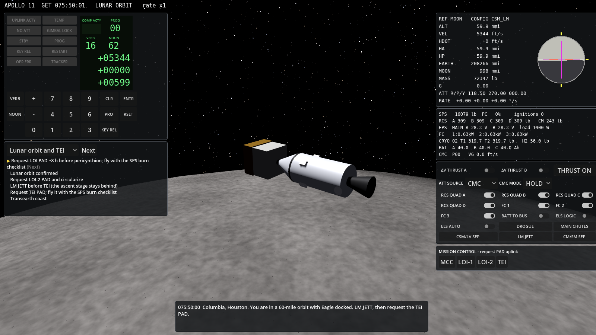
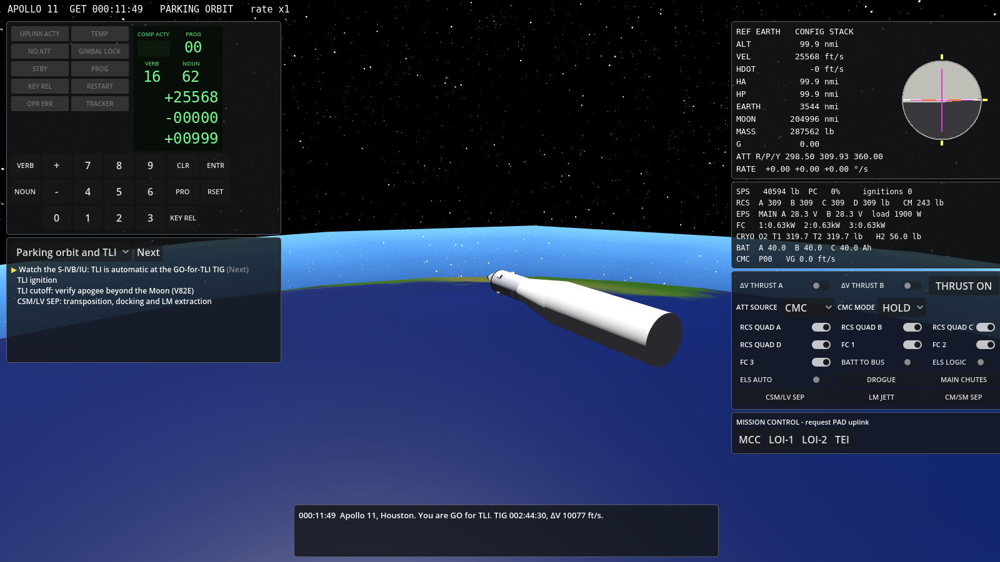
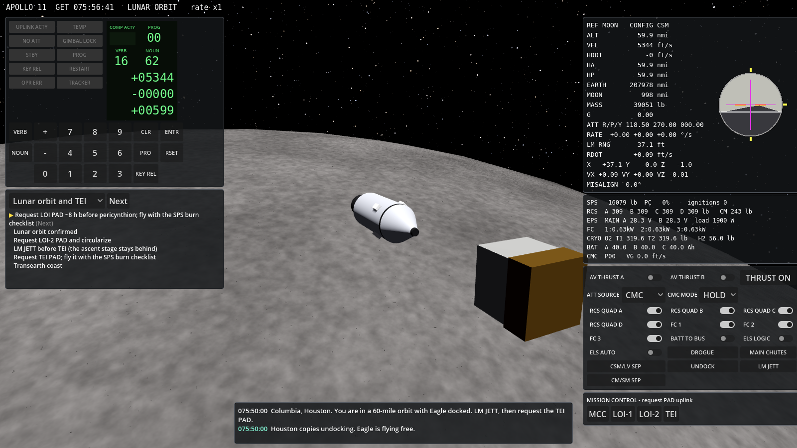
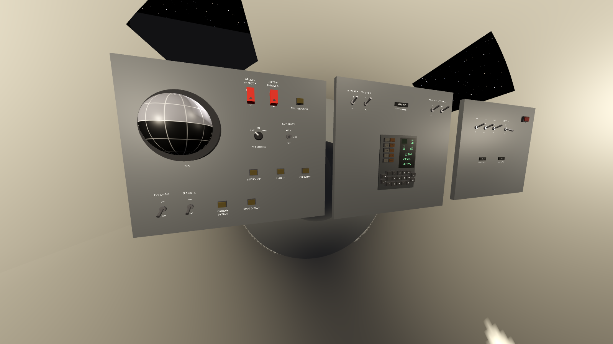
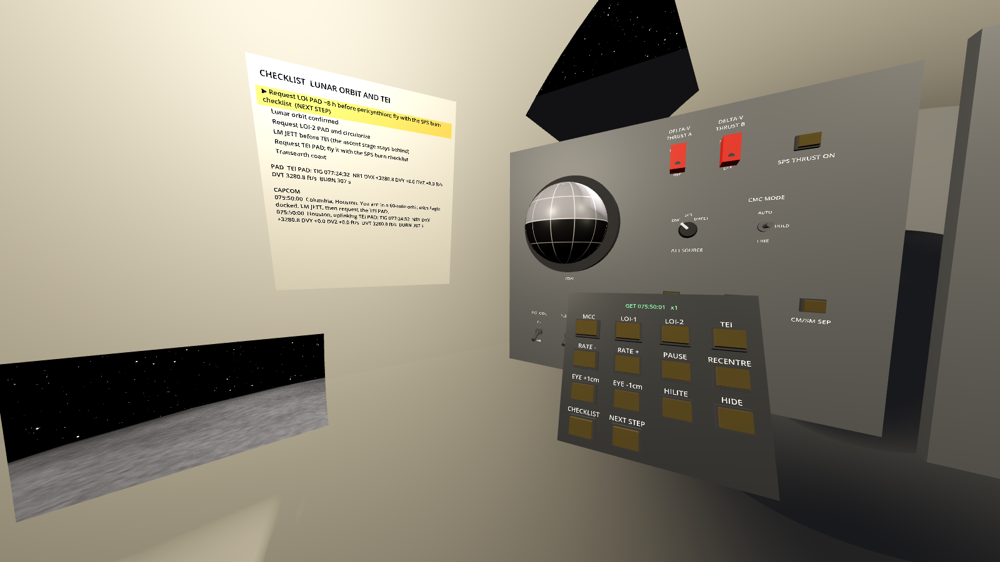

# Apollo CSM Simulator

A lunar-mission simulator of the Apollo Command/Service Module, built with
Godot **4.4.1** on the architecture of the
[Gemini capsule simulator](https://github.com/scomofo/gemini-capsule). It flies the
Apollo 11 profile from Earth parking orbit through TLI, midcourse
corrections, lunar orbit insertion, transearth injection, entry and
splashdown, with every maneuver planned by a simulated Mission Control and
executed through the Apollo Guidance Computer's DSKY.











The project used
[scomofo/gemini-capsule](https://github.com/scomofo/gemini-capsule) as its
template and began as the `apollo/` directory of that repository. It now
lives in its own repository, with its own tests and CI, and needs nothing
from gemini-capsule to build, run or test.

## Running

From the repository root:

```
godot --path .                                  # parking orbit, TLI ahead
godot --path . -- --phase=translunar_coast      # after TLI and docking
godot --path . -- --phase=lunar_orbit           # 60 nmi, Eagle docked
godot --path . -- --phase=transearth_coast      # after TEI
godot --path . -- --phase=entry                 # ~15 min before entry interface
```

Later start phases are made by flying the earlier ones through the RTCC's own
solutions (TLI, TEI), so every start is consistent with the mission it
continues. Starting in `transearth_coast` or `entry` takes a few seconds
while the ground computes the trajectory.

`godot --path . --xr-mode on` starts OpenXR, which is off by default, and
puts you in the commander's couch in a headset. No headset run has been
recorded yet ([docs/ROADMAP.md](docs/ROADMAP.md), slice 2e).
[docs/HEADSET_RUN.md](docs/HEADSET_RUN.md) walks through one, including
the PC VR exports in `export_presets.cfg`;
[docs/VR_ACCEPTANCE.md](docs/VR_ACCEPTANCE.md) is its checklist, and
[docs/VR_INTERACTION.md](docs/VR_INTERACTION.md) describes how the cabin
works in a headset.

| Input | Action |
|---|---|
| W/S, A/D, Q/E | Rotational hand controller: pitch, yaw, roll (hold Shift for 10 %) |
| Arrows, R/F | Translational hand controller: ±Y/±Z, +X/−X (ullage) |
| 0–9, `=`/`-` (or keypad) | DSKY digits, + and − |
| V, N, Enter | VERB, NOUN, ENTR |
| Space, Backspace | PRO, CLR |
| Insert, Delete | KEY REL, RSET |
| T (hold) | SPS THRUST ON, the manual backup |
| `[` `]`, P | Time rate slower/faster (1× to 10,000×), pause |
| C | Window, chase or cabin view |
| Right-drag | Look around (window and chase views) |
| In the cabin view: click, scroll | Work the control under the cursor: a click cycles a switch or presses a key, scrolling moves a switch up or down |
| In the cabin view: right-click, Z, Home | Mouse look on and off; inspect the control under the cursor; recentre |
| In the cabin view: M | Wrist menu: PAD requests, time rate, pause, recentre, eye height, seat, checklist, comfort aids |
| F5 / F9 | Save / load checkpoint |
| H | Key help |

Every DSKY key and cockpit switch is also clickable on screen, in the HUD
or on the CM's main display console in the cabin view. Above 100× the
cabin's switches lock, and its DSKY keys still work. Time acceleration
drops back to 10× by itself when an engine lights, at each scheduled
event (TLI, TIG−60 s, V99) and at entry.

## Flying the mission

1. **Parking orbit.** CAPCOM gives you GO for TLI. The S-IVB/IU flies TLI
   automatically at the planned TIG (GET 2:44). Watch it with `V16N62E` or
   `V82E`.
2. **Transposition and docking.** Press **CSM/LV SEP** after cutoff. It
   happens automatically an hour after cutoff if you don't.
3. **Midcourse correction.** Press **MCC** under Mission Control. The RTCC
   solves the burn and uplinks it (UPLINK ACTY). On the DSKY:
   - `V37E30E` (P30): check TIG in N33 and PRO; check ΔV in N81 and PRO;
     check the predicted apsides in N42 and PRO.
   - Set CMC MODE to AUTO. Then `V37E40E` (P40, SPS), or `V37E41E` (P41, RCS)
     for burns under 10 ft/s.
   - At V50N18, press PRO to maneuver to burn attitude. Set ΔV THRUST A and B
     to on.
   - At TIG−5 s, V99N40 flashes: press PRO to enable the engine. Monitor
     V16N40.
   - After cutoff, trim the V16N85 residuals with the THC, then press PRO.
4. **LOI.** About 8 h before pericynthion, press **LOI-1** and fly it
   (~850 m/s, 6 min, 60 × 170 nmi). Two revs later, fly **LOI-2** to
   circularize.
5. **TEI.** Press **LM JETT**, then **TEI**, and fly it. Then fly one or two
   transearth **MCC**s until the vacuum perigee is about 37 km (20 nmi).
   Before LM JETT you can undock and dock again (below).
6. **Entry.** Press **CM/SM SEP** and select `V37E61E`. Set ELS LOGIC and
   ELS AUTO on. P64 steers the bank angle at 0.05 g, P67 takes over below
   3 km/s, and the drogue and main parachutes deploy automatically.

**Undocking and docking.** In lunar orbit, **UNDOCK** releases Eagle. The
probe pushes the two apart at 0.1 ft/s, and the LM flies free on its own
orbit. Its computer, the LGC, powers up as it undocks and holds the
attitude it undocked in. While it flies free, the flight panel shows the range to its
docking port, the range rate, where the port is along the CSM's axes (X
along the probe) and how it moves, and how far the two docking axes are
out of line. Fly the CSM back to it on the translation controller. The
probe captures, and the vehicles are docked again, when it meets the
drogue at under 1 ft/s, moving across at under 0.5 ft/s, within 1 ft of
its centre, within 10° of alignment and under 1°/s of relative rate. Any
other contact rebounds, and CAPCOM says why.

**Eagle's own burns and the landing.** The LM has its own computer, the
LGC, with its own DSKY. Its descent and ascent engines, its RCS and its
autopilot fly the same way as Columbia's. LOI puts the lunar orbit over
Tranquility Base (0.674° N, 23.473° E) at Apollo 11's landing time.
Mission Control uplinks the DOI PAD and the landing site to the LGC, and
the crew flies DOI with P30 and P40 on the descent engine: 10 % throttle
for 15 s, then 40 %, as Apollo 11 did. Before PDI the ground uplinks the
LM's state vector with the PDI PAD, and it carries the tracking error
(mission.json "pdi"). The LGC flies on its own state vector from then on,
not on truth. Half a revolution after DOI, P63 ignites powered descent
470 km before the site. It brakes at full thrust until the throttle comes
back into its range.

The landing radar under the descent stage finds the ground, the real
ground of NASA's elevation maps. As its data come good, the ALT and VEL
lamps on the LGC's DSKY go out, and N63 shows ΔH, the radar's altitude
less the LGC's: about −3,100 ft here. The crew keys V57, and the radar
pulls the LGC's altitude and velocity in. Without V57 the LGC flies
Eagle into the ground a kilometre short of where it thinks it is. P64
flies the approach from high gate, about 2 km up and 8 km out. The LPD
angle in N64 tells the commander where on the window's scale to look for
the landing point, and each click of the hand controller moves it: 0.5°
fore or aft, 2° left or right. P65 lands automatically. At the first
click of the ROD switch, P66 hands the attitude to the crew while the
throttle holds the descent rate, 1 ft/s per click. CONTACT LIGHT comes
on when a probe touches, and at touchdown P68 shuts the engine down.

**The ascent.** On the surface, Mission Control's ascent PAD gives the
liftoff time. The RTCC flies the LGC's own ascent from where Eagle sits,
and times the liftoff for Columbia to lead by 16.4° at insertion, an
estimate of the lead Apollo 11's rendezvous needed (mission.json
"ascent"). Eagle's and
Columbia's state vectors come up with it. P12 shows the liftoff time
(N33), the insertion targets (N76: 5,535 ft/s, 32 ft/s up, and how far
Eagle sits from Columbia's plane) and the countdown (N74). At V99, five
seconds out, the crew stage with ABORT STAGE, arm the ascent engine and
key PRO: "Abort Stage, Engine Arm, Ascent, Proceed", as Aldrin called
it. The ascent engine lifts Eagle straight up to 40 ft/s while it yaws to
face along Columbia's track, and it pitches over. The LGC's ascent
guidance, after the E guidance Luminary flew, puts it into a 9 × 45 nmi
orbit in Columbia's plane, 60,000 ft up and climbing at 32 ft/s, and the
engine stops about seven minutes after liftoff.

**The rendezvous.** After insertion, Mission Control's CSI PAD carries
the RTCC's plan: Apollo 11's coelliptic sequence, flown from both
vehicles' state vectors, with TPI 2 h 35 min after insertion, as Apollo
11 had it. The ground uplinks CSI's and TPI's times, and Columbia's state
vector as MSFN tracked it, about 900 m off (mission.json "rendezvous").
In P20 the rendezvous radar marks Columbia once a minute, and the marks
take the error out of where the LGC has Columbia relative to Eagle.
V16N54 shows the range, the range rate and Columbia's elevation. P32
targets CSI at the first apolune: the horizontal burn that, with CDH half
a revolution on, has Columbia 26.6° above Eagle's horizon at TPI's time.
P33 targets CDH, onto an orbit a constant 15 nmi below Columbia's. P34
finds when Columbia comes up to 26.6°, and the transfer that meets it
after it has flown 130° of its orbit. P35 corrects the course 15 and 30
minutes after TPI, and P41 flies each burn on the RCS. From a mile out
the commander brakes on the TTCA, holding the closing rate to the range
gates, and stops about 40 m from Columbia. Collins then flies the probe
into the drogue, as he did.

The LGC also has P41 (LM RCS), P42 (the ascent engine, after staging)
and P47, and ENGINE START lifts a landed ascent stage off by hand. The LM
has no cockpit yet, so only the tests fly it (slice 3f adds one).

The on-screen checklist follows along. Steps with a check mark complete
themselves when the Bus shows the action was done. In the cabin, the same
checklist is on the card by the commander's left shoulder, with the last
PAD and CAPCOM's calls, and a green frame marks the control for the
current step. The wrist menu's NEXT STEP goes past a step without a
check. CHECKLIST turns to the next checklist where it was left, so you
can fly a burn down the SPS burn checklist and come back to the phase's;
a finished checklist starts again. SEAT moves you to the
centre couch, where the DSKY is straight ahead and, in a headset, within
reach.

To reproduce the Apollo 13 failure, set `failures.o2_tank_2_get_s` in
`data/missions/apollo_11/mission.json` (the flown time was 55:54:53 =
201293 s). O2 tank 2 vents, fuel cells 1 and 3 fail and the batteries
start carrying the load.

## What was taken from the Gemini template

The left column links to the
[gemini-capsule](https://github.com/scomofo/gemini-capsule) files this
project was derived from, as of commit
[`4dbdff9`](https://github.com/scomofo/gemini-capsule/tree/4dbdff93b60e1d1e41c74ef8c3ca446b9752649b).
The right column names the files in this repository.

| Gemini capsule | Apollo CSM | Notes |
|---|---|---|
| [`src/core/bus.gd`][g-bus] | `src/core/bus.gd`, unchanged apart from comments | Only coupling between controls, systems and displays; SI on the Bus |
| [`src/core/sim_clock.gd`][g-clock] | extended | Same fixed 50 Hz step and stage order; rates up to 10,000×, adaptive coast steps, event landing |
| [`src/core/sim_runtime.gd`][g-runtime] | rewritten | Same build + snapshot/restore contract across truth owners |
| [`src/dynamics/vec3d.gd`][g-vec3d], [`attitude.gd`][g-attitude] | reused | Attitude now sub-steps long coast steps |
| [`src/dynamics/orbit.gd`][g-orbit] (Earth, J2) | `src/dynamics/trajectory.gd` | Earth–Moon three-body RK4, state re-based at the lunar sphere of influence |
| [`src/systems/electrical.gd`][g-electrical] | `src/systems/eps.gd` | Fuel cells, cryo O2/H2, entry batteries, O2 tank failure |
| OAMS/RCS in [`src/dynamics/dynamics.gd`][g-dynamics] | `src/systems/rcs.gd`, `src/systems/sps.gd` | SM quads A–D, CM rings, SPS with arm valves and transients |
| [`src/systems/guidance.gd`][g-guidance] + MDIU | `src/systems/agc_core.gd`, `agc.gd`, `lgc.gd`, `ascent_guidance.gd`, `rendezvous.gd` + `src/systems/dsky.gd` | One AGC core (verb/noun DSKY, P30, thrusting programs, P47, DAP) under two program sets: the CMC's P00/30/40/41/47/61/64/67 and the LGC's P00/12/20/30/32/33/34/35/40/41/42/47/63/64/65/66/68 |
| — | `src/systems/dps.gd`, `aps.gd`, `lm_rcs.gd`, `landing_radar.gd`, `rendezvous_radar.gd` | The LM's descent and ascent engines, its RCS, and its landing and rendezvous radars |
| — | `src/dynamics/terrain.gd`, `data/terrain/`, `tools/terrain/build_terrain.py` | The surface from NASA's elevation maps: LROC's Apollo 11 site model at 4 m, SLDEM2015 along the approach, LOLA elsewhere (sources in NOTICE) |
| [`src/mission/mission_sequencer.gd`][g-sequencer] | rewritten | Phases, S-IVB/IU TLI automation, separations, failures, CAPCOM |
| — | `src/mission/rtcc.gd` | Ground targeting: TLI, MCC, LOI-1/2 over the landing site, TEI, the LM's DOI for the landing pass, its liftoff time and its rendezvous (the CSI PAD), by shooting on the flight model. The sequencer's PDI PAD uplinks the LM's state vector with its tracking error, and the CSI PAD the CSM's with its own |
| [`src/mission/procedure_runner.gd`][g-procedure] | `src/mission/checklist.gd` | Bus-checked flight-plan checklists |
| [`src/systems/recovery.gd`][g-recovery] | `src/systems/els.gd` | Drogues, reefed mains |
| GUT tests, headless | GUT 9.4.0 (vendored in `addons/gut/`), headless | Unit tests plus full mission-segment scenarios |

[g-bus]: https://github.com/scomofo/gemini-capsule/blob/4dbdff93b60e1d1e41c74ef8c3ca446b9752649b/src/core/bus.gd
[g-clock]: https://github.com/scomofo/gemini-capsule/blob/4dbdff93b60e1d1e41c74ef8c3ca446b9752649b/src/core/sim_clock.gd
[g-runtime]: https://github.com/scomofo/gemini-capsule/blob/4dbdff93b60e1d1e41c74ef8c3ca446b9752649b/src/core/sim_runtime.gd
[g-vec3d]: https://github.com/scomofo/gemini-capsule/blob/4dbdff93b60e1d1e41c74ef8c3ca446b9752649b/src/dynamics/vec3d.gd
[g-attitude]: https://github.com/scomofo/gemini-capsule/blob/4dbdff93b60e1d1e41c74ef8c3ca446b9752649b/src/dynamics/attitude.gd
[g-orbit]: https://github.com/scomofo/gemini-capsule/blob/4dbdff93b60e1d1e41c74ef8c3ca446b9752649b/src/dynamics/orbit.gd
[g-electrical]: https://github.com/scomofo/gemini-capsule/blob/4dbdff93b60e1d1e41c74ef8c3ca446b9752649b/src/systems/electrical.gd
[g-dynamics]: https://github.com/scomofo/gemini-capsule/blob/4dbdff93b60e1d1e41c74ef8c3ca446b9752649b/src/dynamics/dynamics.gd
[g-guidance]: https://github.com/scomofo/gemini-capsule/blob/4dbdff93b60e1d1e41c74ef8c3ca446b9752649b/src/systems/guidance.gd
[g-sequencer]: https://github.com/scomofo/gemini-capsule/blob/4dbdff93b60e1d1e41c74ef8c3ca446b9752649b/src/mission/mission_sequencer.gd
[g-procedure]: https://github.com/scomofo/gemini-capsule/blob/4dbdff93b60e1d1e41c74ef8c3ca446b9752649b/src/mission/procedure_runner.gd
[g-recovery]: https://github.com/scomofo/gemini-capsule/blob/4dbdff93b60e1d1e41c74ef8c3ca446b9752649b/src/systems/recovery.gd

Everything follows the same ownership rules as the Gemini project
([docs/ARCHITECTURE.md §3.1][g-ownership] there). The
dynamics owns trajectory and attitude truth, each system owns its state,
controls publish `ctl.*`, and presentation only reads the Bus.

[g-ownership]: https://github.com/scomofo/gemini-capsule/blob/4dbdff93b60e1d1e41c74ef8c3ca446b9752649b/docs/ARCHITECTURE.md#31-bus-ownership-rules

### Parts for the VR cockpit

The VR cockpit ([docs/ROADMAP.md](docs/ROADMAP.md), milestone 2) reuses
gemini-capsule's interaction layer, rigs, panel prefabs and data-driven
panel layout. They were taken later than the rest, at commit
[`40e449c`](https://github.com/scomofo/gemini-capsule/tree/40e449cfb8c35111de47a33bd351b2d945e6fa52).
The CM cabin (`src/cabin/cm_cabin.gd`) and the cabin DSKY
(`scenes/instruments/cabin_dsky.gd`) are new. Every row of
`data/cockpit/controls.csv` places one control or display on the main
display console, at estimated positions (confidence D) until the panel
drawings are transcribed.

| Gemini capsule | Apollo CSM | Changes |
|---|---|---|
| [`src/interaction/control_base.gd`][v-control-base], [`interactor.gd`][v-interactor] | same paths | One addition to `control_base.gd`: a fingertip crossing names the control on `player.last_touch_label` before it counts, so the headset recorder can tell DSKY keys and menu buttons apart |
| [`scenes/controls/`][v-controls]: toggle, rotary, pushbutton | same paths | They start from the value the Bus already holds (the simulation's state, a checkpoint, the HUD) instead of publishing their initial position over it, and the toggle and rotary follow later changes. A two-position toggle can publish a bool, as the HUD does |
| [`scenes/controls/circuit_breaker.gd`][v-breaker] | same path | Gemini's overhead face style, drawn for its SC-4 overhead panel, is left out |
| [`scenes/instruments/`][v-instruments]: lamp, numeric display, clock, flag, round gauge | same paths | None. `Units.convert()` and a minimal `src/presentation/cabin_materials.gd` exist for them, and `src/core/frames.gd` for the FDAI |
| [`scenes/instruments/fdai.gd`][v-fdai] | same path | Shows the view from inside the ball, like the flown instrument: Gemini's ball reads pitch and yaw reversed. The ball also turns relative to its case, so a tilted panel doesn't tilt the horizon |
| [`scenes/player/xr_rig.tscn`][v-xr-rig], [`openxr_action_map.tres`][v-action-map] | same paths | Each fingertip has its own collision shape and a small green marker, so the player can see it. OpenXR is off in `project.godot` until `--xr-mode on`, with the seated Local reference space (Gemini's `project.godot` sets Stage) |
| [`scenes/player/desktop_rig.gd`][v-desktop-rig] | same path | No keyboard head movement, because W/A/S/D/Q/E fly the RHC here. Recentre is the `recenter` action on Home, because R is the THC's +X |
| [`src/interaction/hand_controller_input.gd`][v-hci] | same path | Writes `ctl.rhc` and `ctl.thc` from the keys and the thumbsticks; holding the left grip switches the sticks to the THC. `for_xr_rig()` reads a headset's hands, and each stick axis has a 15 % deadzone, for the RHC's breakout detents |
| [`src/presentation/wrist_menu.gd`][v-wrist-menu] | same path | Apollo's buttons: the PAD requests (writing `ctl.ground.pad_request`, as the HUD does), time rate, pause, recentre, eye height, SEAT, CHECKLIST, NEXT STEP, HILITE, VIGNETTE, HORIZON and AUTHENTIC. Gemini's guide and new-flight buttons stay behind, and settings aren't saved yet |
| [`src/presentation/comfort.gd`][v-comfort] | same path | Reads `dyn.omega`, `dyn.g_load` and `guid.indicator.attitude` in place of Gemini's `guid.rate.*`, dynamic pressure and `guid.att.lvlh`: the vignette starts at 3 deg/s of body rate and 2 g in entry |
| [`src/presentation/gaze_tooltip.gd`][v-tooltip], [`perf_monitor.gd`][v-perf] | same paths | None. The frame budget follows the headset's refresh at session start |
| [`src/presentation/vr_acceptance_recorder.gd`][v-recorder] | same path | Apollo's rows: a panel switch, a DSKY verb and noun and a wrist-menu button worked by fingertip, the thumbsticks on the rotation controller, the vignette, the horizon aid's default and the lock above 100×, in place of Gemini's ACE POWER and RATE CMD. A later session stop rewrites the record, so a headset taken off mid-run doesn't cut it short |
| [`docs/VR_INTERACTION.md`, `HEADSET_RUN.md`, `VR_ACCEPTANCE.md`][v-vr-docs], [`export_presets.cfg`][v-export] | same paths | Rewritten for the CM. The PC VR presets (Windows, Linux) leave out `tests/`, `tools/` and GUT; Gemini's Quest preset stays behind |
| [`src/presentation/checklist_highlight.gd`][v-highlight] | same path | Finds the control from the step's `control` or its check channel, and the frame fits the control's footprint, DSKY included. Off with HILITE or in authentic mode |
| [`src/cabin/cockpit_layout.gd`][v-layout], [`controls.csv`, `channels.csv`][v-cockpit-data] | `src/cabin/cockpit_layout.gd`, `data/cockpit/` | Rows are checked against `CmCabin`'s panels and the channel types in `channels.csv`, and for overlaps. No `spec_id` column until a CM cockpit spec exists. A switch on a bool channel publishes a bool; switch positions are lettered beside the lever and around the knob |
| [`tests/unit/`][v-tests]: `test_control_library`, `test_xr_rig`, `test_openxr_action_map`, `test_desktop_inspection`, `test_gauge_linear_face` | same paths | Gemini-only cases dropped or replaced |

[v-control-base]: https://github.com/scomofo/gemini-capsule/blob/40e449cfb8c35111de47a33bd351b2d945e6fa52/src/interaction/control_base.gd
[v-interactor]: https://github.com/scomofo/gemini-capsule/blob/40e449cfb8c35111de47a33bd351b2d945e6fa52/src/interaction/interactor.gd
[v-controls]: https://github.com/scomofo/gemini-capsule/tree/40e449cfb8c35111de47a33bd351b2d945e6fa52/scenes/controls
[v-breaker]: https://github.com/scomofo/gemini-capsule/blob/40e449cfb8c35111de47a33bd351b2d945e6fa52/scenes/controls/circuit_breaker.gd
[v-instruments]: https://github.com/scomofo/gemini-capsule/tree/40e449cfb8c35111de47a33bd351b2d945e6fa52/scenes/instruments
[v-fdai]: https://github.com/scomofo/gemini-capsule/blob/40e449cfb8c35111de47a33bd351b2d945e6fa52/scenes/instruments/fdai.gd
[v-xr-rig]: https://github.com/scomofo/gemini-capsule/blob/40e449cfb8c35111de47a33bd351b2d945e6fa52/scenes/player/xr_rig.tscn
[v-action-map]: https://github.com/scomofo/gemini-capsule/blob/40e449cfb8c35111de47a33bd351b2d945e6fa52/openxr_action_map.tres
[v-desktop-rig]: https://github.com/scomofo/gemini-capsule/blob/40e449cfb8c35111de47a33bd351b2d945e6fa52/scenes/player/desktop_rig.gd
[v-hci]: https://github.com/scomofo/gemini-capsule/blob/40e449cfb8c35111de47a33bd351b2d945e6fa52/src/interaction/hand_controller_input.gd
[v-tests]: https://github.com/scomofo/gemini-capsule/tree/40e449cfb8c35111de47a33bd351b2d945e6fa52/tests/unit
[v-layout]: https://github.com/scomofo/gemini-capsule/blob/40e449cfb8c35111de47a33bd351b2d945e6fa52/src/cabin/cockpit_layout.gd
[v-wrist-menu]: https://github.com/scomofo/gemini-capsule/blob/40e449cfb8c35111de47a33bd351b2d945e6fa52/src/presentation/wrist_menu.gd
[v-highlight]: https://github.com/scomofo/gemini-capsule/blob/40e449cfb8c35111de47a33bd351b2d945e6fa52/src/presentation/checklist_highlight.gd
[v-cockpit-data]: https://github.com/scomofo/gemini-capsule/tree/40e449cfb8c35111de47a33bd351b2d945e6fa52/assets/data/cockpit
[v-comfort]: https://github.com/scomofo/gemini-capsule/blob/40e449cfb8c35111de47a33bd351b2d945e6fa52/src/presentation/comfort.gd
[v-tooltip]: https://github.com/scomofo/gemini-capsule/blob/40e449cfb8c35111de47a33bd351b2d945e6fa52/src/presentation/gaze_tooltip.gd
[v-perf]: https://github.com/scomofo/gemini-capsule/blob/40e449cfb8c35111de47a33bd351b2d945e6fa52/src/presentation/perf_monitor.gd
[v-recorder]: https://github.com/scomofo/gemini-capsule/blob/40e449cfb8c35111de47a33bd351b2d945e6fa52/src/presentation/vr_acceptance_recorder.gd
[v-vr-docs]: https://github.com/scomofo/gemini-capsule/tree/40e449cfb8c35111de47a33bd351b2d945e6fa52/docs
[v-export]: https://github.com/scomofo/gemini-capsule/blob/40e449cfb8c35111de47a33bd351b2d945e6fa52/export_presets.cfg

## Fidelity

These parts are modelled from published figures (rounded; see
`data/spacecraft.json`):

- SPS (20,500 lbf, Isp 314 s)
- SM RCS (100 lbf jets)
- LM descent engine (10,125 lbf, throttleable from 10 % to 60 %, Isp
  311 s), ascent engine (3,500 lbf) and RCS (100 lbf jets in two systems)
- The rendezvous radar's range (400 nmi), and the TPI elevation and
  transfer angle (26.6° and 130°)
- J-2 TLI (the burn takes about 5 min)
- CSM, LM and S-IVB masses (the LM's split between its stages is
  estimated)
- CM hypersonic L/D 0.3
- Parachute deployment altitudes

A flown Apollo 11 profile in the simulator reproduces these values:

| Quantity | Simulator | Apollo 11 |
|---|---|---|
| TLI | GET 2:44:30, 3,071 m/s | 2:44:16, ~3,180 m/s |
| Translunar coast | ~73 h | ~73 h |
| LOI-1 | 856 m/s, 6.0 min, 54 × 170 nmi | 889 m/s, 5.95 min, 61 × 169 nmi |
| TEI | 1,000 m/s | 1,001 m/s |
| DOI | 73.0 ft/s, 30 s | ~76 ft/s, ~30 s |
| Powered descent | 12 min 6 s, touchdown 140 m from the target (the LGC's crossrange error, which the radar can't see) | 12 min 35 s, about 6 km past the target |
| Ascent, liftoff to cutoff | 7 min 8 s, then 60,054 ft and 32.1 ft/s up, 9.0 × 45.1 nmi | 7 min 17 s, then 60,666 ft and 32.8 ft/s up, 9.5 × 47.3 nmi |
| CSI | 52.3 ft/s, 50 min 50 s after insertion | 51.5 ft/s, 50 min 18 s after insertion |
| TPI | 24.0 ft/s, 2 h 34 min 17 s after insertion | ~25 ft/s, 2 h 34 min 35 s after insertion |
| Midcourse corrections | 0.2 and 0.1 ft/s | ~1 ft/s each |
| Braking, then station-keeping | 15 min 26 s, station-keeping 45 min after TPI | 15 min 8 s, station-keeping 48 min after TPI |
| Docking | 50 min after TPI | 59 min after TPI |
| Entry peak load | 6.9 g | ~6.5 g |
| Splashdown | 8.6 m/s | — |

Deliberate simplifications are tagged `[simplified]` in the code. The main
ones:

- **Moon's orbit.** The Moon moves on a circular orbit, and the Sun direction
  is fixed.
- **Navigation.** The CMC's is ideal: no P52 alignments, and its state
  vector is truth. The LGC keeps its own state vector, with the ground's
  tracking error, but on an ideal IMU.
- **S-IVB guidance.** It uses a prograde energy-cutoff law instead of
  iterative guidance.
- **P40 steering.** P40 holds the N81 direction in the rotating LVLH frame,
  standing in for cross-product steering.
- **Entry guidance.** It is a constant-drag bank controller without range
  targeting.
- **Atmosphere.** Earth rotation and winds are ignored.
- **Launch.** There is no launch phase.
- **The landing.** The Moon turns synchronously, its pole on the normal
  of its orbit. The surface is NASA's elevation maps, smooth between their
  posts: 4 m at the site, so no smaller rocks, and the gear meets the
  ground level, straight below the centre of mass. The descent's guidance
  targets are this simulator's own, designed after Klumpp's Apollo
  guidance. The tracking error is set in the mission data, where it meets
  PDI, and the landing radar is noise-free. The LGC has no terrain model,
  as Apollo 11's had none, so the radar's altitude over lower ground reads
  high. The crew's ENGINE STOP after contact light is the LGC's at
  touchdown. The LM can't tip over or break its gear: a hard landing only
  draws a call from CAPCOM. The space view still draws the Moon as a
  sphere; the LM cockpit (slice 3f) will show the ground.
- **The LM.** Its systems power up as it undocks. Docked, it is dark,
  and the CSM flies the stack. The crew's throttle-up in DOI is the
  LGC's. The descent engine has no gimbal trim, and staging leaves the
  descent stage behind, no longer simulated. The ascent engine fires only
  after staging (no fire-in-the-hole abort).
- **The ascent.** The ground times the liftoff from both vehicles' true
  state vectors, and uplinks them as the truth. The lead Columbia has at
  insertion is estimated from Apollo 11's rendezvous. P12's steering
  takes the engine's nominal thrust for its acceleration, not the
  measured one.
- **The rendezvous.** The rendezvous radar is noise-free and finds
  Columbia wherever it is, without gimbal limits or a manual lock-on.
  P20 weights each mark by fixed gains, not Luminary's filter, and
  updates only Columbia's state vector. The RTCC and P32 to P35 target
  impulsive burns on the flight model, which P41 flies as finite ones,
  and CDH comes half a revolution after CSI. MSFN's error in Columbia's
  state vector and the braking gates are estimates.
- **Docking.** Capture docks the vehicles hard at once, without a soft
  dock and probe retraction. Only the probe can touch the LM: the
  vehicles' bodies pass through each other. The docking geometry, the
  push apart at undocking and the capture limits are estimates.
- **The cabin.** It is a blockout: the vessel, couches and console follow
  the CM in outline, and every panel position is estimated. The Block II
  main display console layout is on file in
  `reference/nasa-history-diagrams/` (the Operations Handbook's
  Figure 3-1, sheets 1-6, with its position grid). It gives control
  identity and placement, not physical dimensions.

## Tests

From the repository root:

```
godot --headless --path . --import
godot --headless --path . -s addons/gut/gut_cmdln.gd -gexit
```

The unit tests cover:

- The Bus
- The propagator: orbit closure, step independence, SOI re-basing, lunar
  orbit stability
- The Moon-fixed frame: the Moon keeps a face to the Earth and turns once
  a sidereal month, and selenographic coordinates round-trip
- The terrain: Tranquility Base 1,927 m below the reference sphere, West
  crater 30 m deep east of the LM, and the maps blending without steps
- The landing radar: its slant range to the ground in both antenna
  positions, over West crater too, its data-good ranges and its velocity
  over the turning surface
- The ascent guidance: its targets are a 9 × 45 nmi orbit, it pitches
  over along the track, steers back into the CSM's plane, and its time to
  go is the rocket equation's
- The rendezvous targeting: the CSM's elevation, the next apsis, CDH
  leaving the LM the same height below the CSM's orbit all the way round,
  CSI sized for the TPI elevation at TPI's time, and TPI's time and its
  transfer meeting the CSM (24.6 ft/s, and 31.6 ft/s to brake)
- The rendezvous radar: range, range rate and the line of sight in the
  LM's axes, and no data with the Moon in the way, beyond 400 nmi,
  docked or powered down
- DSKY key logic
- CMC programs
- Systems: SPS arming, EPS consumption and the Apollo 13 failure, SCS/CMC
  autopilot, the coast-step policy
- Checkpoint round-trip, with a map of vehicles, each with its own
  systems, and the LGC's rendezvous state (schema 3). Older checkpoints
  are rejected
- The main scene
- The hand controllers, from the keys and from the XR thumbsticks, with
  the thumbstick deadzone
- The space view: the cabin and the cameras stay fixed while Earth, Moon,
  Sun and stars turn around them with the attitude, and the LM, once it
  undocks, is drawn where it flies and turned as it is
- The cabin controls and instruments, the XR and desktop rigs and the
  OpenXR action map taken from gemini-capsule
- The cockpit layout: `controls.csv` validates, malformed rows are
  reported, and every row round-trips between its node and the Bus. Every
  HUD switch has a cabin control, the cabin DSKY types into the CMC, and
  the desktop rig can click every control from the commander's couch
- What the cabin shows and sets on the Bus: the DSKY display, the FDAI
  attitude, and switches that follow the HUD and checkpoints
- The checklists in the cabin: one book shared by the HUD and the card,
  the card's checklist, PAD and CAPCOM, and the highlight on the control
  each step names or whose channel it checks
- The wrist menu: its PAD, clock, recentre, eye-height and checklist
  buttons, M and the controller button, the palm gesture, and buttons
  that work while the panels are locked
- The headset aids: the vignette and horizon ring, authentic mode, the
  gaze tooltip, the frame-time monitor, and the seat switch that brings
  the DSKY within reach
- The main scene's headset branch, run against a stand-in for the OpenXR
  interface: the XR rig and its camera, hands and menu, frame pacing to
  the headset's refresh, and one record across a restarted session

The scenario tests fly real segments through the crew interface:

- S-IVB TLI to lunar arrival
- MCC, LOI-1 and LOI-2 into lunar orbit
- TEI and the transearth MCCs into the entry corridor
- CM/SM separation, P61/P64 entry and splashdown
- An MCC PAD flown with P30 and P41 using only the cabin's controls,
  each one clicked through the desktop rig
- A PAD requested from the wrist menu through the desktop rig: UPLINK
  ACTY on the cabin DSKY, the PAD on the checklist card, and the
  checklist worked on from the menu and the DSKY
- The headset acceptance recorder on the desktop rig: fingertip crossings
  on a switch, the DSKY and the menu (a click doesn't count), the
  thumbsticks' pitch and roll response, the lock above 100× and the
  record it writes
- Every checklist worked from the commander's couch through the desktop
  rig until the card shows it complete: parking orbit and TLI, LOI-1,
  LOI-2 and TEI each down the SPS burn checklist on P40 with a residual
  trimmed on the translation controller, LM JETT, and entry to
  splashdown. The cabin scenarios share `tests/cabin_test.gd`
- Undocking and docking in lunar orbit (`tests/scenarios/test_docking.gd`).
  The stack splits with its momentum conserved. An equiperiod separation
  (0.6 m/s radially down) carries the CSM 4ΔV/n ahead of the LM half a
  revolution later, as the linear (Clohessy-Wiltshire) solution has it,
  and brings it back within 5 m a revolution later. A checkpoint taken
  mid-revolution flies on as the uninterrupted run does. The CSM docks
  again on the translation controller, and contacts that close too fast
  or misaligned rebound
- DOI on the LGC (`tests/scenarios/test_doi.gd`), slice 3b's check. Eagle
  undocks, Mission Control uplinks a DOI PAD to the LGC, and P40 flies it
  on the descent engine, at 10 % and then 40 % throttle. Half a
  revolution later Eagle passes its pericynthion within 250 m of the
  PAD's 50,000 ft above the site (15,205 m against 15,239 m), while
  Columbia's orbit stays as it was
- The landing at Tranquility Base (`tests/scenarios/test_landing.gd`),
  slice 3c's check. LOI turns the orbit over the site, and the
  `lunar_orbit` phase starts over it. The PDI PAD's state vector is off
  by its tracking error at PDI. From a checkpoint before PDI:
  - The automatic landing. The crew keys V57 when the radar's altitude
    comes good, with ΔH at −954 m, and ΔH is −22 m by high gate. P63,
    P64 and P65 land Eagle 140 m from the site at 0.8 m/s down and none
    across.
  - Without V57, Eagle hits the ground 4 km short at 24 m/s.
  - With a 900 m error along the track, the commander redesignates in
    P64 and lands 2 m from the site.
  - A run takes over in P66 at 150 m, with the hand controller and the
    ROD switch.
  
  A landed LM turns with the Moon, and lifts off on its ascent engine.
- The ascent (`tests/scenarios/test_ascent.gd`), slice 3d's check. Eagle
  is set down at the site. The RTCC times the liftoff for Columbia to
  lead by 16.4° at insertion. P12 lifts off at that time, rises for 8 s,
  and cuts off 7 min 8 s after liftoff. It inserts at 60,054 ft and
  32.1 ft/s up into a 9.0 × 45.1 nmi orbit, 0.001° from Columbia's
  plane, with Columbia 16.42° ahead and 167 kg of propellant left. A
  checkpoint taken mid-ascent flies on to the same insertion
- The rendezvous (`tests/scenarios/test_rendezvous.gd`), slice 3e's
  check. From Eagle's insertion, the CSI PAD plans CSI at 52.3 ft/s
  (Apollo 11: 51.5), 15 nmi below Columbia, and TPI at 24.0 ft/s.
  Columbia's uplinked state vector is 914 m off, and after 12 marks P20
  has it within 0.2 m relative to Eagle. The LGC flies the sequence: CDH
  2.1 ft/s onto 14.6 nmi below, TPI 18 s before the plan's time, and
  midcourse corrections of 0.2 and 0.1 ft/s. The commander brakes by the
  gates and stops 40 m out, and Collins docks at 0.33 ft/s. Eagle's ΔV,
  116.0 ft/s, is 6 % over the RTCC's plan (the check allows 20 %)
- The LM's other systems (`tests/scenarios/test_lm_burns.gd`): P41 on its
  RCS, P47 on a translation, staging and P42 on the ascent engine, its
  autopilot turning and holding it, the LGC dark while the LM is docked,
  and the two computers each keeping its own DSKY

`tools/screenshot.tscn` renders the images above (`--view=0` window,
`1` chase, `2` cabin; `--hud=0` leaves the HUD out, `--menu=1` shows the
wrist menu, `--pad=<kind>` asks Mission Control for a PAD first, and
`--undock=<s>` undocks the LM and lets it drift for that many seconds).
They were rendered in software, so the frame time on the wrist menu's top
line is the software renderer's:

```
godot --path . tools/screenshot.tscn -- --phase=lunar_orbit --view=1 --out=res://docs/images/x.png
godot --path . tools/screenshot.tscn -- --phase=lunar_orbit --view=1 --undock=400 --yaw=3.6 --out=res://docs/images/lm_undocked_chase.png
godot --path . tools/screenshot.tscn -- --phase=lunar_orbit --view=2 --yaw=-0.3 --pitch=-0.12 --hud=0 --out=res://docs/images/cabin_lunar_orbit.png
godot --path . tools/screenshot.tscn -- --phase=lunar_orbit --view=2 --yaw=0.55 --pitch=-0.08 --hud=0 --menu=1 --pad=tei --out=res://docs/images/cabin_checklist.png
```

## Roadmap

[docs/ROADMAP.md](docs/ROADMAP.md) plans what comes next, in order of
value: CI, a VR cockpit, the LM and a lunar landing, and navigation
realism. The VR cockpit waits on a headset run. The LM undocks, flies
free and docks again (slice 3a), flies DOI on its own computer (slice
3b), lands at Tranquility Base (slice 3c), lifts off to orbit at the
RTCC's time (slice 3d), and flies the rendezvous back to Columbia, which
docks with it (slice 3e).
