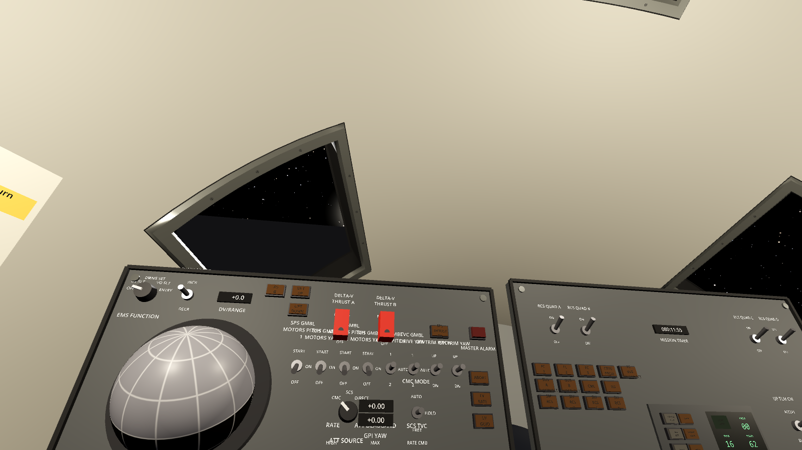
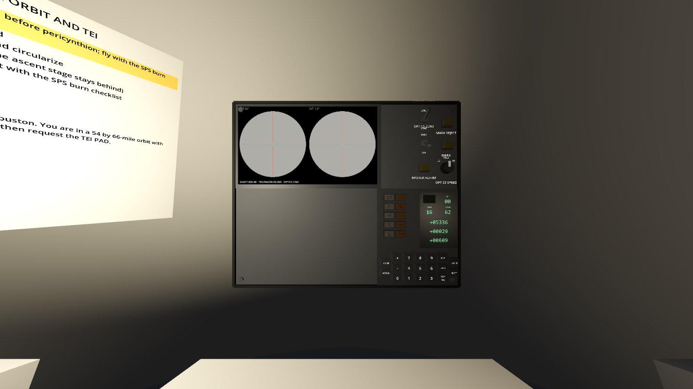

# Cabin interior fidelity

## Window surrounds, October 2026

The CM's previous window retainers used straight bars at the radius of
each opening's centre. Over the length of a rendezvous opening the
estimated shell radius changes by 18.4 cm, so the bars floated away from
one end and disappeared into the wall at the other.

The surrounds now use the same axial and angular coordinates as the
shell openings. Continuous bands form a dark gasket, a bevelled metal
retainer and a recessed black liner. Twelve small slotted fasteners per
window follow the local shell normal. Their heads and slots are batched;
each window still has eight rendered surfaces, as the old eight bars did.
These are static presentation meshes without control collision shapes.



### Reference and estimates

[NASA TN D-6721, Apollo Experience Report: Window Contamination](https://ntrs.nasa.gov/citations/19720012257)
(March 1972), printed pages 3-4, figures 1-6, describes the five CM
window assemblies, their inner pressure-vessel panes and outer heat-shield
panes. Its sections show separate frames and a recessed viewing path.
Page 4 describes aluminium frames and black silicone covering visible
insulation to reduce glare. Those construction features guide this pass.

The 55 mm radial recess, 34 mm surround, 7 mm screw heads, screw count,
spacing, colours and roughness are **estimates**. The existing aperture
locations and sizes have not changed. The surrounds follow the simulator's
cone; real pressure panes are planar. Rectangular openings remain a
**[simplified]** approximation, including the rendezvous windows. No glass
surface, refraction, optical coating, dirt or mission-specific window
contamination has been added. This is a correction to the existing
blockout, not a dimensioned reconstruction of a particular flown cabin.

### Verification and capture

`test_cockpit_layout.gd` checks the actual mesh's distance from the shell
and ray intersections through and around every
opening, including the left-side window across the angular seam. Existing
tests check the five shell apertures, all control click targets, Bus
bindings, DSKYs and seat anchors. The main-scene tests cover cabin setup.
With a real renderer the window test also checks all 60 fastener
orientations. Godot 4.4's dummy renderer returns identity for MultiMesh
transform reads, so those assertions are skipped headless; run the window
tests with `--rendering-method gl_compatibility` and without `--headless`
to exercise them.

The screenshot is a Godot 4.4.1 Compatibility render at 1600 x 900, from
the commander's station in lunar orbit:

```sh
godot --path . --rendering-method gl_compatibility --resolution 1600x900 tools/screenshot.tscn -- --phase=lunar_orbit --view=2 --hud=0 --pitch=0.55 --yaw=-0.16 --zoom=1.65 --out=res://docs/images/cabin_window_detail.png
```

The screenshot tool's optional `--zoom` uses the existing desktop
inspection magnification. It does not change the gameplay camera's
default FOV or headset settings. Desktop render checks are separate from
the pending human headset and Quest performance acceptance passes.

## Lower equipment bay

Selecting LEB previously turned the navigator toward body +Z while its
panel still faced the couches along -X, leaving it above the initial
view. Panel LEB122 now uses the station's existing LEB basis and sits
48 cm ahead of its unchanged eye point. Its optics, second DSKY, switches
and labels face the navigator upright. A short-range task light illuminates
the panel. The panel centre and lighting remain **estimated**, not a
transcription of flown dimensions.



The station test checks the panel's direction, upright orientation and
reach; the existing desktop test clicks every LEB control from that
station. Capture with the same screenshot command, replacing the pitch,
yaw and zoom arguments with `--seat=LEB`.

## Next interior passes

1. Transcribe the window planes and outlines from dimensioned drawings,
   distinguishing inner pressure frames from outer rendezvous recesses.
2. Calibrate the fitted couch frames, hinges and restraint anchors against
   dimensioned drawings; the component refinement below is complete.
3. Develop the console's stepped structure and equipment-bay enclosures
   around the existing functional controls, checking labels and reach.

Each pass should retain its references, state estimated dimensions, and
include a fresh visual check alongside the relevant interaction tests.

## Couch supports and restraints, 2026-10-03

The thick back/seat/leg slabs now use thin support webs with rounded perimeter
rails, separate foot pans and headrest supports. Each couch has a lap belt,
two shoulder straps and a three-point buckle with a release lever. Empty-couch
straps lie against the support; there is no occupant or restraint simulation.
Static pieces are baked into three material surfaces per couch. Crew eyes,
stations, hand controllers, panel coordinates and control Touch shapes retain
their previous locations.

[NASA TN D-8178, Apollo Experience Report: Crew Station Integration, Volume I](https://ntrs.nasa.gov/citations/19760011098)
(March 1976), printed pp. 15-16, describes a frame-supported Armalon web
(Teflon-covered fiberglass Beta cloth), back/seat/leg/foot pans, a headrest,
lap belt, two shoulder straps and a lever-operated three-point buckle.
The [original PDF](https://ntrs.nasa.gov/api/citations/19760011098/downloads/19760011098.pdf)
was retrieved on 2026-10-03 with SHA-256
`60d9043be5ef73915f25a4e35c2c9bff733a55a252b865f2e4bd20287a38139d`.
[Printed page 11](images/couches/nasa-d8178-page11.png), figures 7-10, records
the crowded surrounding crew stations; it does not supply couch dimensions.

The tubular cross-section, 28 mm rail diameter, web thickness, strap routing,
anchor coordinates, buckle shape and finishes are **estimates**. This pass
adds described components inside the working envelope; it does not establish
flown couch articulation, attenuation struts or calibrated crew reach.

| Fixed view | Previous slabs | Framed supports and restraints |
| --- | --- | --- |
| Unchanged CDR eye, 90° lens | [Before](images/couches/before-couches-cdr.png) | [After](images/couches/after-couches-cdr.png) |
| Supplemental inspection pose, 65° lens | [Before](images/couches/before-couches-inspection.png) | [After](images/couches/after-couches-inspection.png) |

The [before](images/couches/before-captures.json) and
[after](images/couches/after-captures.json) records have identical body-frame
cameras, targets, lens, viewport (1600×900), phase, GET and capture-script hash.
The inspection pose is explicitly separate from the crew eye. Reproduce with
`tools/couch_review.tscn -- OUTPUT_DIRECTORY` using Godot 4.4.1 Compatibility
rendering and a display. The tool freezes simulation time.

The displayed layout suite passes 13 tests / 1356 assertions, including actual
baked geometry bounds, three surfaces per couch, absence of pick-intercepting
collisions, existing control round trips/reach and all window assemblies.
This draw budget is not physical headset performance acceptance.
