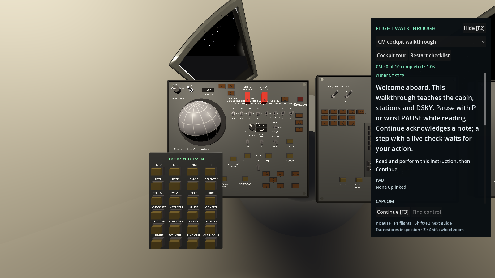
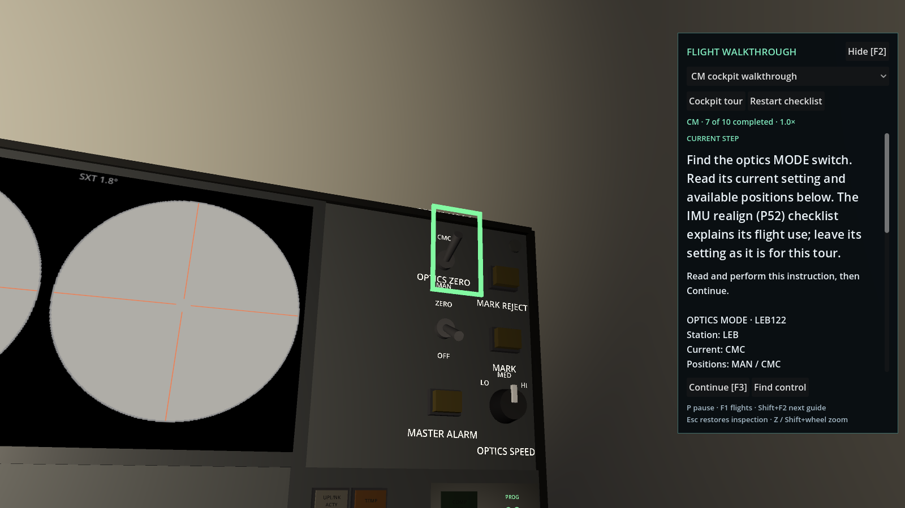

# Flying with the walkthrough

Press **F2** or click **Walkthrough [F2]** at the bottom right. Choose an existing
flight checklist from the selector, or **Cockpit tour** for a short introduction
to the vehicle you are aboard. **P** or wrist **PAUSE** pauses the flight while
you read; opening the guide does not pause or reset the simulation. The progress
line shows PAUSED or the current time rate.



The CM tour covers the FDAI, wrist menu, centre couch, DSKY monitor entry,
navigation station and optics MODE switch. The LM tour covers its DSKY, standing
stations, DEDA and engine-arm switch. Flight checklists remain mission-specific;
Apollo 8 has no LM tour. These are simulator orientation lessons, not transcribed
Apollo flight documents. The remaining geometric fidelity work is tracked in
[Cabin fidelity](CABIN_FIDELITY.md#next-interior-passes).

## Read, find, act, verify

The guide shows the current instruction and its control's panel, crew station,
live setting and available switch positions. It also shows guard/lever-lock
instructions where applicable. Scroll for the PAD, latest CAPCOM call and nearby
steps. Action buttons stay at the bottom of the panel.

The current instruction sits on a contrasting flight-data-file reading card.
Above it, the progress bar counts completed steps and the status distinguishes
**READ & CONTINUE**, **SET & VERIFY**, and **MONITOR / VERIFY**. These labels
follow the existing checklist checks; they do not acknowledge actions for you.
The paper treatment is a simulator reading aid, not a reproduction of a flown
Apollo checklist. The status also appears on the headset reading card.
The desktop card keeps its intended text size when a smaller window scales
the rest of the HUD. Scroll within the card for longer instructions and live
control details; its action buttons stay visible.

- **Continue [F3]** acknowledges a reading or manual-verification step. The DSKY
  lesson asks you to enter V16N20 ENTR, verify the display, and Continue.
- A checked step advances when its existing flight-checklist condition holds.
  Continue is disabled for these steps. Waiting for an event or reading shows
the observed and required values.
- **Find control** aims and magnifies the desktop view without actuating the
  control. When a different station is needed, the button says **Go to CMP +
  Find** or **Go to LEB + Find**. This changes the seat explicitly. **Esc** restores
  the view within that station; wrist **SEAT** returns to another station.
- **Restart checklist** rewinds only the selected checklist. It does not undo
  switch settings, change the clock, start a new flight or clear other checklists.
  Conditions already satisfied still check themselves off.
- **Flight checklist** returns from a cockpit tour to the current flight
  phase's checklist in the vehicle you are aboard. It preserves that book's
  progress and does not start a new flight.
- **Resume flight** appears for paused flight checks. **Resume at 1×** releases
  the high-rate control lock. Neither button verifies the outstanding step.



The guide, compact HUD checklist, cabin card, highlight and wrist menu share
one checklist book for each vehicle. Changing vehicle follows that vehicle's
book. The guide replaces the duplicate checklist displays while open; hiding
it restores them. Starting or resuming a flight opens its phase checklist as
before. Walkthrough progress is not stored in saved flights.

## Inputs

| Desktop | Action |
| --- | --- |
| F2 | Show/hide the guide |
| Shift+F2 | Open the next checklist |
| F3 | Continue a reading step while the guide is open |
| Esc | Restore a desktop inspection view |
| Z / Shift+wheel | Existing desktop inspection/zoom |
| M | Show/hide the wrist menu in cabin view |
| P | Pause/resume |
| F1 | Choose a flight |

The guide consumes clicks and wheel events over its panel, including
Shift+wheel, so reading it does not operate controls or zoom the cabin behind
it. While the guide is open, the desktop wrist menu fits beside it, including
when the cabin is magnified. Apollo's **C** view switching and **N** DSKY NOUN
entry remain available.

In a headset, wrist **WALKTHRU** toggles a world-space reading card, **CHECKLIST**
cycles the shared book, **NEXT STEP** acknowledges a reading step, and **CABIN
TOUR** selects the orientation lesson. **FIND CTRL** shows the target's name,
panel and station; it never changes headset pose, FOV or seat. Use wrist **SEAT**
yourself to move stations. Toggle **WALKTHRU** off to read the original card's
full PAD and CAPCOM log. The existing target highlight remains optional.

Turning on **AUTHENTIC** hides the guide. You can explicitly reopen it while
keeping authentic mode and its disabled highlights intact.

## Implementation and verification

The interaction is adapted to Apollo's existing `ChecklistBook`, inspired by
[Gemini's cockpit guide at 03ae202](https://github.com/scomofo/gemini-capsule/blob/03ae202ac57cc1fd11b7e5306ea9258e257df5b5/src/presentation/cockpit_guide.gd).
Tutorial data lives in `data/tutorials/`; it is appended in the main scene,
leaving the mission checklist loaders and their flight procedures unchanged.

`test_cockpit_guide.gd` checks live state, restart isolation, checked-step gates,
targets for every mission, real GUI clicks and scroll capture, and layout at
1024 × 600 and 1280 × 720 logical viewport sizes. `test_main_walkthrough.gd`
completes both tours through crew inputs and verifies CM/LM handoff. The main
scene's fake-OpenXR test checks the headset card and absence of automatic head
movement. Physical headset readability and Quest performance still require
the [headset acceptance pass](HEADSET_RUN.md).

Capture the desktop introduction with Godot 4.4.1:

```sh
godot --path . --rendering-method gl_compatibility --resolution 1600x900 tools/screenshot.tscn -- --phase=lunar_orbit --view=2 --hud=0 --guide=1 --menu=1 --out=res://docs/images/cockpit_walkthrough.png
```

For the optics detail above, replace `--menu=1` with `--guide-step=7` and use
`cockpit_walkthrough_find.png` as the output name. This screenshot-only option
stages a tour step for visual review; it does not demonstrate completing the
preceding steps. The crew-input tests cover that progression.
